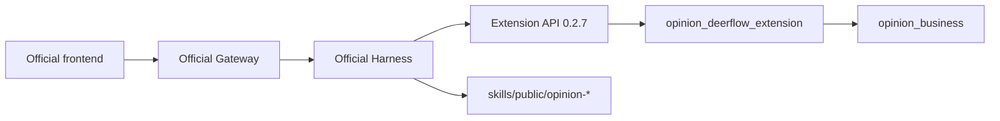

# ADR-0001: DeerFlow baseline and business extension boundary

Status: accepted for Phase 0 on 2026-10-15, following the requested architecture.

## Context

The old project owns useful public-opinion code and a separate LangGraph runtime.
The new runtime must be the complete official DeerFlow project, pinned to
`8d994cc1e7ee63c61283a71a169248beb4ed1c52`. No old agent loop is part of the new startup.
The fixed source identifies itself as DeerFlow `2.2.0-dev`, harness `2.1.0`, and
Extension API `0.2.7`; the task's “2.0” describes the architecture migration,
not a reason to replace those upstream versions.

## Decision

Import all 4000 files from the immutable upstream archive. Keep a SHA-256 manifest
in `docs/migration/upstream-manifest.json` and preserve its MIT LICENSE. Preserve
the 306-file pre-migration snapshot under `legacy/pre-deerflow/`, including its
license and dependency locks. Original `src/` remains available for Phase 1.
Archive old root package manifests there so default project commands target DeerFlow.

The extension imports only the public `deerflow_extension_api` contract and the
business package. It contributes a `PluginContribution` with one `ModelTool` and
one `BackendAction`; no custom Gateway, agent loop, memory or sandbox is introduced.
Seven business domains expose contracts only. Their actual implementation stays
in the old source pending an explicit next phase.

## Dependency distribution

The official manager snapshots local extensions into `backend/extensions/sources/`
and audits local lock references against the stock Docker build context.
Canonical business source lives at the required root path. A reviewed copy of
that distribution is prepared under `backend/extensions/sources/opinion-business`
by `scripts/sync_opinion_business.py`, then declared with `uv add --group extensions`.
The official `deerflow extensions install` installs and enables the plugin.
Both packages consequently resolve from relative paths inside `backend/`, without
changing the official Dockerfile or depending on a workstation path. Tests check
deployment source parity. Rebuild snapshots and lock when canonical source changes.

Alternatives considered: root-relative editable sources would need Docker context
and runtime copy changes; publishing these early interfaces to PyPI would add an
unnecessary release dependency. Installing packages only with `uv pip` would leave
the official lock unaware of the runtime and is rejected.

## Consequences and limits

Full upstream functionality remains present and configurable. The offline profile
uses the official local sandbox, disables memory/background scheduling, and has no
model credentials; full agent conversation is intentionally unverified. Managed
extension code runs with Gateway privileges. The smoke profile's auth bypass is
loopback-only and process-scoped. Docker build/run and unified Nginx ingress must
be validated on a host with a running Docker engine or WSL2; local service checks
do not establish that acceptance item.

Tests and documentation are the handoff contract. Do not merge this branch into
main until the reported environmental limits have been resolved and reviewed.
