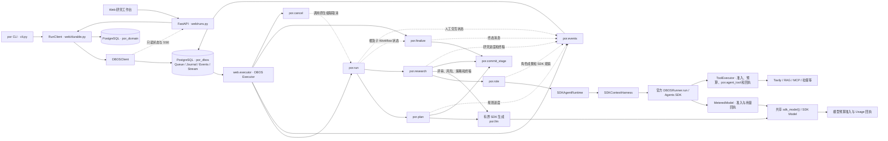
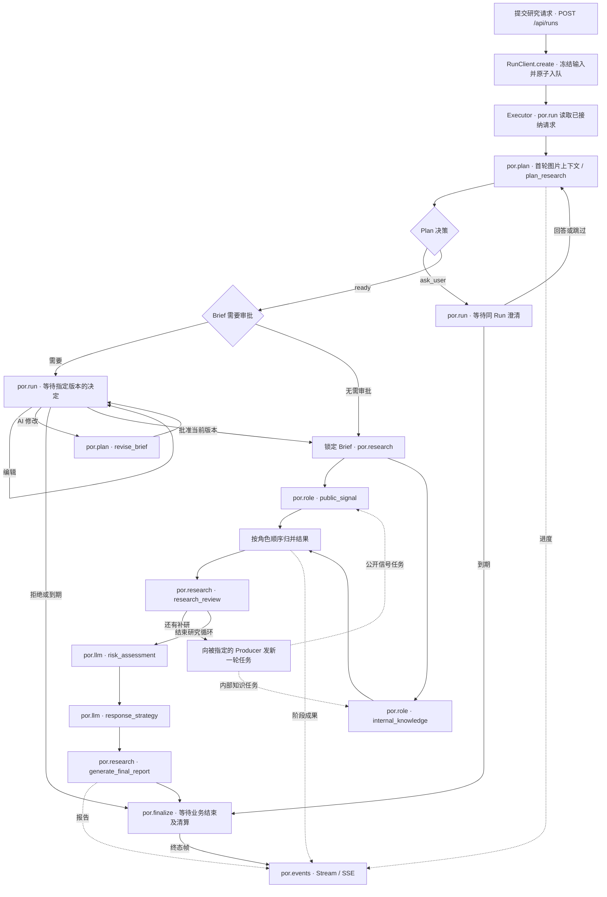

# 业务执行与 Agent Loop

当前应用版本为 `por-datasource-stage-v1`，SDK Runtime 版本为 `sdk-vertical-v1`。根依赖锁包含 DBOS 3.3.0、`dbos-openai-agents` 0.3.0 和 OpenAI Agents SDK 0.24.0。 [部署](dbos-deployment.md) · [数据库设计](dbos-deployment.md#数据库设计) · [故障验收清单](../audits/dbos-architecture-closeout.md#故障验收清单)

## 架构分层

| 层 | 代码入口与职责 |
| --- | --- |
| CLI / API / RunClient | `cli.py` 加载并校验 `config.yaml`，经 `RunClient.create` 冻结快照并原子入队；`status`/`inspect`/`approve`/`clarify`/`report`/`retry` 直接控制同一持久 Run，不经过 FastAPI。可选 `web/runs.py:create_run` 仍校验令牌、Idempotency-Key 与 Session，但业务设置同样来自冻结配置。`web/durable.py:RunClient` 按 owner 检查 Session、请求指纹、容量及未结算效果，用 `DBOSClient` 接受请求并提交取消、审批、澄清与重试授权。 |
| DBOS | `web/executor.py:launch` 注册队列并启动监听。`workflow/dbos_workflow.py` 定义 Workflow 和 Step。DBOS 用同一 PostgreSQL 中的 journal 决定恢复位置，管理 Workflow 状态、消息、Event、Stream 及 rewind。 |
| Agent Runtime / Harness | `SDKAgentRuntime` 装配并启动两个自主研究角色，`SDKContextHarness` 调用官方 `DBOSRunner.run`、观察 SDK 生命周期并清算工具。SDK 保有原始历史。输入过滤器估算容量，按完整轮次滚动压缩旧内容。`MeteredModel` 负责 Agent 推理的准入及回执，`ToolExecutor` 负责工具准入及 `por.agent_tool`。 |
| 业务可靠性 | `budget.py` 负责共享配额、最终报告预留及 `model_attempts` 收据。`workflow/execution.py` 结合取消意图和原生 Executor 所有权保护外部效果，`operations` 只记录需要保护的工具。 |
| 结果交付 | `events_workflow` 单写 Stream。`RunClient.get` 和 `web/observations.py` 按需查询原生状态、输出及业务结算。`web/runs.py` 提供 SSE 和历史查询。Finalizer 确认终态、汇总用量、发布终态并执行用户已授权的安全重试。 |

`por.run` 和 `por.events` 入 `por-control`，`por.finalize` 入 `por-finalize`。根通过 `por-business` 入队每轮 Plan、AI Brief 修改及 Research，以 owner 为分区键。`por.research` 启动研究 Agent，在本 Workflow 内完成评审、风险评估、回应策略和终稿的模型 Step。取消请求需要时另入 `por.cancel`。

## 完整业务链路

| 节点 | 输入、输出及持久边界 |
| --- | --- |
| 1. 提交 | Web 经 `POST /api/runs` 创建，再单独订阅 `GET /api/runs/{run_id}/events`。CLI 直调同一 RunClient。Web 请求可携带主题、组织背景、本次 RAG 开关、会话 ID 和图片。服务端冻结有效配置并构造初始 `HumanMessage`。 |
| 2. 准入 | `RunClient.create` 在事务内创建 Run ID，复用合规 Session 或创建新 Session，固定请求、配置指纹、初始 State 和版本，原子写请求、入队三个 Workflow 并发送排队消息。成功创建返回 `202`，相同请求重投返回原 Run。 |
| 3. 启动 | `run_workflow` 调用 `load_request` Step 核对冻结配置与版本。根为各轮规划和研究设置稳定子 ID，通过原生结果句柄获取下一段 State。 |
| 4. 图片与 Plan | `planning_workflow` 第一轮调用 `intake.enrich_query_images`，有图片时将理解结果纳入消息。`intake.plan_research` 根据消息、图像和配置返回 `ask_user` 或带 Markdown Brief 的 `ready`。模型调用在有独立 Step 边界时使用 `por.llm`。消息 ID 由 `python_state.message_identity` 按 Run、阶段与列表位置确定性生成，不再需要单独的固定 Step。 |
| 5. 澄清与 Brief | 根以 `phase`、`clarification`、`plan` Event 发布待处理内容，`receive_interaction` 通过 DBOS `recv` 等待对应 owner、版本和截止时间的决定。最多发布三轮澄清，答复或跳过写进同一 Run 的消息。需审批时，手工编辑生成新版本，AI 修改用以请求键绑定 ID 的 `por.plan` 子 Workflow，仍受原审批截止时间约束。批准当前版本或无需审批时，根写 `brief_locked` 并将 Brief 元数据放入 Research 输入。 [交互协议](research-brief.md) |
| 6. 并行 Producer | `research_workflow` 给 `public_signal`、`internal_knowledge` 启动各自的 `por.role`（按启用配置工作）。`role_snapshot` 为角色隔离 State。`wait_first_async` 收集先结束的子 Workflow，`assemble_research_results` 等本轮齐备后按固定角色顺序归并 `ResearchRoleResult`，含角色报告、来源、指标和预算增量。 |
| 7. Review / Gap | `por.research` 内的 `review_round` 用 `research.research_review` 对照 Brief 与角色报告，单用途模型产出结构化 Review；它是一次有界模型调用加普通业务函数，不是独立 Workflow，因此 Review 失败只重跑本轮评审而不会重复已提交的角色研究。`followup_assignments` 按任务去重、轮次、角色与预算生成新 packets，仅向有补研任务的角色分派。 |
| 8. 风险与策略 | 补研结束后，`por.research` 依次调用风险评估与回应策略。两步复用 `generate_text()` 和 `por.llm`。Risk 读取获批 Brief、两份研究报告和最新 Review，Strategy 还读取 Risk 输出。两份 Markdown 写入原 State 字段，并通过原生 Event 保留进度与阶段报告，供 Run 状态和 History 读取。 |
| 9. 报告 | `por.research` 在 Strategy 后直接调用 `generate_final_report()`，由一个 `por.llm` Step 综合获批 Brief、角色报告、Risk、Strategy 和最新 Review。终稿写入 `report.final`，先经 `por.research` 的 `report` Event 暴露，再由 `por.commit_stage` 事务提交阶段事件。 |
| 10. SSE | `events_workflow` 收集原生消息并通过 `DBOS.write_stream_async` 追加，公开 `seq = offset + 1`。GET 分页和 SSE 共用 `RunClient.read_events`，由 `Last-Event-ID` 或 `after` 补发。研究中可交付阶段报告。`delivery` Event 确认当前代次已交付前缀。 |
| 11. Finalizer / 历史查询 | `finalize_workflow` 等待根终态。`por.completion_facts` 确认业务子 Workflow 已退出活跃状态，并根据原生结果和账本汇总状态、清算与用量。随后发布 `_terminal`。历史列表读取终态候选和已交付的业务状态，历史详情复用 Run 查询。 |

`state.py` 定义 `messages`、`workflow`、`agents`、`report`、`runtime`。`workflow/python_state.py` 的 `copy_state`、`role_snapshot` 与 `apply_patch` 负责规范化、角色隔离和显式 reducer；跨 Workflow 传递的是序列化的 State、patch 或结果。SDK 循环内的工作上下文由 Harness 从 DBOS Tool Step、Context Step 和原生 checkpoint 恢复。 [角色结果格式历史](../audits/research-role-results-assembly.md)

## 可靠性设计

### 请求可靠性

`trusted_owner` 用服务端配置的单操作员令牌确定 owner。`Idempotency-Key` 与 owner 组成唯一键，规范化请求和 Session 组成 fingerprint。同键同指纹读回原 Run，同键异指纹返回冲突。网络丢失响应时可用相同请求重投。新键在事务级 advisory lock 下检查 Session 归属、活跃 Run、未结算效果和容量。`enqueue_in_transaction` 使用写入 `por_domain.requests` 的同一个 PostgreSQL 连接事务，请求、排队消息及原生 Workflow 一起提交或回滚。 [DBOS Client 事务入队](https://docs.dbos.dev/python/reference/client)

澄清和审批的 API 先校验当前状态再发送去重的原生消息，根 Workflow 消费时再次校验 owner、版本及数据库时钟。AI 修改的提交键是原生消息身份的一部分，手工编辑或成功 AI 修改会使旧版本命令失效。取消意图与 `por.cancel` 原子提交。关闭 SSE 后研究继续。 [交互协议](research-brief.md)

### 阶段事务与检查点边界

可靠性机制按职责分成四层，业务代码只表达业务顺序：

| 层 | 归属 | 何时使用 |
| --- | --- | --- |
| Workflow | `por.run`、`por.plan`、`por.research`、`por.role`、`por.events`、`por.finalize`、`por.cancel` | 业务控制流、并行分派、人工交互等待、原生 Event/Stream |
| Step | `por.llm`、`por.agent_tool`、`por.role_tools`、`por.load_request`、`por.clock`、`por.completion_facts`、`por.retry_execution`、条件使用的 `por.wait_for_revision` | 一次外部调用或一次非确定性读取 |
| Datasource Transaction | `por.commit_stage` | 在同一业务数据库事务提交阶段事件及检查点 |
| 普通 Python | 其余函数 | 可确定性重算的合并、评审编排、状态推导 |

`SQLAlchemyDatasource` 与业务引擎共用同一 PostgreSQL。`por.commit_stage` 在一个事务里写入 `step_started`/`step_failed`/`step_completed` 等业务事件和该事务的 checkpoint，因此崩溃不会留下半个阶段，恢复时命中 checkpoint 即整体跳过。它登记为原生 Step，`rewind_workflow` 会随该 Step 一起删除 checkpoint，重放时重新执行事务。契约只做行级写入，不需要串行化隔离。模型、搜索、MCP 与 Embedding 调用一律留在 Step，绝不进入数据库事务。除 `por.clock` 与 `por.load_request` 读取数据库时钟和已接纳请求外，不再有专用时间戳或冻结结果的 Step：事件时间戳在产生事件时写入消息，消息 ID 由业务来源和列表位置确定性生成。

### 执行可靠性

匹配应用版本和 Executor 身份重启后，DBOS 从持久输入重新进入 Workflow，读取已提交的 Step 结果。SDK 的 `_model_call_step` 返回已保存的模型响应，`ToolExecutor` 调度的 `por.agent_tool` 返回已保存的工具输出及局部用量，Context Step 补齐 Harness 所需状态。已完成的 Step 命中 journal 时不会进入 provider 函数或业务工具。子 Workflow 使用稳定 ID，可恢复一侧 Producer 的未完成部分并读取另一侧结果。父 Workflow 在两侧齐备后用同一 reducer 和固定顺序合并。 [DBOS 恢复](https://docs.dbos.dev/architecture#how-workflow-recovery-works) · [官方 DBOSRunner 集成](https://docs.dbos.dev/integrations/openai-agents) 独立推理的 `por.llm` 保存已结算文本、用量和输出验收信息。恢复用同一结果完成 Pydantic 解析或决定是否重试。只有新的请求尝试才登记新的模型回执。

`por.agent_context` 保存滚动摘要、已压缩轮次、摘要调用增量和已改写的输入窗口。SDK 用重放的响应重建轮次边界及角色用量投影。工具输出及局部用量来自 `por.agent_tool`。若 Tool Step 抛出异常，其错误回执保留局部用量；退出结算在进程内补齐终态，不再是独立的 DBOS Step。可选 SQLite transcript 供排查，SDK 恢复数据来自 DBOS journal。

两个角色仍并行运行。DBOSRunner 为同批工具确定 Step 分配顺序，工具调用可以并行完成。原生 rewind 保留断点前缀。后缀中的普通调用可重新执行，受保护调用由 `ToolExecutor` 按原操作身份查回执。 [工具观察记录终态](tools.md#观察记录的终态)

角色失败时 Research 等同批角色结算。后端统一检查活跃 Workflow、可重放的断点、所需预算和断点处的受保护操作。`RunClient.retry` 原子保存授权并入队该代次的 Finalizer。Finalizer 沿 native 子 Workflow ID 从叶到根调用 `rewind_workflow`，成功的角色继续提供原结果。原生取消沿子 Workflow 级联。 [DBOS 取消与 rewind](https://docs.dbos.dev/python/tutorials/workflow-management)

### 外部调用可靠性

Step 结果缺失时，`read` 可以重做请求并记录可能的重复费用，`idempotent` 复用原幂等键。Apify 的 `call-actor` 在处理结果前保留 Actor Run ID，恢复时调用同一个 MCP 服务的 `get-actor-run`，由 Agent 使用原 Dataset ID 继续读取。其它受保护操作的失联回执需要核实。收到外部返回后 PostgreSQL 回执 ACK 丢失时，`commit_receipt` 在有限时间内补写同一回执。 [Apify MCP](https://github.com/apify/apify-mcp-server) · [业务持久化审计](../audits/dbos-domain-simplification.md)

已知只读工具可以在缺失 Tool Step 结果时重新执行。效果检查结合请求取消意图和原生 Workflow/Executor 归属。PostgreSQL 的准入事务覆盖请求及原生入队，远端 provider 独立提交。操作员确认 Executor 已停止并核对外部记录后，可以记录 reconciliation 以解除 Session 准入隔离，原记录继续保留。 [数据库与运维](dbos-deployment.md)

`start_model_attempt` 持请求锁执行 Run 级预算检查，保留最终报告额度。有 Token 上限时，只等待当前代次中仍由原生 Workflow 持有的在途账单。前次执行的未确认用量使用模型上下文窗口和请求输出上限作预算预留，并保留物理调用次数。新的物理请求写独立的 `model_attempts` 记录。公开用量来自已有回执，未知部分保持 `usage_complete=false`。工具与搜索次数来自 `tool_calls`，`operations` 关联该工具调用及其原生 Step。

## 已知限制

- **deepseek-flash 会间歇地把工具调用以 DSML 文本写入 `content`**，而不是 API `tool_calls`。后果有两层：研究循环把该轮当作普通回复，提前耗尽 `max_react_tool_calls`；角色报告压缩模型看到转录里的调用文本后也可能原样复述。第六轮真实 Smoke 中两次复现（Run `14aeb718…`、`3d626b20…` 以 `insufficient tool messages` 或空证据报告结束）。这是模型适配层问题，轮次预算调到 10 后两次完整成功（`b3321ea7…`、`d3375523…`），但报告证据深度仍受其影响。后续轮次应在 chat-completions 适配层识别 DSML 文本并回放为结构化调用，而不是扩大预算。
- **压缩投影的调用配对**已由第六轮修复：转录在早停、取消的兄弟调用或缩减之后结束，投影会为没有回应的 `function_call` 原位补一条 `function_call_output`，避免 DeepSeek 以 `insufficient tool messages` 拒绝整次请求。

## 交付与执行状态

`native_status` 是根 Workflow 状态，`status` 加入人工等待和业务结果解释，`settlement` 表示回执结算。`event_cursor` 是已交付偏移，`events_complete` 表示当前代次已交付终态。relay 按代次接收 `_terminal` 并追加 `done`。恢复时若 relay 已结束，Finalizer 用 DBOS rewind 重新开放同一个 Stream，已交付的事件仍在原偏移。每代 Finalizer 提交终态后退出。 [工作台协议](agent-execution-studio.md)
