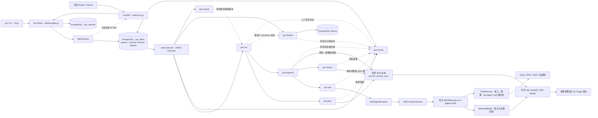
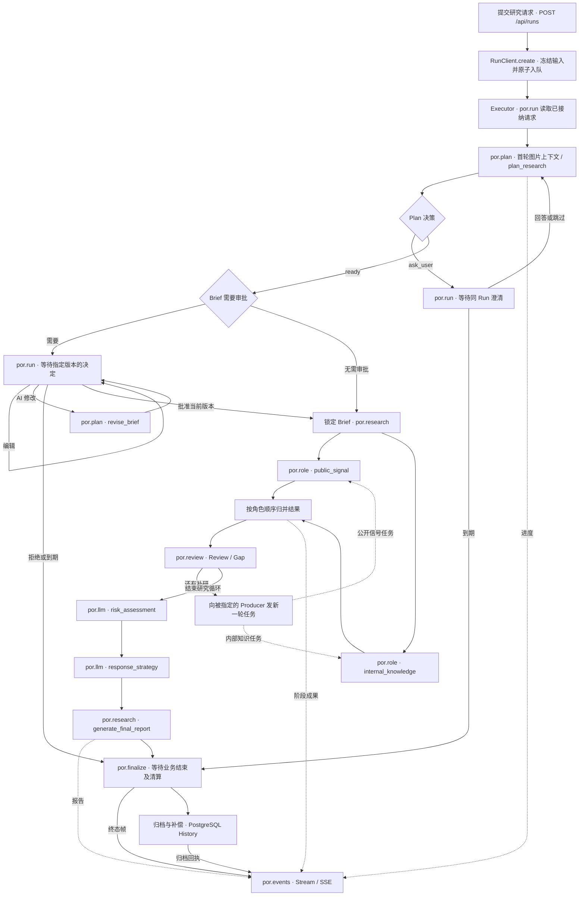

# 业务执行与 Agent Loop

当前应用版本为 `por-call-ledger-v1`，SDK Runtime 版本为 `sdk-vertical-v1`。根依赖锁包含 DBOS 3.3.0、`dbos-openai-agents` 0.3.0 和 OpenAI Agents SDK 0.24.0。 [部署](dbos-deployment.md) · [数据库设计](dbos-deployment.md#数据库设计) · [故障验收清单](../audits/dbos-architecture-closeout.md#故障验收清单)

## 架构分层

| 层 | 代码入口与职责 |
| --- | --- |
| CLI / API / RunClient | `cli.py` 加载并校验 `config.yaml`，经 `RunClient.create` 冻结快照并原子入队；`status`/`inspect`/`approve`/`clarify`/`report`/`retry` 直接控制同一持久 Run，不经过 FastAPI。可选 `web/runs.py:create_run` 仍校验令牌、Idempotency-Key 与 Session，但业务设置同样来自冻结配置。`web/durable.py:RunClient` 按 owner 检查 Session、请求指纹、容量及未结算效果，用 `DBOSClient` 接受请求并提交取消、审批、澄清与重试授权。 |
| DBOS | `web/executor.py:launch` 注册队列并启动监听。`workflow/dbos_workflow.py` 定义 Workflow 和 Step。DBOS 用同一 PostgreSQL 中的 journal 决定恢复位置，管理 Workflow 状态、消息、Event、Stream 及 rewind。 |
| Agent Runtime / Harness | `SDKAgentRuntime` 装配并启动两个自主研究角色，`SDKContextHarness` 调用官方 `DBOSRunner.run`、观察 SDK 生命周期并清算工具。SDK 保有原始历史。输入过滤器估算容量，按完整轮次滚动压缩旧内容。`MeteredModel` 负责 Agent 推理的准入及回执，`ToolExecutor` 负责工具准入及 `por.agent_tool`。 |
| 业务可靠性 | `budget.py` 负责共享配额、最终报告预留及 `model_attempts` 收据。`workflow/execution.py` 结合取消意图和原生 Executor 所有权保护外部效果，`operations` 只记录需要保护的工具。History 使用稳定业务键。 |
| 结果交付 | `events_workflow` 单写 Stream。`RunClient.get` 和 `web/observations.py` 按需查询原生状态、输出及业务结算。`web/runs.py:event_stream` 提供 SSE，`finalize_workflow` 清算、归档补偿及执行用户已授权的重试。History 有独立读取接口。 |

`por.run` 和 `por.events` 入 `por-control`，`por.finalize` 入 `por-archive`。根通过 `por-business` 入队每轮 Plan、AI Brief 修改及 Research，以 owner 为分区键。`por.research` 启动研究 Agent 和 Review 子 Workflow，并依次执行风险评估、回应策略和终稿的模型 Step。取消请求需要时另入 `por.cancel`。

## 完整业务链路

| 节点 | 输入、输出及持久边界 |
| --- | --- |
| 1. 提交 | Studio、Classic 或 `deep-research` 调用 `POST /api/runs`，旧 `POST /api/research` 复用提交和订阅入口。`ResearchRequest` 接收主题、支持的模型等业务参数，服务端构造初始 `HumanMessage`。 |
| 2. 准入 | `RunClient.create` 在事务内创建 Run ID，复用合规 Session 或创建新 Session，固定请求、配置指纹、初始 State 和版本，原子写请求、入队三个 Workflow 并发送排队消息。成功创建返回 `202`，相同请求重投返回原 Run。 |
| 3. 启动 | `run_workflow` 调用 `load_request` Step 核对冻结配置与版本。根为各轮规划和研究设置稳定子 ID，通过原生结果句柄获取下一段 State。 |
| 4. 图片与 Plan | `planning_workflow` 第一轮调用 `intake.enrich_query_images`，有图片时将理解结果纳入消息。`intake.plan_research` 根据消息、图像和配置返回 `ask_user` 或带 Markdown Brief 的 `ready`。模型调用使用 `por.llm` / `por.llm_sync`（有独立 Step 边界时），`por.stage_result` 在 patch 有消息时固定其 ID。 |
| 5. 澄清与 Brief | 根以 `phase`、`clarification`、`plan` Event 发布待处理内容，`receive_interaction` 通过 DBOS `recv` 等待对应 owner、版本和截止时间的决定。最多发布三轮澄清，答复或跳过写进同一 Run 的消息。需审批时，手工编辑生成新版本，AI 修改用以请求键绑定 ID 的 `por.plan` 子 Workflow，仍受原审批截止时间约束。批准当前版本或无需审批时，根写 `brief_locked` 并将 Brief 元数据放入 Research 输入。 [交互协议](research-brief.md) |
| 6. 并行 Producer | `research_workflow` 给 `public_signal`、`internal_knowledge` 启动各自的 `por.role`（按启用配置工作）。`role_snapshot` 为角色隔离 State。`wait_first_async` 收集先结束的子 Workflow，`assemble_research_results` 等本轮齐备后按固定角色顺序归并 `ResearchRoleResult`，含角色报告、来源、指标和预算增量。 |
| 7. Review / Gap | `review_workflow` 用 `research.research_review` 对照 Brief 与角色报告，单用途模型产出结构化 Review。`followup_assignments` 按任务去重、轮次、角色与预算生成新 packets，仅向有补研任务的角色分派。 |
| 8. 风险与策略 | 补研结束后，`por.research` 依次调用风险评估与回应策略。两步复用 `generate_text()` 和 `por.llm`。Risk 读取获批 Brief、两份研究报告和最新 Review，Strategy 还读取 Risk 输出。两份 Markdown 写入原 State 字段，并通过原生 Event 保留进度与阶段报告，供 Run 状态和 History 读取。 |
| 9. 报告 | `por.research` 在 Strategy 后直接调用 `generate_final_report()`，由一个 `por.llm` Step 综合获批 Brief、角色报告、Risk、Strategy 和最新 Review。终稿写入 `report.final`，并经 `por.research` 的 `report` Event 和 `por.publish_stage` 交付。Finalizer 读取终稿并归档。 |
| 10. SSE | `events_workflow` 收集原生消息并通过 `DBOS.write_stream_async` 追加，公开 `seq = offset + 1`。GET 分页和 SSE 共用 `RunClient.read_events`，由 `Last-Event-ID` 或 `after` 补发。研究中可交付阶段报告。`delivery` Event 确认当前代次已交付前缀。 |
| 11. Finalizer / History | `finalize_workflow` 自准入时就在等待根终态。`completion_facts` 检查业务子 Workflow 已退出活跃状态并读取清算，先发送 `_terminal`，再由 `archive_step` 归档。失败会独立重试归档；成功的 `_archive_saved` 由 relay 更新交付回执。`GET /api/history` 和详情接口读取 `por_domain.history`。 |

`state.py` 定义 `messages`、`workflow`、`agents`、`report`、`runtime`。`workflow/python_state.py` 的 `copy_state`、`role_snapshot` 与 `apply_patch` 负责规范化、角色隔离和显式 reducer；跨 Workflow 传递的是序列化的 State、patch 或结果。SDK 循环内的工作上下文由 Harness 从 DBOS Tool Step、Context Step 和原生 checkpoint 恢复。 [角色结果格式历史](../audits/research-role-results-assembly.md)

## 可靠性设计

### 请求可靠性

`trusted_owner` 用服务端配置的单操作员令牌确定 owner。`Idempotency-Key` 与 owner 组成唯一键，规范化请求和 Session 组成 fingerprint。同键同指纹读回原 Run，同键异指纹返回冲突。网络丢失响应时可用相同请求重投。新键在事务级 advisory lock 下检查 Session 归属、活跃 Run、未结算效果和容量。`enqueue_in_transaction` 使用写入 `por_domain.requests` 的同一个 PostgreSQL 连接事务，请求、排队消息及原生 Workflow 一起提交或回滚。 [DBOS Client 事务入队](https://docs.dbos.dev/python/reference/client)

澄清和审批的 API 先校验当前状态再发送去重的原生消息，根 Workflow 消费时再次校验 owner、版本及数据库时钟。AI 修改的提交键是原生消息身份的一部分，手工编辑或成功 AI 修改会使旧版本命令失效。取消意图与 `por.cancel` 原子提交。关闭 SSE 后研究继续。 [交互协议](research-brief.md)

### 执行可靠性

匹配应用版本和 Executor 身份重启后，DBOS 从持久输入重新进入 Workflow，读取已提交的 Step 结果。SDK 的 `_model_call_step` 返回已保存的模型响应，`ToolExecutor` 调度的 `por.agent_tool` 返回已保存的工具输出及局部用量，Context Step 补齐 Harness 所需状态。已完成的 Step 命中 journal 时不会进入 provider 函数或业务工具。子 Workflow 使用稳定 ID，可恢复一侧 Producer 的未完成部分并读取另一侧结果。父 Workflow 在两侧齐备后用同一 reducer 和固定顺序合并。 [DBOS 恢复](https://docs.dbos.dev/architecture#how-workflow-recovery-works) · [官方 DBOSRunner 集成](https://docs.dbos.dev/integrations/openai-agents) 独立推理的 `por.llm` / `por.llm_sync` 保存已结算文本、用量和输出验收信息。恢复用同一结果完成 Pydantic 解析或决定是否重试。只有新的请求尝试才登记新的模型回执。

`por.agent_context` 保存滚动摘要、已压缩轮次、摘要调用增量和已改写的输入窗口。SDK 用重放的响应重建轮次边界及角色用量投影。工具输出及局部用量来自 `por.agent_tool`。若 Tool Step 抛出异常，其错误回执保留局部用量，`por.agent_settlement` 补齐终态。可选 SQLite transcript 供排查，SDK 恢复数据来自 DBOS journal。

原生取消会沿 child Workflow 级联，根可能先进入终态。Finalizer 再检查仍活跃的业务子 Workflow，并等待已发起调用结算。人工重试需要新键、观测到的 `state_version`、当前代次终态已交付以及安全失败。`RunClient.retry` 只写授权和消息；`por.finalize` 验证授权绑定的实际失败版本和外部回执，按失败叶子到根逐个 `rewind_workflow` 并等待子结果。安全目标限于可重试的 Plan、Review 或 Report 后缀。旧键只能确认原授权。 [DBOS 取消与 rewind](https://docs.dbos.dev/python/tutorials/workflow-management)

### 外部调用可靠性

Step 执行体与外部服务返回之间存在提交窗口。宕机发生在原生结果提交前，恢复会再次进入对应边界。调用前尚无意图记录时可开始执行；Model 或受保护 Tool 已有意图或回执而原生结果缺失时，同一调用身份会被拒绝，Run 保留已知结果并进入核对流程。保护记录可能只证明准入，`returned` 也只证明 invoker 返回。收到外部返回但 PostgreSQL 回执 ACK 丢失时，`commit_receipt` 在有限时间内补写相同收据。远端实际效果需要依据供应商记录核对。 [业务持久化审计](../audits/dbos-domain-simplification.md)

已知只读工具可以在缺失 Tool Step 结果时重新执行。History 写入使用稳定业务键，效果检查结合请求取消意图和原生 Workflow/Executor 归属。PostgreSQL 的事务覆盖本库请求、原生队列和报告归档，远端 provider 独立提交。操作员确认 Executor 已停止并核对外部记录后，可以记录 reconciliation 以解除 Session 准入隔离，原记录继续保留。 [数据库与运维](dbos-deployment.md)

`start_model_attempt` 持请求锁检查并行调用共享的 Run 级预算，保留最终报告额度后才登记物理调用。`model_attempts` 按 `(run_id, id)` 唯一写入，返回或失败有用量时以同键更新。`por_domain.tool_calls` 记录每一次准入的工具调用（无论预算是否开启），`por_domain.operations` 通过 `tool_call_id` 外键归属到发起它的工具调用。`RunClient` 按字段归属汇总用量：模型次数与 Token 来自 `model_attempts`，工具与搜索次数来自 `tool_calls`，阶段事件只提供告警和降级原因，因此同一次调用不会被重复相加。已提交的模型响应重放、客户端重连和归档补偿各自复用记录。缺少真实 Token 时保留已知调用数并标记 `usage_complete=false`；一次未报告用量的尝试不会永久阻断后续调用。有 Token 上限时，在途账单按有限等待结算，超时后按预算不足结束。公开用量来自 provider 回执，实际货币费用由 provider 账单确认。

## 交付与执行状态

`native_status` 表示 DBOS 根 Workflow 状态，`status` 加入人工等待和业务结果解释，`settlement` 表示回执结算。`event_cursor`、`events_complete` 和 `archive_status` 分别表示已写前缀、当前代次终态交付和 History 状态。relay 收到终态或归档通知后排空已提交邮箱前缀，再追加尾帧并写 `delivery`。SSE 可以在已交付的人工等待前缀或终态前缀结束。报告已经可读时，History 仍可能 pending。使用原生状态和当前代次回执确认进度。 [Studio 协议](agent-execution-studio.md)
