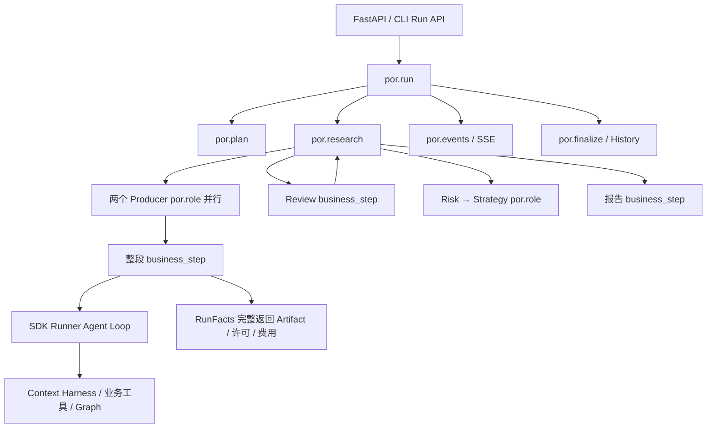
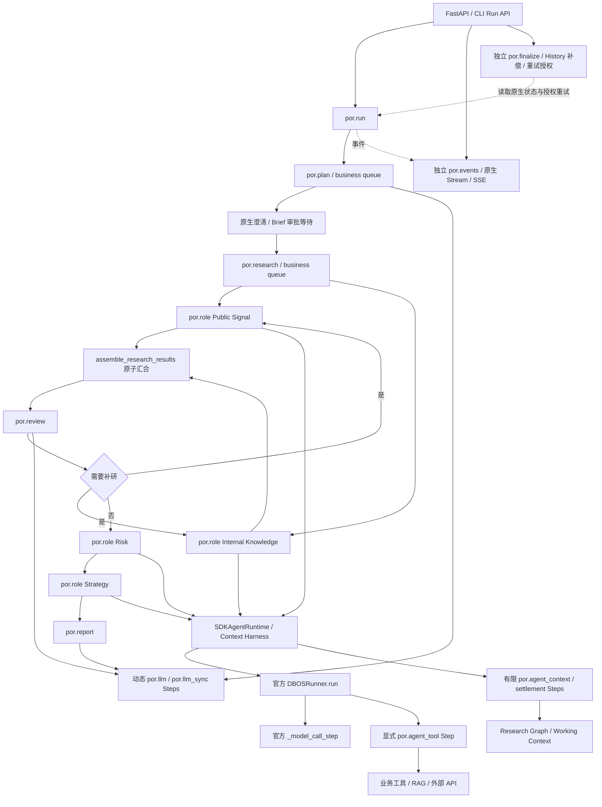

# DBOSRunner 与统一阶段持久化

2026-11-05 开始，2026-11-06 继续验收（Asia/Shanghai）。源码基线 `origin/main` **b22428ac**，不是最初工作目录的旧检出；原目录的 59 个未提交文件未参与本改造。锁定 DBOS **3.3.0**、Agents SDK **0.24.0**、官方 `dbos-openai-agents` **0.3.0**。本次应用版本 **dbosrunner-unified-v1**；不增加 `por.role.v2`，不修改 SDK 源码。

本页同时作为源码学习入口和迁移说明。验证结果、审查与尚未完成的事项见[验收记录](../audits/dbosrunner-unification.md)。

## 1. 前后架构

改造前：

改造后：

图中的 Python 条件、循环与 reducer 不成为新调度引擎。DBOS 的 Workflow journal、Step 结果、Queue 和消息仍是唯一执行恢复权威。RAG 知识图、Research Graph、长期 Memory、报告 History 保持独立所有权。

## 2. 八个 Workflow

| 名称 | 职责和调用关系 | 并发/资源 |
| --- | --- | --- |
| `por.run` | 读取冻结请求，启动 Plan，原生澄清/审批，启动 Research | control queue；人审等待不占 business slot 或领域预留 |
| `por.plan` | 图片识别、动态 Plan/澄清响应生成，输出不可变 Brief 决策 | business queue；返回前释放预留 |
| `por.research` | 双 Producer 启动/join、补研循环、Risk→Strategy、Report | business queue；保留全局/owner/session 资源约束 |
| `por.role` | 原地执行一个角色；SDKAgentRuntime→DBOSRunner；返回原业务 envelope | Producer 两个子 Workflow 并行；Consumers 顺序执行 |
| `por.review` | 研究充分性、Gap、补研 packets 和继续判断 | Research 子 Workflow；纯分配结果由 native Step 保存 |
| `por.report` | synthesis 或 sections；章节、汇总、组装、Memory | Research 子 Workflow；native 章节按顺序建立检查点，安全重试保留已完成章节 |
| `por.events` | 单写者聚合 SDK/阶段事件、终态 manifest、Stream/cursor | control queue；订阅不执行研究 |
| `por.finalize` | 清算、History 补偿、验证并应用失败代次绑定的 retry grant | archive queue；仍是唯一 rewind 权威 |

Review/Report 的安全重试会先恢复叶子，再恢复 Research/Run；已前进的 native execution 不会因旧 key 再次 rewind。Finalizer 在叶子已启动但尚未清算时等待，不能把该瞬时状态直接确认成 blocked。

## 3. Step 映射与粒度

| 边界 | 保存的内容 | 重放/副作用规则 |
| --- | --- | --- |
| `load_request` | 已验证请求与配置 | 原生结果；配置/版本漂移拒绝 |
| `reserve_step` / `release_step` | 资源准入/释放回执 | 领域预留不领取或调度任务 |
| `por.stage_started` | 阶段开始观察 | 不包裹业务函数 |
| `por.llm` | 单次普通异步模型响应与用量 | 结构化响应解析/重试在 Workflow；调用次数动态 |
| `por.llm_sync` | 同步 Vision/RAG 模型响应与用量 | 原 owned worker thread；不依赖 Session 恢复 |
| 官方 `_model_call_step` | SDK 原生 `ModelResponse`（output/usage/request IDs） | 由未修改的 DBOSRunner 实现；每次 SDK 模型调用一个 Step |
| `por.agent_tool` | 明确的工具结果、执行状态、该工具独立费用 delta | 官方 turnstile 固定调用启动顺序；已保存结果用于重建 collector |
| `por.agent_context` | 有限证据批次、输入过滤结果、Working Context/receipts/summary/预算快照 | 不包含 Agent Loop；内部抽取/更新/压缩模型共享该有限 Step；中断不盲目重做批次 |
| `por.agent_settlement` | 有界退出清算与可变状态 | 已取消的 Workflow 只做 owned cleanup，不追加 native 命令 |
| `por.sdk_observation` | 脱敏观察及交付 ID | 重放不重复发布；manifest 只保存本边界新增 ID |
| `por.sdk_transcript` | 私有检查用 Session 投影 | 空历史驱动 SDK；DBOS 恢复，Session 只供查看 |
| `por.stage_result` | 原结果类型的 JSON envelope / State patch | 纯结果冻结；UUID、Review packets 在此保存；不使用领域 Artifact 恢复 |
| `por.report_memory` | 最终报告 Memory 提交回执 | 未提交 native ACK 的外部未知效果停止核验；不以 caught exception 伪报成功 |
| 既有 approval/interaction clocks | DB 时钟、审批期限 | native 结果保证重放不换期限 |
| `public_event` / `completion_facts` | 协议投影、清算/manifest 观察 | 保留终态事件交付门禁 |
| `archive_step` | 幂等 History 写入结果 | 独立补偿，不重跑研究 |
| `retry_execution` | 已授权 native rewind 结果/可重试控制故障 | 绑定失败版本；旧 grant 不能授权下一代失败 |

`business_step()` 的历史函数名为了消费者保留，但它不再带 `@DBOS.step`；它是在 Workflow 上下文内重建阶段的普通函数。`checkpoint()` 只是公开 `DBOS.run_step[_async]` 的薄调用，不解释 journal、不维护游标。若已在 Step 内，不会假装嵌套调用形成新检查点。

DBOS 3.3.0 的 rewind 会截去起点之后的 journal。原生章节因此顺序调用，成功章节保留在失败调用之前；Standalone 业务服务继续使用原并行行为。安全读重试在当前阶段选择最后一次模型响应/失败调用，不能用前一阶段已处理的错误回退；已保存 `por.stage_result` 时只重新提交幂等业务投影。章节模式的延迟权衡见验收记录；双 Producer 的并发不变。

## 4. SDK、Harness、预算

官方 0.3.0 会通过公开 `Agent.clone()` 替换模型和 FunctionTool。`BoundAgent` 只接受这一份预期 clone，核对模型委托、工具 schema/权限及 handoffs；然后 Harness 继续按精确对象身份核验。四个 AgentSpec、提示词、工具可见性和实际执行授权不变。

调用身份使用 run/unit/role/task/round/native tool call ID。SDK invocation ID 在同一 durable unit 内稳定；Graph call ID 因而不随进程改变。工具结果在 Tool Step 重放后恢复 status/observation，Context Step 恢复 consumed、receipt、Working Context、rolling summary 和预算数据。Store、数据库连接、锁和 asyncio Task 不序列化。Context snapshot 不再重复保存 raw 工具输出；它依赖前面的 Tool Step 重建这些数据。

费用分为：实际发出的调用（有 intent/usage receipt）、已提交的 native 结果、恢复复用的结果、失败且可能已计费的调用。Hook 在每次 Python 重建时触发，其次数不作为实际计费账本。最终模型次数/token/detail 以物理回执去重结算；只有缺少回执的既有费用差额作为 carry。每次新 provider 请求还在物理调用边界核对预算，保留原 budget error 与最终报告预留。未返回用量的 provider 失败只能记录已知尝试，不能推测收费 token。

取消、旧执行者许可撤销、未知效果分别处理。一个阶段只保留一条轻量许可/取消查询，覆盖普通节点初始化及无模型等待；它不领取工作、不续租、不做恢复调度。持久化取消意图可由预留/许可拒绝路径幂等补发 native cancel，覆盖 HTTP 在提交意图后丢失 RPC 的窗口。一次真正失败的权限/存储读取会成为当前执行的致命屏障，不能因数据库随后恢复而悄悄继续模型/工具；缓存的控制错误重放时也恢复同一屏障。Graph 的许可锁只覆盖实际写入，不在抽取/压缩 LLM 等待期间长期持有业务数据库事务。

模型或工具返回后，只对结束回执的 SQL 写入进行最多 15 秒 owned 重试。精确相同的 fingerprint/status/usage ACK 可确认旧提交，先检查当前 permit 且不重复发事件；started、不同账单或旧执行者均不因此得到执行授权。超出窗口、失去许可或实际结果未能持久化时仍保留未知效果，不假定有跨系统的成功提交。

## 5. RunFacts 精简与数据边界

| 原功能 | 本次处理 |
| --- | --- |
| acquire 从完整 Artifact 返回执行结果，跳过业务阶段 | 删除。重放只读取 DBOS 的模型/工具/结果 Step |
| units 保存完整 State、补研 packets、私有 Memory 等执行返回 | 改为阶段完成标记、交付 manifest、用户研究报告投影；完整结果只在 native journal |
| finish_unit 作为完整业务结果的第二个 ACK 恢复源 | 删除该恢复含义；native 结果先保存，再幂等更新用户成果/费用/清算投影 |
| 通用游标/任务领取/lease | 没有新增，也没有借本次迁移恢复旧实现 |
| 可撤销 permit/fencing/check | 保留，防旧执行者与取消后非法副作用 |
| 外部 operation intent/fingerprint/receipt | 保留；新增 usage 字段保存真实尝试费用，不保存模型或工具执行返回值 |
| 请求、审批、重试 grant、资源预留 | 保留业务授权和安全规则；不替代 native status |
| 实际费用、失败和清算事实 | 保留；与 journal 的执行结果用途不同 |

`por_dbos` 属于 DBOS，代码不直接改其表结构。`por_domain` 保留 6 张既有业务表；新增 `operations.usage` 与 `admission_permit` 两列，以及 `operations(unit)` 索引，均为 additive migration，不删旧数据/表。`admission_permit` 只记录原操作被授权时的 fencing 身份：同一单位行锁内检查当前许可、旧未决操作，再插入新 intent。旧 permit 或 NULL 的 started/uncertain 操作阻止新外部工作，包括退出清算；已提交 native 结果仍可以纯重建。同 permit 下有 Python 暂存证明的有界清算保留。该字段不保存执行结果、不续租、不调度。

Neo4j evidence 与 History、MySQL Memory 的逻辑 ID/owner 策略保留。回滚保留新列/索引，不要求 destructive DDL。

## 6. 故障与明确限制

已提交的 LLM/Tool Step 可以复用；未提交的调用可能已经发生外部效果。外部 intent 已存在而 native 结果缺失时拒绝再次调用，不把未知当成功。需要 authoritative receipt 与确认旧执行者停止后核验；不能用重建库、删除 journal 或新建 Run 掩盖窗口。

本次没有声称 DBOS 为外部 API、Graph、Memory 提供跨系统 exactly-once。Context 内部模型调用仍以有限批次为恢复粒度；不是每个内部调用一个检查点。SDK 不用持久 Session 的旧历史驱动重放，不混用 server-managed conversation。无新的通用 LLM 检查点数据库、Agent Loop、队列或消息中间件。

## 7. 发布与回滚前检查

1. 停止旧 API 准入。对旧发行版运行 `--migration-check` 所需的 catalog 盘点及原有 Run API 盘点，涵盖 queued/running/paused、unknown、retry-pending、archive-pending。
2. **旧 `dbos-brief-spec-v1` 以及更早 journal 不兼容本次命令序列。** 原 role 的单 Step 变成模型/工具/Context/结果多个命令；Plan 的调用边界、Review/Report 子调用及序列化错误合同也改变。必须由匹配原发行版/Executor 完成，或明确取消并清算/核验。保留数据库，不迁移未确认工具单元。
3. 使用根锁部署，运行 `web.executor --initialize-only` 增加费用/授权列与索引，再运行 `web.executor --migration-check`。新 Executor 启动及新请求准入均拒绝含未完成旧版本 `por.*` journal 的安装；不会自动采用它们。
4. 同时备份 DBOS/domain schema、Graph、Memory/History。切换新准入，验证 Run、审批等待不占资源、两 Producer、SSE manifest、History 和费用。
5. 回滚先停新准入；本发行版继续清算其已接受任务，不能将新 journal 交给旧 Executor。保留 additive 列和所有成果/回执，不改写原 `.env`。

本地验收只使用 UUID 测试库和专用测试容器。未连接用户生产 DBOS catalog，不能据此声称生产任务已经排空。

## 面试与源码阅读要点

- **为什么不把 Agent 整体放在 Step？** 整体结果只能在 Loop 结束后复用。官方 DBOSRunner 将每次 SDK 模型响应放进 native Step；显式 Tool Step 保存真实返回，重放由 SDK 重新构建控制流。
- **为什么 Harness 还需要数据快照？** native ModelResponse 不包含 Python collector、Working Context、receipt、consumed 状态和 rolling summary。有限 Context/settlement Step 保存这些数据；原始工具观察从前面的 Tool Step 重建，不序列化连接、锁或 Task。
- **为什么还有 RunFacts？** 请求/审批、撤销许可、外部操作未知结果、真实费用和实际成果属于业务事实。它们不选择下一任务，不保存通用执行返回以跳过阶段；DBOS journal 才决定已完成的调用。
- **一次外部调用能否天然 exactly-once？** 不能。业务幂等键及准入/回执减小窗口；native ACK 缺失而外部效果未知时停止核验。既不重复付费调用，也不把未知当成功。
- **为什么 Hook 不能直接算实际费用？** 重放会再次触发 Hook，但 provider 可能没有再调用。Hook 只重建本次 Python 状态；去重的物理账单加缺少回执的历史差额结算，保留失败尝试和 token details。新真实调用也检查历史失败费用与最终报告预留。
- **为什么 sections 顺序执行？** DBOS 3.3.0 rewind 截断日志后缀。把成功章节留在失败章节之前，才能只替换最后失败/无效响应；前一阶段已处理的异常不应成为后退起点。代价是章节模式并行吞吐下降，见独立性能表。
- **报告、执行和归档是否同一状态？** 不是。native 执行状态是权威；有报告但 History 尚在补偿是合法状态。取消 intent、执行结束、owned 清算和未知外部效果也必须分别表达；SSE 断线只要求按游标重连。

## 8. 官方依据与阅读路线

先读 `workflow/dbos_workflow.py`，再读 `runtime/sdk_runtime.py` / `sdk_context.py`、`runtime/durable_agent.py`、`workflow/durability.py`、`workflow/run_facts.py` 与 `web/durable.py`。在真实进程测试中对照“调用返回、native ACK、业务成果投影”三个时刻理解可靠性边界。

官方资料：[DBOS Agents 集成](https://docs.dbos.dev/integrations/openai-agents)、[DBOSRunner 源码](https://github.com/dbos-inc/dbos-openai-agents/blob/main/dbos_openai_agents/runner.py)、[OpenAI SDK 总览](https://developers.openai.com/api/docs/guides/agents/sdk)。本次实际运行使用根锁的 0.3.0 wheel；线上 main 文档是滚动资料，不能替代锁版本合同测试。
