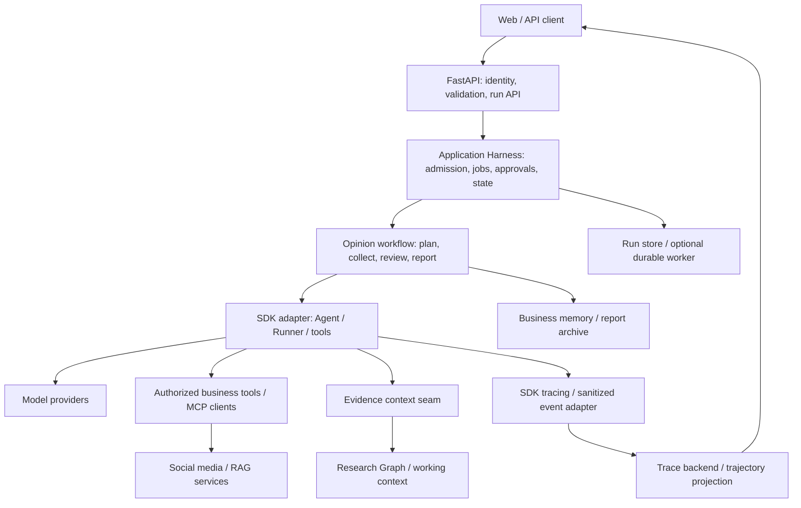

# OpenAI Agents SDK 迁移边界与实施准备

> 2026-10-24 Phase 5：当前默认链路已统一为 DBOS + SDK + Harness，旧 Graph/Agent Loop 和 LangGraph 依赖退役。当前行为、残留引用及验收以 [Phase 5 审计](../audits/openai-agents-phase5.md)、[执行架构](agent-loop.md) 和 [部署说明](dbos-deployment.md) 为准。下文保留准备阶段及 Phase 0–4 的历史决策，不作为新入口或运行命令。

> 2026-10-23 架构更新：根据正式迁移请求，Phase 4 在独立替代分支改为 DBOS 原生 Workflow/Step + 原生 SDK Runner；本页原 SQL Worker 设计保留为历史背景，当前实现和验收以 [DBOS 审计](../audits/openai-agents-phase4-dbos.md) 为准。Phase 5 不在本次范围。


准备基线日期：2026-10-16（Asia/Shanghai）。2026-10-21 更新：**Phase 0–4 已完成；四角色 SDK Runtime 和 Research Graph Context Harness 已接入 Python 确定性 Workflow，并提供显式启用的持久 Run、SQL Worker、Web/SSE、审批及安全恢复。LangGraph 与 Web/API 默认保持兼容**。实现、验证及限制分别见 [Phase 0 验证记录](../audits/openai-agents-phase0.md)、[Phase 1 审计](../audits/openai-agents-phase1.md)、[Phase 2 审计](../audits/openai-agents-phase2.md)、[Phase 3 审计](../audits/openai-agents-phase3.md) 和 [Phase 4 审计](../audits/openai-agents-phase4.md)。Phase 5 尚未实施；单操作员 Token 不等于多租户身份，恢复限已提交安全步骤，未知工具效果不自动重放。

后续同日已补做真实 DeepSeek 基础调用、非思考/思考模式 SDK 并行工具与 Producer/Consumer 验证，发现并修正窄边界问题；实测范围、用量和 557 项离线回归见验证记录第10节。该补验没有进入 Phase 1。

准备分支以 `backup/pre-deerflow` 的 `41cbc134f748750ffbfc7c7dde65c7552ace6296` 为源码起点；Phase 0 从准备分支最新提交 `2c876398` 创建 `codex/openai-agents-phase0`，合并后 Phase 1 起点为 `7a72aadc`。默认仍执行旧 Runtime；显式配置 `business_agent_runtime=openai_agents` 时，现有业务装配层把四角色 Spec、Prompt 和工具转换为 SDK Agent，由 Runner 执行循环，再返回原 State patch。源码清理和当时未安装 SDK 的基线另见 [准备审计](../audits/pre-openai-sdk-cleanup.md)。

## 1. 迁移目标与证据基线

目标是由 OpenAI Agents Python SDK 管理模型与工具循环，由项目掌握运行授权、预算、证据上下文、任务生命周期和部署。四个舆情角色、证据复核及补充研究、RAG、Research Graph、记忆和报告保持业务所有权。保留现有单仓 Python 包与 FastAPI/Web 入口，不为迁移另建微服务体系。

正式确定的目标组合是 **OpenAI Agents SDK + Python 确定性工作流 + 自定义 Research Graph Context Harness**。迁移后的主链路不采用 LangGraph，不引入 DBOS 或另一套通用工作流引擎；下文对 SDK 外部耐久集成能力的介绍不代表项目选型。

非功能要求包括：默认拒绝未授权工具和跨用户访问；断开浏览器不会隐式重放研究；模型/工具失败及重试不漏计、不重复累计 usage；研究证据可追溯；离线测试不需要真实付费模型；资源可关闭；运行状态和观测数据分别持久化；旧数据与接口可有界回滚。当前离线通过并不代表数据库、模型供应商或生产故障恢复已获验收。

### 1.1 官方资料与版本

2026-10-16 实际检索、打开官方文档，并读取官方 GitHub 源码与 release/tag API。`releases/latest` 当时指向 **v0.24.0**，发布时间 `2026-10-15T02:20:12Z`（北京时间 10:20:12），tag 对应 commit **`17d994bd3045dae71acda676a4ef4762ed8ecd94`**。下文源码依据固定到该 commit；在线文档是滚动版本，未来实施应重新比对选定版本，不能仅凭网页示例升级依赖。[官方 Release](https://github.com/openai/openai-agents-python/releases/tag/v0.24.0)、[Tag 指向](https://api.github.com/repos/openai/openai-agents-python/git/ref/tags/v0.24.0)

该版本要求 Python `>=3.10`、`openai>=3.0.0,<4`、`pydantic>=2.12.2,<3`、`mcp>=1.19.0,<3`。**准备基线**的 `uv.lock` 锁定 `openai==2.20.0`、`pydantic==2.11.5`，不满足前两项下限；准备阶段未升级。后续 Phase 0 已更新根锁文件并回归旧链路，实际依赖版本与结果以 [Phase 0 验证记录](../audits/openai-agents-phase0.md) 为准。[固定版本 pyproject.toml](https://github.com/openai/openai-agents-python/blob/17d994bd3045dae71acda676a4ef4762ed8ecd94/pyproject.toml)

准备阶段的依赖整理仅调整现有工具的归属：`pytest` 从生产依赖移至 `dev` extra，`ipykernel` 移至 `notebooks` extra；开发/离线测试使用 `uv sync --extra dev --locked`，笔记本另加 `--extra notebooks`。CI 对应安装 dev extra。该准备工作不是 SDK 迁移，也不删除可复现评测和学习环境所需的可选安装路径；当时的锁文件验证结果见准备审计。

另保留既有依赖例外：`markitdown-mcp` 声明 `mcp~=1.8.0`，项目为 MCP adapter 设置 `mcp>=1.9.4` override，当前锁定 `mcp==1.23.0`。原 `pyproject.toml` 注释说明 markitdown 仅按子进程调用且默认禁用；本次依赖检查仍会报告该冲突，不能称整套依赖完全无冲突。正式迁移需评估隔离其安装环境或升级可兼容版本，不能为消除告警将主链 MCP 降回 1.8。

SDK 与 OpenAI 管理的 **Agents API** 是不同产品。SDK 在应用进程中运行；Agents API 的托管 Harness、持久任务和托管环境不能当作安装 SDK 后自动获得的能力。[官方 SDK 总览](https://developers.openai.com/api/docs/guides/agents/sdk)

### 1.2 来源索引

| 编号 | 实际核对资料 | 主要用途 |
| --- | --- | --- |
| S01 | [Agents](https://openai.github.io/openai-agents-python/agents/)、[固定 Agent 源码](https://github.com/openai/openai-agents-python/blob/17d994bd3045dae71acda676a4ef4762ed8ecd94/src/agents/agent.py) | Agent 配置、结构化输出、as_tool |
| S02 | [Running agents](https://openai.github.io/openai-agents-python/running_agents/) | Runner、停止条件、输入过滤、耐久集成 |
| S03 | [Tools](https://openai.github.io/openai-agents-python/tools/) | 函数工具、宿主工具、本地执行、子 Agent |
| S04 | [Handoffs](https://openai.github.io/openai-agents-python/handoffs/) | 控制权、参数校验、历史传递、授权时点 |
| S05 | [Sessions](https://openai.github.io/openai-agents-python/sessions/)、[固定 Session 协议](https://github.com/openai/openai-agents-python/blob/17d994bd3045dae71acda676a4ef4762ed8ecd94/src/agents/memory/session.py) | 对话持久化、compaction wrapper |
| S06 | [Guardrails](https://openai.github.io/openai-agents-python/guardrails/) | 首入/最终输出/函数工具检查的不同边界 |
| S07 | [Lifecycle](https://openai.github.io/openai-agents-python/ref/lifecycle/)、[固定 Hooks 源码](https://github.com/openai/openai-agents-python/blob/17d994bd3045dae71acda676a4ef4762ed8ecd94/src/agents/lifecycle.py) | Run/Agent 生命周期观察 |
| S08 | [Tracing](https://openai.github.io/openai-agents-python/tracing/) | Trace processor、敏感数据、导出 |
| S09 | [MCP](https://openai.github.io/openai-agents-python/mcp/) | Hosted MCP、stdio、SSE、Streamable HTTP |
| S10 | [Streaming](https://openai.github.io/openai-agents-python/streaming/) | raw/run item/agent 事件、完整收尾 |
| S11 | [Models](https://openai.github.io/openai-agents-python/models/)、[固定 Model 接口](https://github.com/openai/openai-agents-python/blob/17d994bd3045dae71acda676a4ef4762ed8ecd94/src/agents/models/interface.py) | Responses、Chat Completions、自定义 provider |
| S12 | [Human-in-the-loop](https://openai.github.io/openai-agents-python/human_in_the_loop/) | interruptions、RunState、审批身份和恢复 |
| S13 | [Sandbox concepts](https://openai.github.io/openai-agents-python/sandbox/guide/)、[固定默认 capabilities](https://github.com/openai/openai-agents-python/blob/17d994bd3045dae71acda676a4ef4762ed8ecd94/src/agents/sandbox/capabilities/capabilities.py) | SandboxAgent、文件、Shell、Manifest |
| S14 | [Sandbox clients](https://openai.github.io/openai-agents-python/sandbox/clients/) | Unix-local/Docker/hosted 的真实隔离边界 |
| S15 | [固定 Skills 实现](https://github.com/openai/openai-agents-python/blob/17d994bd3045dae71acda676a4ef4762ed8ecd94/src/agents/sandbox/capabilities/skills.py) | skills 索引、延迟加载、物化 |
| S16 | [固定 Compaction 实现](https://github.com/openai/openai-agents-python/blob/17d994bd3045dae71acda676a4ef4762ed8ecd94/src/agents/sandbox/capabilities/compaction.py) | provider 参数与 compaction item 截断 |
| S17 | [Usage](https://openai.github.io/openai-agents-python/usage/)、[Context](https://openai.github.io/openai-agents-python/context/) | usage、依赖注入、序列化边界 |
| S18 | [Testing](https://openai.github.io/openai-agents-python/testing/) | 官方离线测试替身和故障注入 |

## 2. SDK 已提供的能力及实际限制

下表说明 v0.24.0 可复用的 primitives，不表示本仓已实现相应 SDK 适配。

| 能力 | 官方实际支持 | 必须由本项目确认或补足 |
| --- | --- | --- |
| Agent / Runner / Loop | Agent 绑定 instructions、模型、工具、handoffs、guardrails、output_type；Runner 有 async/sync/streamed 入口并处理模型→工具/移交→模型循环及 max_turns。[S01](https://openai.github.io/openai-agents-python/agents/)、[S02](https://openai.github.io/openai-agents-python/running_agents/) | max_turns 是模型轮次限制，不等价于跨角色 Token/搜索/工具额度；Runner 不承担本项目证据充分性判断和章节分配。 |
| Tool Calling | 函数签名/类型生成 schema、参数解析与本地调用；也有 OpenAI 托管工具及本地执行工具。[S03](https://openai.github.io/openai-agents-python/tools/) | 工具业务实现、参数级授权、副作用幂等、数据归一化和可调用名单仍由应用负责。Hosted tool 的可用性取决于对应 provider/API。 |
| Agents as Tools | `Agent.as_tool()` 创建 FunctionTool；可传结构化 parameters/input_builder、输出提取器、审批与嵌套 streaming 回调。主 Agent 保留对话控制权。[固定源码](https://github.com/openai/openai-agents-python/blob/17d994bd3045dae71acda676a4ef4762ed8ecd94/src/agents/agent.py) | 子 Agent 接收生成/构造的输入，不会天然收到完整父历史；需显式传业务任务和证据引用。不要为每个并发取证步骤额外引入一次 LLM 路由。 |
| Handoffs | 工具形式的控制权移交，支持 input_type/on_handoff/input_filter。[S04](https://openai.github.io/openai-agents-python/handoffs/) | handoff 与“执行完取证后回到复核”的业务调用不同。is_enabled 在模型参数生成前执行，不能授权参数内资源；需在 on_handoff 开始处校验并拒绝。 |
| Sessions | 自动读写对话历史；SQLite、Redis、SQLAlchemy 等实现，及 OpenAI Conversations 路径；支持自定义 Session 协议。SQLiteSession 只传 session ID 默认使用内存数据库，显式指定数据库文件才保存磁盘历史。[S05](https://openai.github.io/openai-agents-python/sessions/) | 磁盘历史也不等于持久化执行。Session 不替代研究证据库、长期知识记忆、任务队列或报告档案。存储服务、用户隔离、同会话并发规则和恢复策略仍需部署与实现。 |
| Guardrails | 首个 Agent 的 input、最终 Agent 的 output，以及 FunctionTool/local MCP 的调用前后检查与 tripwire。[S06](https://openai.github.io/openai-agents-python/guardrails/) | input 默认并行，可能在拒绝前已经消耗 Token/执行工具；强准入使用阻塞检查。Hosted/builtin execution tools 和 handoff 不走同一 FunctionTool guardrail pipeline；as_tool 不直接暴露该工具检查选项。授权必须落在实际执行边界。 |
| Hooks | RunHooks 覆盖一次运行；AgentHooks 限于单个 Agent，提供 Agent、LLM、tool、handoff 回调。[S07](https://openai.github.io/openai-agents-python/ref/lifecycle/) | 不把只观察事件的 hook 当成可任意修改输入的 middleware。上下文转换用 SDK 支持的输入过滤/构造入口；证据入库及业务状态提交使用明确的服务调用。 |
| Tracing | 原生模型/工具/移交/guardrail span、自定义 span、processor/exporter。[S08](https://openai.github.io/openai-agents-python/tracing/) | 默认会包含敏感输入输出；选定脱敏和导出政策。Trace 不是执行数据库、预算账本或永久轨迹档案；非 OpenAI 模型路径也需单独配置 trace 导出或关闭。 |
| MCP | HostedMCPTool，以及 SDK 进程管理的 stdio/SSE/Streamable HTTP servers、过滤、缓存、审批和 manager。[S09](https://openai.github.io/openai-agents-python/mcp/) | 私有本地服务应走本地 client path；Hosted MCP 需要模型服务能够访问服务地址。MCP 服务仍需自己校验受保护操作；工具 annotations 只是发现提示，不授予权限。[v0.24.0 release](https://github.com/openai/openai-agents-python/releases/tag/v0.24.0) |
| Streaming | RawResponsesStreamEvent、RunItemStreamEvent、AgentUpdatedStreamEvent；嵌套 agent streaming 可显式观察。[S10](https://openai.github.io/openai-agents-python/streaming/) | 应耗尽事件迭代器，最后一个可见 Token 不等于 persistence/compaction 已完成。SDK 事件需映射到现有 API/DSH 业务协议；重连游标、持久订阅与浏览器退出行为不自动提供。 |
| Structured Outputs | output_type 接受 Pydantic/TypeAdapter 支持类型；本地校验与 strict schema。[S01](https://openai.github.io/openai-agents-python/agents/) | 不保证跨 provider 都支持相同 JSON schema/工具强制调用；字段结构正确也不证明引用成立或研究充分。仍需业务证据验证。 |
| Model Provider | OpenAI Responses/Chat Completions，Model/ModelProvider 扩展点；Any-LLM/LiteLLM 为可选、best-effort beta adapters。[S11](https://openai.github.io/openai-agents-python/models/) | 不能把现有 BaseChatModel 直接当 SDK Model。保留 provider:model 解析、密钥/端点决策，分别验证 reasoning、vision、tools、结构化输出、usage 和错误语义。Chat Completions 路径可能丢弃 Responses-only 字段；迁移测试应启用 provider 的 strict_feature_validation 暴露不兼容。 |
| 审批与恢复 | needs_approval、interruptions、RunState 序列化和原 session 上恢复。[S12](https://openai.github.io/openai-agents-python/human_in_the_loop/) | RunState 不认证快照或审批人；服务端保存原快照，授权+原子消费 decision 后恢复。SDK/Agent 定义要版本绑定；v0.24.0 的快照 schema 升级有旧图身份限制，不可随意改标签强制读取。[release](https://github.com/openai/openai-agents-python/releases/tag/v0.24.0) |

### 2.1 文件系统、Shell、Skills、压缩与队列

不能沿用“SDK 只有 Loop，完全没有 Sandbox/Skills/Compaction”的旧结论。当前官方源码已经提供这些可组合能力；同样不能把能力声明当成部署好的安全环境。

| 能力 | v0.24.0 边界 | 项目选择与需要自主扩展的部分 |
| --- | --- | --- |
| 文件系统 / Shell sandbox | `SandboxAgent`、Manifest、Filesystem、Shell 与 sandbox client 已存在；默认 capabilities 包含 Filesystem、Shell、Compaction。[S13](https://openai.github.io/openai-agents-python/sandbox/guide/)、[固定默认值](https://github.com/openai/openai-agents-python/blob/17d994bd3045dae71acda676a4ef4762ed8ecd94/src/agents/sandbox/capabilities/capabilities.py) | 舆情检索不必默认开放 Shell。后续出现文件分析需求时优先评估官方 Docker/hosted client，自己负责镜像、容量、权限、mount、网络、凭据和销毁/恢复策略。 |
| 隔离保证 | Linux Unix-local 是宿主进程，工作目录/HOME 不构成 OS 隔离；macOS 的文件限制不等于网络隔离；Windows 应选择 Docker 或 hosted provider。[S14](https://openai.github.io/openai-agents-python/sandbox/clients/) | 不把本机目录当作不可信代码沙箱。验收越界读写、网络关闭、最小凭据、并发工作区与进程清理；SDK 内的路径检查不能替代后端实际隔离。 |
| Skills | Sandbox Skills capability 支持 LocalDir/Git 来源、索引、lazy load 和 materialization，已有 SKILL.md 解析。[固定实现 S15](https://github.com/openai/openai-agents-python/blob/17d994bd3045dae71acda676a4ef4762ed8ecd94/src/agents/sandbox/capabilities/skills.py) | 若引入 skill 包，复用加载 primitives，自建可信来源/版本/审核、角色可见性、执行授权和发布策略。现有 `PublicOpinionAgentSpec` 是业务契约，不需要改写成 skill 文件。当前备份没有 DeerFlow skill 运行体系可直接搬入。 |
| 对话压缩 | `OpenAIResponsesCompactionSession` 使用 responses.compact 包装 Session；Sandbox Compaction 设置 context_management 参数并在 compaction item 后截断旧输入。[S05](https://openai.github.io/openai-agents-python/sessions/)、[固定实现 S16](https://github.com/openai/openai-agents-python/blob/17d994bd3045dae71acda676a4ef4762ed8ecd94/src/agents/sandbox/capabilities/compaction.py) | 取决于 provider 的 compaction 能力，不能对所有模型自动适用。保留项目证据写入后 micro-compaction、冲突/来源保护和 working context；与通用对话压缩区别建模，避免二次压缩丢证据。 |
| 压缩运行限制 | 自动压缩可能延长 stream 收尾；wrapper 不能与 OpenAIConversationsSession 随意叠加，外部直接修改 underlying session 会绕过 wrapper 协调。[S05](https://openai.github.io/openai-agents-python/sessions/) | 自定阈值、预算、空闲时压缩、失败降级和同会话写入所有权；Token 估算和供应商实测单独记录。不能把 handoff 历史重排视为敏感数据脱敏。 |
| 任务队列 / durable workflow | Runner/Session/RunState 是执行与状态 primitives；官方文档列出 Temporal、Restate、DBOS 等外部耐久集成。[S02](https://openai.github.io/openai-agents-python/running_agents/) | SDK 没有为本项目自动运行生产 worker、租约、重试调度和跨进程取消服务。先明确单机重启恢复粒度；需要生产耐久时选择一个成熟组件或小型数据库队列，不同时引入多套。 |
| 长期记忆 | Sandbox Memory capability 可读取/生成文件型记忆，Session 可保存历史。[官方 memory](https://openai.github.io/openai-agents-python/sandbox/memory/) | 不替代已有 MySQL 对话/摘要、RAG memory loader、增量索引或四角色私有记忆；选定一处记录原文、一处检索投影，约定版本与删除传播。 |

以上为当前源码和文档核验，不是已经完成 sandbox、安全或付费 provider E2E 测试。

## 3. 能力归属矩阵

分类：**A** SDK 原生 primitives；**B** 项目 Harness 扩展；**C** 已有舆情业务复用；**D** 正式迁移时替换的 LangGraph/LangChain 耦合；**E** 独立基础设施/数据服务。一个能力可同时有多个归属，例如业务预算策略属 B，当前 LangChain usage callback 属 D。

源码位置均相对于 `src/open_deep_research/`，`security/` 特别标明。表中测试位于根 `tests/`，它们是已有契约资产；“需补”表示目前不能由该测试证明新 SDK 行为。

| 归属 / 能力 | 现有源码位置 | 当前实现 | 目标职责 | SDK 原生支持 | 自定义扩展 | 迁移风险 | 关联实际测试 |
| --- | --- | --- | --- | --- | --- | --- | --- |
| A/D 模型工具循环 | `runtime/agent_runtime.py` | 手写 ReAct、ToolMessage、gather、停止 | SDK Runner 负责循环；保留结果业务 envelope | Agent/Runner/FunctionTool（S01–03） | 保留预算、证据提交等明确边界 | 高：错误、未知工具和 completed tool pair 语义 | `test_token_accounting.py`、`test_budget.py`、`test_research_graph_context_harness.py` |
| A/D 模型结构化结果 | `budget.py`、`state.py`、`workflow/intake.py` | with_structured_output + 重试/解析 | SDK output_type + 原业务 Pydantic schema | 有（S01） | 证据/字段业务校验、供应商 fallback | 高：parse retry、失败计费、schema 差异 | `test_token_accounting.py`、`test_model_factory.py` |
| A/B/D 子 Agent 调用 | `runtime/business_agent.py`、`workflow/research.py` | 装配 AgentSpec，LangGraph Send/汇合 | 显式业务调度调用 SDK specialist；按需 as_tool | as_tool/handoff 有（S01/S04） | 任务 envelope、join、角色状态提交 | 高：handoff 误替代返回调用，丢失并发/复核 | `test_public_opinion_research_loop.py`、`test_role_reports_propagation.py` |
| A/B/D 对话与恢复 | `state.py`、`web/server.py`、`langgraph.json` | MessagesState/graph；Web 直接 astream | SDK Session/RunState + 应用 Run 资源 | Session、快照/审批恢复有（S05/S12） | 持久 worker、运行租约、恢复版本、幂等 | 高：Session 被误当 checkpoint/队列 | `test_state_architecture.py`、`test_web_history.py`；需补重启恢复 |
| A/B/D Guardrails/权限 | `mcp/domain_filter.py`、`runtime/business_agent.py`、`security/auth.py` | role-domain allowlist、Supabase/LangGraph hooks | 受信主体、工具参数级准入、审批 | Guardrails/needs_approval 有（S06/S12） | 身份/owner/资源授权，宿主执行检查 | 极高：工具可见不等于可执行授权 | `test_public_opinion_tool_permissions.py`；需补跨用户 API/审批 |
| A/B/D 观测和流 | `observability/langsmith.py`、`web/server.py`、`web/static/app.js` | LangSmith callbacks、节点更新 SSE | SDK tracing/hooks + 稳定业务事件适配 | 有（S07/S08/S10） | 脱敏、持久游标、事件投影、保留政策 | 高：重复事件/usage、末 Token 误判结束 | `test_langsmith_integration.py`、`test_web_history.py`；PR #14 专项测试 |
| A/B/D MCP 客户端 | `mcp/tools.py`、`mcp/tool_wrapper.py`、`tools/registry.py` | langchain-mcp-adapters、服务故障隔离 | SDK MCP clients；业务域分类留项目 | 有（S09） | 工具冲突、审批、权限、连接生命周期 | 高：transport/auth/provider 可达性差异 | `test_public_opinion_tool_permissions.py`、`test_social_media_skill.py` |
| A/B 文件/Shell/Skills | 当前无通用 sandbox/skills runtime；`rag/loaders/` 是受控数据读入 | 加载知识文档/图片，不执行任意任务 shell | 可选 SandboxAgent/client；默认最小工具 | 条件支持（S13–16） | package 信任、策略、隔离部署、资源配额 | 高：本机 host process 被误称隔离 | `test_query_images.py` 覆盖读入部分；sandbox 需新隔离测试 |
| A/B/C/D 上下文压缩 | `research_graph/compaction.py`、`context_manager.py`、`runtime/agent_runtime.py` | 证据入库后 micro/rolling compact、protected context | SDK 输入 seam + 保留证据上下文策略 | 通用 compaction 有（S05/S16） | 证据/冲突保护、预算阈值和多 provider | 高：二次压缩、无引用或工具链不配对 | `test_token_accounting.py`、`test_research_graph_context_harness.py` |
| B Token/工具预算 | `budget.py`、`workflow/reporting.py` | usage capture、增量 reducer、最终报告预留 | Harness admission 与共享使用量账本 | Usage、max_turns 部分（S17） | 并发预留、退款/结算、搜索/工具限制 | 高：并行超支、失败调用漏记、重复累计 | `test_budget.py`、`test_token_accounting.py`、`test_report_section_budget.py` |
| B/E Run 调度/取消 | `web/server.py` | 请求级 Semaphore、连接内执行 | 后端持久 Run 状态和 worker，SSE 仅订阅 | 无完整应用队列；有外部集成（S02） | queued/running/paused/terminal、租约/取消 | 高：崩溃失任务，取消后重复副作用 | `test_web_history.py`；需补队列/断线/跨进程取消 |
| C 四角色规范 | `public_opinion_agents/{base,registry,public_signal,internal_knowledge,risk_assessment,response_strategy}.py` | 不可变 AgentSpec：职责、prompt、工具/记忆/输出策略 | 继续作为领域唯一角色定义 | SDK Agent 承载配置，业务不内建 | 轻量 assembler 将 Spec 变成 SDK Agent | 中：把角色特征压成通用 prompt | `test_public_opinion_agents.py`、`test_public_opinion_tool_permissions.py` |
| C/D 规划、复核、补充研究 | `workflow/intake.py`、`research.py` | 澄清→brief→plan→取证→review→补充→risk/strategy | 纯业务决策+明确步骤，SDK 执行模型部分 | Runner 不提供业务研究流程 | 保留任务去重、两 producer、轮次上限 | 高：研究充分性/完成任务与预算混合 | `test_public_opinion_research_loop.py`、`test_report_section_budget.py` |
| C/D 报告 | `workflow/reporting.py`、`prompts.py` | 章节规划/并发写作、最终汇编 | 继续业务报告管线；替换模型调用边界 | 结构化结果/工具可复用 | 章节与角色输出、缺证据降级 | 高：丢章节、错误引用、最终调用不足 | `test_public_opinion_agents.py`、`test_role_reports_propagation.py`、`test_report_section_budget.py` |
| C/E/D RAG | `rag/service.py`、`indexer.py`、`retriever.py`、`reranker.py`、`citations.py`、`graph*.py`、`loaders/` | loader→split→embedding/vector/BM25→fusion/graph/rerank→citations | 保留检索/索引领域服务，仅适配 tool/model | Hosted FileSearch 可选，不等价于现有 RAG | 已有服务复用；逐个处理 LangChain Document 等耦合 | 高：索引身份、权威过滤和引用语义 | `test_rag.py`、`test_graph_rag_ablation.py`、`test_rag_retrieval_evaluation.py` |
| C/E Research Graph | `research_graph/{models,schema,store,extractor,resolver,retriever,strategy,workspace}.py` | run scoped 来源/claim/evidence/finding/冲突图 | 保留证据生产/消费、可追溯与有界上下文 | 无领域证据图 | 已有服务直接复用；运行事件 seam 后续适配 | 高：run/tenant 串图、写入前压缩丢来源 | `test_research_graph_context_harness.py`、`test_graph_consumer_without_rag.py` |
| C/E/D 长期记忆 | `memory/{types,store,extractor,writer,context}.py`、`rag/{memory,memory_writer,mysql_memory}.py` | 原始对话/摘要/抽取 MySQL/文件与 RAG memory 索引 | 保留业务记忆与可检索引用；Session 另管短期历史 | Session/Sandbox Memory 只覆盖部分（S05/S13） | owner、提取策略、重复/删除和索引同步 | 高：把不同数据层直接合并 | `test_state_architecture.py`、`test_rag.py` |
| C 四角色私有记忆 | `runtime/agent_runtime.py`、`state.py`、`public_opinion_agents/*` | bounded report memory，按角色 reducer | 角色 scope 的领域记忆，不混入所有 Agent | context/session 可作为载体 | 角色裁剪、输入注入、持久数据权属 | 中：记忆泄漏给其他角色/研究 | `test_public_opinion_agents.py`、`test_state_architecture.py` |
| C/E 社媒采集 | `social_media/domain.py`、`social_media/tools.py`、`social_media_mcp.py`、`social_media_apify_api.py` | 本地数据、HTTP、Apify、MCP、归一化/分页/聚合 | 保留业务服务；协议薄层调用领域实现 | FunctionTool/MCP 可接入，采集业务不内建 | 复用 domain helpers、provider-specific 语义 | 中：不同存储/情绪取值的聚合误合并 | `test_social_media_skill.py` |
| C/E 独立 MCP 服务 | `rag/mcp_server.py`、`social_media_mcp.py` | 领域 MCP server/list_tools/call_tool | 独立服务继续可供任意 MCP client 使用 | SDK 是 client 集成，不替代服务 | 服务授权、配置/连接和运维 | 中：管理工具错误授予只读业务角色 | `test_rag_mcp_server.py`、`test_social_media_skill.py`、`test_public_opinion_tool_permissions.py` |
| C/D Vision | `rag/loaders/query_images.py`、`rag/loaders/knowledge.py`、`workflow/intake.py` | 用户图片直接 Vision；知识图像 OCR/Vision 路由 | 保留两条不同业务路径与 prompt；provider 边界迁移 | 模型 image inputs 条件支持 | MIME/尺寸/数量限制、失败降级、调用预算 | 高：恢复旧 OCR 分类路径、用户图入库混淆 | `test_query_images.py`、`test_rag.py` |
| D/E 模型适配 | `models/factory.py`、`llm/{context,errors,native_search}.py` | BaseChatModel、provider:model、DeepSeek/Ark 特殊处理 | 保留解析/配置；实现 SDK ModelProvider seam | 有扩展点（S11） | 真实 provider 能力与错误映射 | 高：强制 tool_choice 与 reasoning 不兼容 | `test_model_factory.py`、`test_model_factory_routing.py`、`test_token_accounting.py` |
| D 状态与图协议 | `workflow/graph.py`、`state.py`、`workflow/state_utils.py`、`deep_researcher.py` | StateGraph/Send/Command/MessagesState/reducers | 保留领域 schema/合并语义，移除图协议绑定 | 无 LangGraph state/reducer drop-in | 显式业务状态提交；一次性入口兼容 | 高：把 schema、reducer 和框架一起删除 | `test_architecture_contract.py`、`test_state_architecture.py`、`test_workflow_state_utils.py` |
| D/B 配置装配 | `configuration.py`、`config_values.py`、`rag/config.py`、`workflow/shared.py` | Pydantic/environment + RunnableConfig/configurable | 单一业务配置，SDK RunConfig 在装配边界生成 | RunConfig 是 SDK 运行配置 | 保留旧环境优先级、secret 分离/白名单 | 中：扁平/子配置重复、默认悄然漂移 | `test_rag.py`、`test_model_factory.py`、`test_p1_fixes.py` |
| E API/Web 与档案 | `web/{server,history}.py`、`web/static/` | FastAPI/SSE、Neo4j HistoryRecord/导入 | 受信身份、参数验证、稳定 Run API、归档投影 | SDK 不提供本项目 HTTP API | owner、分页、请求字节限制、archive 补偿 | 高：档案仍绑 SSE，误把 Trace 变恢复数据 | `test_web_history.py`、`test_web_research.py` |
| E 存储/数据服务 | `rag/{vectorstore,elasticsearch_bm25,mysql_memory}.py`、`research_graph/store.py`、`web/history.py`、`compose.neo4j.yaml` | Milvus/FAISS、ES、MySQL、Neo4j | 原存储继续各司其职 | SDK 可连接部分 session backend，无替代领域库 | 生命周期、异步 I/O、tenant scope、备份/迁移 | 高：driver 泄漏、阻塞、重复索引 | `test_rag.py`、`test_research_graph_context_harness.py`、`test_web_history.py`；需真实服务验收 |
| E 评测与测试 | `evaluation/`、`tests/`、`scripts/model_provider_smoke.py` | Golden Set、baseline、离线 fake、真实模型入口 | 保留 datasets/rubric/指标；替换 evaluator 的 runner adapter | 官方 testing primitives 可借鉴（S18） | 离线/付费路径明确隔离与版本快照 | 中：模型变化与 runtime 变化混测 | `test_rag_retrieval_evaluation.py`、`test_graph_rag_ablation.py`、现有全部业务契约 |

### 3.1 四个业务 Agent 的复用合同

| 角色 | 保留职责 | 明确允许的工具域 | 上下文策略与输出边界 |
| --- | --- | --- | --- |
| public_signal | 外部舆情、传播、投诉和公众信号取证；区分事实/传闻和样本局限 | core、web_search、social_media | research_graph_producer；保留原始来源边界，给复核提供有引用的事实 |
| internal_knowledge | 企业内部材料、产品事实、FAQ、历史案例与规则检索 | core、rag | research_graph_producer；无足够本地证据明确指出缺口，不编造内部知识 |
| risk_assessment | 汇总取证结果，识别冲突、不确定性和品牌/合规风险 | core、web_search、rag、social_media | research_graph_consumer；以已有证据关系形成风险判断，不把 graph retrieval 当结论 |
| response_strategy | 依据内部依据和风险形成响应、行动、沟通及升级策略 | core、rag | research_graph_consumer；保留只读/不执行外部发布的权限边界 |

原 Spec 中的 input_contract、output_schema、tool_policy、memory_policy、execution_strategy、handoff_policy 全部保留。业务定义里的 handoff_policy 是研究分工约束，不要求机械对应 SDK Handoff。保持 `test_public_opinion_agents.py` 的四角色唯一注册、私有记忆与完整报告合同，以及权限测试的 unknown/unlabeled 默认拒绝。

### 3.2 两类 Graph 和三类记忆不可混同

RAG Graph 维护**知识库文档/chunk 关系与检索扩展**；Research Graph 维护**某次研究的来源、证据、claim、finding、冲突及工作上下文**。即使同用 Neo4j 或部分稳定键，也不合并 schema、run scope 或生命周期。SDK Session 保存对话，长期业务记忆保存可复用知识和原始对话引用，角色私有记忆服务当次角色连续推理；这些也不是同一份数据。

## 4. 目标结构、接口边界与决策

### 4.1 建议结构

Phase 1/2 的兼容调用链为（Phase 3 继续保留）：

```text
LangGraph Workflow
  -> runtime/business_agent.py (AgentSpec / assignment / tools / private memory)
  -> business_agent_runtime
       legacy:        AgentRuntime -> existing ReAct loop
       openai_agents: SDKAgentRuntime -> SDK Agent / Runner / FunctionTool
  -> existing business tools / MCP
  -> shared report services -> AgentRuntimeResult -> original State reducers
```

Phase 1 当时复用 `models/sdk.py` 和 `SDKContextHarness`，没有改写 `workflow/`；Phase 3 新增 `get_workflow(config)`，通过 `workflow_backend=python` 和 `business_agent_runtime=openai_agents` 显式执行 `PythonWorkflow.ainvoke`，复用同一角色装配、Runner 和 Harness。默认仍是原图与 legacy Runtime。
Phase 2 在原接缝上完成批次阶段保留/补清算、四角色证据交接、Working Context
作用域与刷新，以及兼容 SDK 原生工具/reasoning 协议的应用侧滚动摘要。Graph 模式
的策略角色另外接收有界上游风险分析，风险报告不作为原始证据入图。
预算与失败/取消限制及真实存储验收见 Phase 2 审计。以下蓝图继续表示最终目标，
不是全部已经部署的能力。Phase 3 完成 Python 进程内编排、状态显式汇合与取消收尾；Phase 4 已提供显式启用的 Web/SSE/SDK Session、SQL Worker、审批与安全步骤恢复。多租户身份、任意工具位置恢复和生产多机吞吐/HA 并未因此完成，实际边界见 Phase 4 审计。

延续 `src/open_deep_research/` 包名，优先在已有目录内明确边界。下列是正式迁移时的职责建议；Phase 0 仅新增少量 SDK 适配文件，未按蓝图批量创建模块或空目录。

```text
src/open_deep_research/
  runtime/                 SDK Agent/Runner 装配、模型/消息/事件适配
  harness/                 仅在正式迁移有实际代码时新增：预算准入、Run 生命周期、审批和上下文策略接缝
  public_opinion_agents/   现有四角色 Spec；不依赖 SDK 类型
  workflow/                规划、取证、复核、补充任务、报告的领域步骤/路由
  research_graph/          研究证据服务、生产/消费策略、working context
  rag/                     知识库索引/检索与 RAG Graph
  memory/                  业务长期记忆
  social_media/            社媒领域规则/公共实现；协议入口逐步变薄
  models/                  provider:model 配置解析与供应商适配
  mcp/                     工具域策略与 MCP client 装配
  tools/                   业务工具定义和注册
  web/                     FastAPI、稳定业务协议、历史、静态 UI
  observability/           SDK/LangSmith/exporter/轨迹适配
src/security/              受信身份和授权边界，迁离 LangGraph 专属 callback
evaluation/、tests/        保留评测数据、baseline、离线与服务契约
```

不再新增一个宽泛 `infrastructure/` 目录搬动所有存储。`rag`、`research_graph`、`memory` 内的 store/repository 保持贴近自己的领域；`models`、MCP、web 则提供窄边界。只有出现确实跨业务共用且稳定的组件时才提取。



### 4.2 数据/控制接口

以下是正式迁移的完整业务合同；Phase 0 仅验证 SDK 和模型上下文窄边界，未提前实现全部服务或抽象基类。

| 接缝 | 输入 → 输出/副作用 | 所有者与禁止越界 |
| --- | --- | --- |
| 研究任务 | 已校验 topic/images、受信 principal、领域 Configuration → research_session_id / run_id | API/Harness 创建，浏览器不得指定别人的 owner 或供应商密钥 |
| 角色装配 | AgentSpec、任务、角色状态、工具权限、模型选择 → 本次可运行 SDK Agent | runtime 装配；Spec 不接收 SDK/LangGraph 内部对象 |
| 模型上下文 | 工作消息 + role memory + protected evidence context → 实际下一次输入 | 证据上下文策略决定内容，runtime 适配 Responses items；预算估算必须用同一实际输入和 tool schemas |
| 工具执行 | principal/role/run + 校验后的参数 + call_id → 业务结果 envelope | 工具实现授权资源，返回来源、状态、usage/receipt；副作用使用由研究/任务派生的稳定 operation_id 幂等键，不能只依赖重试后重新生成的 tool_call_id；完成但观察失败不能直接重放副作用 |
| 证据写入 | 已完成 tool batch → 来源/证据回执、上下文 delta | ResearchWorkspace；写入成功后才压缩相应原始结果 |
| usage | SDK/provider 实际 usage + 独立本地工具 usage → 运行增量 | Harness 统一结算；SDK 嵌套 totals 与项目 capture 不能双计。缺少数据保留 unavailable，不捏造零/Token |
| 业务状态 | 单个角色/步骤的结果 + 预期状态版本 → 原子提交及下一步 | workflow/Harness；保留按角色合并、完整章节和 followup 去重 |
| 审批 | 服务端固定 plan/tool args + opaque decision id → owner 校验后的单次状态迁移 | Harness；不得从客户端恢复整份 RunState，不把批准对象重规划 |
| 事件 | SDK 模型/tool/handoff 事实 + 应用步骤结果 → versioned public events | observability；保留父子关系和 call_id；不给 UI 暴露原始 secret/context |
| 档案 | 终态/已完成阶段事件 → 幂等 HistoryRecord 投影 | 业务 archive；不依赖 HTTP subscriber 完整消费，也不依赖 Trace 能随时查询 |

标识至少区分 `research_session_id`（研究会话）、`run_id`（一次执行/恢复尝试的应用资源）、`agent_invocation_id`、`tool_call_id`、`trace_id`。SDK `RunResult` 不是应用数据库中 Run 资源的替代品；SDK Trace ID 也不能当业务 owner。正式实施需定义恢复使用原 run 还是新 attempt，并保持一个会话可对应多个执行尝试。

切换与回滚只影响新研究接纳；已接纳任务持久绑定 backend、SDK/Agent 定义版本和业务 ID，禁止失败后自动切另一后端再次执行。待运行任务和待审批快照继续在原版本完成、排空或显式停止，不能搬回旧入口冒充恢复。数据 schema 先加字段/索引并兼容读取，保留旧 ID 映射；owner 无法判定的旧记录隔离而不默认公开。回滚仍保留安全修复、usage 对账和档案补偿，恢复备份不等于撤销外部副作用。

### 4.3 关键决策记录（Proposed，供正式迁移实现评审）

| 决策 | 选择 | 备选与取舍 | 验证条件 |
| --- | --- | --- | --- |
| ADR-P01 Runtime | SDK 管理单个 Agent loop；应用代码保留确定性的业务步骤/复核路由 | 全部变成自由 handoff 易丢审批与复核；继续自写循环会重复 SDK primitive | 相同 fixture 的角色/复核/报告合同等价，无额外无价值模型路由 |
| ADR-P02 Harness | 先组合官方可用 primitives，只补业务与生产生命周期的缺口 | 从头做 sandbox/session/skills 增维护成本；全盘接受默认配置会丢权限/证据/预算 | 每个自建能力有明确缺口、责任、故障和测试，不引入空框架 |
| ADR-P03 持久化 | Session、Run 状态、Evidence、Memory、Archive、Trace/Trajectory 各有明确数据所有者 | 用 Session/Trace 或一个大 JSON 统一所有数据，难以授权、恢复和检索 | owner scope、备份/删除传播、幂等提交和故障恢复合同分别通过 |
| ADR-P04 耐久执行 | 先明确恢复粒度，再在数据库 worker 与 Temporal 等成熟方案中选一个 | 请求内 task 简单但不耐重启；引入完整编排服务有部署成本 | 真实进程崩溃/租约/重复投递测试；非幂等步骤有 reconcile 路径 |
| ADR-P05 模型供应商 | 保留本项目模型名称/端点策略；在单一 adapter seam 迁移 | 直接套 LangChain wrapper 或为所有 provider 增加一层万能代理会掩盖差异 | 每条实际 provider 路径通过 tools/vision/schema/usage/error smoke |
| ADR-P06 业务/轨迹 | 保留 DSH 的协议/投影成果，重写其采集适配；原生 SDK tracing 与轨迹分工 | 整分支合并会带 LangChain callback/执行管理；只靠 tracing 无持久会话 UI | live/replay fixture 等价，记录故障不重跑研究，观测无额外模型调用 |

ADR-P01 的单角色 SDK loop 在 Phase 1 以显式 Runtime 配置落地，工作流替换在 Phase 3 完成，原默认入口保留。Phase 4 已落实 Run/Session/证据/档案分工及数据库任务队列；接受的选型、并发/恢复保证和替代方案详见 Phase 4 审计中的 ADR-P4-01–04。其余未实施部分保持 Proposed，不把观测/多租户等未来能力写成已完成，也不引入新的业务编排框架。

## 5. 旧 LangGraph Agent Server 审计的迁移待办

已阅读 [旧审计的固定 Git 历史版本](https://github.com/kkaaakk/public_opinion_research/blob/534c74a6ccab829fcca0bc8947df3a949665f8c4/docs/audits/langgraph-agent-server-overlap-audit.md) 的 F01–F24。旧报告已从当前源码树删除，原始取证、离线探针和历史环境仍可从该提交追溯。其证据日期为 2026-10-14，含当时本地状态与环境；引用问题必须重新对照当前分支，不能把旧版本/历史测试数当本次结果。以下保留仍适用的工程问题，撤销平台专属的“换 Agent Server 即可获得”的实施方向。

| 旧项 | 当前问题/优先级 | 转为 OpenAI SDK 的行动和验收 |
| --- | --- | --- |
| F01 | P1：Web 直接执行、缺持久 Run | 应用 Run store+worker+恢复合同；Runner 只负责执行，不能视作 Agent Server |
| F02 | P1：请求级 Semaphore/等待无持久身份 | 先设计队列、全局/会话并发和 lease；新调度完成前保留旧限流，不能直接删除 |
| F03 | P1：断线、Stop、恢复混用 | 分离订阅与执行；显式取消后等结算，断线/重连不重跑；外部副作用不宣称回滚 |
| F04 | P1：节点 SSE 无稳定游标 | SDK streaming→业务事件 adapter，version/id/重连测试；保留现有 UI 兼容期 |
| F05 | P0（启用审批时）：批准计划重算/预算漏记 | 计划结果和 usage 先持久化，审批绑定不可变 plan version，再继续；本次不提前改 graph |
| F06 | P1：Web 无完整 HITL 合同 | 明确 paused 状态、decision API、过期/拒绝/恢复；SDK interruptions 只是底层能力 |
| F07 | P0（多用户认证时）：旧 create_run 授权缺口 | 旧入口仍存在时保留修复责任；新 API 对 create/read/stream/cancel/resume 全部 owner-check。不能照搬 LangGraph callback |
| F08 | P1：身份跨业务库不统一 | trusted principal 贯通 memory、history、Research Graph、MCP；拒绝客户端 owner/config 冒充 |
| F09 | P2：长期记忆与 checkpoint 不同 | 保留 MySQL/文件原文、摘要、检索索引，不以 Session 自动替代 |
| F10 | P2：证据/RAG 与运行存储不同 | 两类 graph 保留；增加 run/tenant 数据合同 |
| F11 | P1：角色局部循环无逐步耐久性 | 确定 SDK RunState 能支持的恢复点；持久 pending tool/receipt，崩溃时 reconcile 已执行副作用 |
| F12 | P1：归档绑在 SSE 消费者 | 用运行终态和完成阶段驱动幂等档案/补偿；断线与崩溃测试 |
| F13 | P2：Trace 与预算合理分工 | 更换事实来源至 SDK/provider usage；保留策略，逐请求/重试/嵌套 usage 不双计 |
| F14 | P2：多 Agent 是业务编排 | 保留两 producer→review→缺口 followup→risk→strategy；不是把 Server 队列迁成 handoff |
| F15 | P2：手写工具循环部分重复 | 正式接入时用 Runner/FunctionTool 替换 primitive；业务回执/权限/预算继续保留，本次不动循环 |
| F16 | P1：async 链同步 I/O 和缓存 driver | 生命周期管理与 async/thread 边界独立落实；pool 不按每 run 无限创建，数据 scope 仍按 run |
| F17 | P2：重复编译 Graph Factory | 当前兼容期记录，不花大改造替换为另一 LangGraph 专属优化；正式 SDK 入口稳定后整体退役图装配 |
| F18 | P2：research/thread/run/trace 混同 | 定义应用 session/run/attempt 与 SDK trace 映射，resume 不串档 |
| F19 | P1：只看 Content-Length | API 按实际接收 body bytes 限流，含 chunked/缺 header；SDK 不提供 ASGI 请求限制 |
| F20 | P2：原始 transcript 与 Trace 各有用途 | 定义证据/调试/轨迹保留、owner 与脱敏；缩减重复 payload 前核实消费者 |
| F21 | P1：声明/lock/环境与恢复保证未核实 | 固定实际部署依赖和 worker/backend；重启恢复验收，废止 Agent Server 部署/许可参数建议 |
| F22 | P2：PR #14 采集与执行管理待评估 | 保留事件/投影/存储 seam，替换 callback 和进程任务管理；不未经评估合入 |
| F23 | P2：离线评测是必要基础设施 | 保留 fake/固定数据与成本 baseline；为新 adapter 增离线等价测试，外部服务测试另列 |
| F24 | P2：兼容 helper 消费者不明 | 核实导入、测试、文档/脚本及公共 API；有消费者/外部未知的兼容导出留在正式迁移评估 |

### 5.1 DSH 分支独有成果的保存与复用

只读审查 `origin/codex/dsh-trajectory-ui`，head 为 **`41e3ef16d0626c5a0b1ad5cd7fd510c1c5632769`**；未合并或 cherry-pick。其 [PR #14](https://github.com/kkaaakk/public_opinion_research/pull/14) 与分支保留。重点核对如下：

| 旧分支路径（当前分支尚无这些模块） | 独有价值 | SDK 迁移处置 |
| --- | --- | --- |
| `trajectory/events.py` | versioned SessionEvent、seq/time、call/run parent 关系、session id 校验 | 保留协议思路；langgraph_node 等字段用版本兼容策略迁移，不伪造 SDK 事实 |
| `trajectory/persistence.py`、`ownership.py` | UTF-8 JSONL、contiguous-prefix 校验、torn tail 明示、OS writer lease、retention | 可作为本地轨迹 backend；单文件系统 lease 不等于分布式执行所有权 |
| `trajectory/projection.py` | live 和 cold replay 同一 deterministic fold，未知执行/中断明确表示 | 优先复用，fixture 验证 SDK 事件映射；轨迹 replay 仅展示，不恢复模型/工具执行 |
| `trajectory/sanitization.py` | 入库/发布前脱敏、payload/stream bounds | 保留安全要求；移除 BaseMessage 类型依赖，用 provider 事实测试而非盲目复制 |
| `trajectory/lifecycle.py`、`recorder.py` | 真正模型 request 分配 step、工具 call_id/ancestry 配对、失败尝试、重试/压缩事件 | 改为 SDK hooks/stream/tracing 事实 adapter；避免 SDK span+UI event 重复计数，未能关联时保留 unresolved |
| `web/research.py:ResearchExecution` | SSE subscriber 与执行 task 分开，显式 Stop 等后端收尾 | 保留语义，不直接将进程内 asyncio.Task/Semaphore 作为生产耐久 worker |
| `web/frontend/src/trajectory/` | DSH renderer、adapter/reducer、上游来源及本地兼容修复 | 渲染层独立于 Runtime，可复用；保留上游 license/source 和协议 fixture |
| `tests/test_trajectory_ledger.py`、`test_trajectory_web.py`、frontend tests | 四角色一 Turn、并行/嵌套 tool、失败/重试、脱敏、落盘/重载/Stop | 这些测试位于保留分支，不能报告成本分支通过；正式迁移时逐合同移植 |

该分支 ADR 002 明确 JSONL 仅提供本地 writer 协调，不路由跨进程 SSE；hard crash 可能丢失未结算的流 buffer，应显示 interrupted。后续需补新 SDK 的 raw request、嵌套 agent、同名工具、provider 失败和取消 fixture。旧 LangChain run_id 不可直接假设等于 SDK span/call id。

PR #12 的 RAG 配置整合作为独立参考保留，不因此提前整体合并。将其配置来源收敛、默认一致性和兼容输入价值与当前 `configuration.py` / `rag/config.py` 的已有实现逐字段比较；正式迁移不以改变 Runtime 为理由退回多处重复配置。

## 6. 正式迁移风险与验收门槛

### 6.1 已确定的六阶段路线

| 阶段 | 范围与边界 | 当前状态 |
| --- | --- | --- |
| Phase 0 | SDK 安装、provider:model 适配、Hook、Producer/Consumer 可行性；生产入口不切换 | 已完成，见 Phase 0 审计 |
| Phase 1 | 四业务 Agent Runtime 全部使用可选择的 SDK Agent/Runner；保留旧 Runtime、LangGraph Workflow 和 Web/API 默认 | 已完成，见 Phase 1 审计 |
| Phase 2 | 完整 Research Graph Context Harness：工具批次、四角色证据交接、Working Context 更新、压缩和终止清算全链路 | 已完成；真实 Runner/编译 LangGraph 离线全链路、本地 MCP stdio 与 Neo4j 受控 smoke，范围及限制见 Phase 2 审计 |
| Phase 3 | 确定性 Python Workflow 接替 LangGraph；保留双研究并行、汇合、Review/Gap 循环和 State 业务合同 | 已完成；显式 Python API、真实 SDK Runner 离线对照、失败/超时/取消清算及本地 MCP/Neo4j 合成验证，见 [Phase 3 审计](../audits/openai-agents-phase3.md)。默认入口未切换 |
| Phase 4 | Web/SSE/Session、Run 生命周期、身份/审批、取消/恢复、事件与档案补偿的生产集成和故障验证 | 已完成；SQLAlchemy/MySQL 队列与本地 SQLite、独立 Worker、持久 Run/事件/审批/回执、真实进程 kill/restart 与 TCP 重连验证。仅显式启用，单操作员身份；恢复范围与外部服务限制见 [Phase 4 审计](../audits/openai-agents-phase4.md) |
| Phase 5 | 旧 Runtime 退役及依赖清理，完成必要观测适配和兼容入口验收 | 待执行；不整分支合并 DSH |

不引入 DBOS、Temporal 或新的工作流框架，不把跨仓调用链简化或独立分支开发混入 Runtime 迁移。LangChain 在工具、报告服务、RAG loaders/vector/document 等非 Agent loop 的使用在本阶段保留。

### 6.2 业务与工程验收

| 验收域 | 必须保持/新增的判定 | 既有回归资产与缺口 |
| --- | --- | --- |
| 四角色/权限 | 四角色职责、输入输出与私有记忆保持；unknown/unlabeled/default-deny；response_strategy 不获得社媒写工具 | `test_public_opinion_agents.py`、`test_public_opinion_tool_permissions.py` |
| 复核循环 | public/internal 同时完成后再 review；补充任务去重/按角色批处理；轮次上限；预算信息不改变业务充分性结论 | `test_public_opinion_research_loop.py`、`test_state_architecture.py` |
| 证据契约 | persist-then-compact、source→evidence→claim→finding、冲突 provenance、run isolation、consumer 无 RAG tool 仍可读图 | `test_research_graph_context_harness.py`、`test_graph_consumer_without_rag.py` |
| RAG | 引用/权威过滤、原始 query、索引稳定 id、BM25/vector fusion、图扩展、memory scope 均不回退 | `test_rag.py`、`test_graph_rag_ablation.py`、`test_rag_retrieval_evaluation.py` |
| Vision | 用户图与知识图的 prompt/路径不同；大小/数量/MIME/失败降级；无图零调用 | `test_query_images.py`、`test_rag.py` |
| 预算与报告 | 每次真实尝试计数，未知 usage 不猜；并发 delta 合并一次；工具/搜索限额；最终报告预留；完整章节保留 | `test_budget.py`、`test_token_accounting.py`、`test_report_section_budget.py`、`test_role_reports_propagation.py` |
| MCP/API | list_tools/call_tool schema、分页、错误、权限、HTTP app import 与 mock transport；部署测试独立报告 | `test_social_media_skill.py`、`test_rag_mcp_server.py`、`test_web_research.py` |
| 输入与展示安全 | 保留 constant-time Token 比较、validation 错误不回显敏感值和 DOMPurify fail-closed；实际 body 字节限制覆盖缺失/分块 Content-Length；本地路径、知识库/DB/MCP URL 只能来自受信配置 | 既有 Web/Vision 负向测试；需补分块超限、越界配置、净化器不可用和多用户路径权限测试 |
| 历史/记忆 | 完成/失败/取消保留阶段报告；旧 timestamps/档案兼容；原文/摘要类型、稳定 memory_id、pending 索引批次和查询时补偿保留；临时图片上下文不写原始记忆/索引；明确 freshness、过期记忆和删除传播 | `test_web_history.py`、`test_state_architecture.py`、`test_rag.py`；需补退出时未索引批次的补偿 |
| SDK adapter | tools/schema/stream/usage/timeout/provider errors、nested agent 与 handoff 的实际合同 | 现有模型测试作参照；需新增 SDK fake/in-memory 测试，不能用旧 fake 测试证明新 runtime |
| 身份/审批 | 跨用户 create/read/stream/cancel/resume 拒绝；同一审批只消费一次；批准的计划不重算 | 需新增 API 认证/租户/并发审批测试；旧认证问题仍登记 P0 条件风险 |
| 流与取消 | SSE 分块/跨行/空帧、事件去重和错误/暂停/终态正确；EOF 未收到终态不能报成功；重连不 create 新任务，游标/事件保留过期后读取状态/报告；覆盖 queued/running 取消、取消与完成竞争及不可取消工具迟到结算 | 需新增真实 ASGI/TCP 断线及 worker 测试；fake CancelledError 与完整消费响应不能替代 |
| 耐久/副作用 | kill worker/重复投递/lease 过期后不重复不可逆操作；历史补偿；断线不重跑；取消终态一致 | 需真实进程/存储集成测试，SDK Session 测试不能替代 |
| 观测/轨迹 | live/replay 相同、工具关系真实、错误类别完整、无 secret、无重复调用/usage | `test_langsmith_integration.py` + 保留分支轨迹 fixtures；需 SDK 事实 adapter 测试 |
| sandbox（若启用） | host 越界、网络、mount/credential、并发空间、超时进程、快照恢复 | 需 Docker/选定 hosted provider 隔离测试；本次未启用 |
| 工程质量 | Ruff/既有类型检查、关键入口 import、依赖解析和 package boundaries 全部明确；原有失败不被跳过掩盖 | `test_architecture_contract.py`、`test_package_boundaries.py`、CI 配置与准备审计 |
| 成本与研究质量 | 分别测量搜索/逐页摘要扇出、同 URL 跨轮重复、最大上下文、压缩自身成本与后续节省、role report/章节重复输入；质量覆盖 gap 发现、无谓 followup、补证完成、冲突、引用与角色越界，不能只评价文笔或 Token 降幅 | 保留固定 case、rubric、cost baseline；正式迁移先同 fixture 离线对照，真实付费 benchmark 另行授权 |

历史架构日志的仍适用结论是报告结构规划与动态证据补查分层，保留“研究→复核→缺口补查→再复核”；补查复用既有角色，不为纯路由另加 Supervisor/Followup Agent，按 gap 返回新增证据、引用、冲突和任务状态，避免无依据重复整轮研究，同时保全正式角色报告/证据合同。更窄的上下文和 Evidence Delta 属后续独立优化，不与 SDK 替换捆绑。本项目已存在 raw search 和写入回执后压缩路径，旧日志的单次调用数不能直接当当前故障或验收阈值。原设计与成本证据见 [固定历史日志](https://github.com/kkaaakk/public_opinion_research/blob/534c74a6ccab829fcca0bc8947df3a949665f8c4/docs/ARCHITECTURE_OPTIMIZATION_LOG.md) 及 [保留的成本验证记录](https://github.com/kkaaakk/public_opinion_research/blob/534c74a6ccab829fcca0bc8947df3a949665f8c4/evaluation/cost_profile/ROUND2_VERIFICATION_REPORT.md)。

### 6.3 可复现的离线基线入口

在项目实际 Python 环境中运行，命令本身不调用真实模型。外部模型 smoke、在线评测及 integration 路径不能混入以下离线验收。执行前必须检查当前测试夹具的出网拦截策略；本次实际执行结果以准备审计为准。

```powershell
python -m pytest -q
python -m pytest -q tests/test_public_opinion_agents.py tests/test_public_opinion_tool_permissions.py tests/test_public_opinion_research_loop.py tests/test_role_reports_propagation.py
python -m pytest -q tests/test_rag.py tests/test_rag_mcp_server.py tests/test_graph_rag_ablation.py tests/test_graph_consumer_without_rag.py tests/test_research_graph_context_harness.py
python -m pytest -q tests/test_query_images.py tests/test_budget.py tests/test_token_accounting.py tests/test_report_section_budget.py tests/test_social_media_skill.py tests/test_web_history.py tests/test_web_research.py
python -m ruff check .
python -m mypy src
```

最后两条用于完整记录仓库当前质量基线；若仓库已有类型/格式/第三方 stub 问题，应保留错误数量与分类。不能通过删除测试、放宽断言、降低检查范围或新增 blanket ignore 制造通过。真实 Neo4j/MySQL/Milvus/ES、MCP transport、sandbox provider 和付费模型能力需另做服务验收，本次未验证的内容不得写为通过。

## 7. 准备工作的停止边界（历史基线）

准备阶段交付到源码恢复、安全整理、审计、明确旧问题与可复现测试基线，以及上述目标合同为止。后续 Phase 0 见 [验证记录](../audits/openai-agents-phase0.md)，四角色 Runtime 的 Phase 1 实施见 [审计](../audits/openai-agents-phase1.md)。旧 Runtime、LangGraph Workflow 和必要业务/兼容入口仍保留。无论 SDK 当前已经提供多少 primitive，都须以本项目业务合同和选定版本的实测结果决定复用与替换范围。
