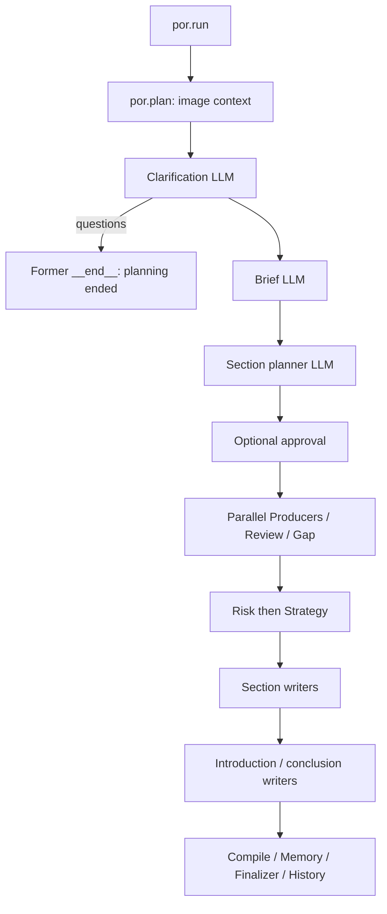
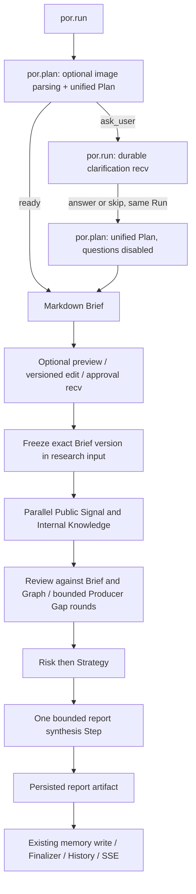

# Markdown Research Brief workflow

This release uses application version `dbos-brief-spec-v1`; SDK 0.24.0 and runtime
`sdk-phase5-v1` remain unchanged. It starts from main `338c480e49881852deb0089b32ca0b1ce4124e41`.
DBOS is the execution authority, Runner owns the four business Agent loops, and
Research Graph owns evidence. Markdown carries research intent, never execution control.

## Before and after





`por.plan` remains a BUSINESS child workflow, with no human wait inside its queue
slot. `por.run` owns native `recv` for clarification and approval on CONTROL.
Reservations are released after each planning segment and reacquired for research.
Two planning segments have distinct durable IDs (`:planning:1`, `:planning:2`) and
unit IDs. Answering never replays the first segment or creates another Run.

## Plan and Markdown contract

`workflow/brief.py` defines a strict Pydantic `PlanDecision`:

```json
{"action":"ready","questions":[],"brief_md":"# Research title\n\n## Research objective\n..."}
```

`ask_user` requires 1–4 displayable questions, unique bounded IDs, kinds `single`,
`multiple`, or `text`. Choice questions have 2–8 unique options; text questions
have no options. Its `brief_md` must be empty. `ready` requires readable Markdown
with a title and substantive sections and no questions. No duplicate objective,
scope, constraints or research-question JSON fields exist.

The prompt recommends five sections (objective, scope, core questions, constraints,
completion criteria) and 600–1200 Chinese characters. Headings are not parsed as a
machine control protocol. `validate_brief` enforces a title/sections, substantive
content, and at most **2500 estimated tokens** using `estimate_text_tokens`.
The counter is an application approximation, not a provider tokenizer claim.
An overlong generated Brief gets at most one additional shortening invocation;
another oversize or invalid result fails explicitly. No string truncation or raw
query fallback can bypass validation. The shortening prompt preserves all user
constraints. Structured parsing attempts and shortening share existing Budget,
Usage and Trace accounting. The structured Plan output allowance is at least
4096 tokens to accommodate Markdown plus its decision envelope.

Images retain the existing limits, isolated temporary message and usage capture.
No image means no Vision request. Only the first planning segment parses images.
Clarification disabled, answered or skipped still uses unified Plan and requires
`ready`; an attempted second question set fails closed.

## Persistent human interaction

`GET /api/runs/{id}` includes either pending `clarification` or `plan`, independently.
Native phase is `awaiting_clarification` or `awaiting_approval`; neither is terminal.
SSE emits a durable status, closes that delivered waiting prefix, and the observer
continues polling. Refresh/reconnect reads the same native events and cursor.

`POST .../clarification` accepts `{version, answers, skip}`. Answers are validated
against the pending question IDs/kinds/options. Partial answers are allowed; skip
must have empty answers. Unknown information stays unspecified. The same existing
`RUN_APPROVAL_SECONDS` policy bounds each human-interaction stage; approval edits
do not extend its original deadline. Expiry settles as cancelled, never completed.
Cancellation uses the existing persisted intent/native cancellation and Finalizer.

`POST .../approval` accepts `{plan_version, decision}` where decision is `approve`,
`reject`, or `edit`. An edit also supplies `brief_md`, validates it, then publishes
a new version. Saving and approving are separate commands: an old approval cannot
approve newly edited text. Unsaved edits disable the UI approval button.

No new tables: the existing locked request row and `por_domain.approvals` hold the
last accepted interaction receipt, and DBOS stores the transactional continuation
message and journal. A receipt binds topic, exact version and payload digest.
Same-payload clarification/edit retransmissions acknowledge the committed command.
Repeated approve/reject keeps the existing 409 already-consumed contract. A changed payload,
stale version, cancellation, expiry or wrong owner fails closed. Once a later
interaction replaces the receipt, an old submission can only be rejected, never
re-executed. No HTTP path calls rewind. New-release human controls validate the
accepted application/configuration version before sending any message.

## Brief persistence and context

Markdown remains the single `workflow.brief` string. Step artifacts and DBOS's
native `plan` event preserve it; no Markdown filesystem database exists. Plan
metadata has `revision` (starting at 1), `content_hash` (SHA256 of normalized UTF-8
Markdown), and `version` (digest binding Run ID, revision and content hash).
Editing back to earlier text still creates a different version. Approval state is
derived from native phase/receipts; research records `brief_locked` and copies
`brief_version`, `brief_hash`, `brief_revision` into its immutable workflow input.
The existing reducer preserves those fields across research and Gap packets.

`_build_business_agent_assignment` injects this same Markdown and version as user
task data, once in each role's initial SDK input. Fixed AgentSpec/System instructions
and tool admission remain unchanged. SDK history compaction keeps the pre-response
input head verbatim; it compacts response/tool units, not that initial assignment.
Graph context is refreshed separately by Harness. Follow-up Producers receive the
original Brief plus their scoped Gap tasks. ResearchWorkspace/Graph Evidence,
Finding and source ownership are unchanged. Long initial assignments still fail
the existing protected-context capacity guard rather than silently dropping constraints.

Old plain-string Briefs and archives remain readable. Old journals require their
matching release; they are not migrated or replayed by this release.

## Review and reporting

Review checks actual Graph findings/evidence against the Brief, with existing task
deduplication, round limits, budget and deterministic role merge. It creates no
free scheduling Agent. Risk runs after the last review and Strategy after Risk.

Default `report_mode="synthesis"` does not invoke section planning/writing or
separate introductions/conclusions. `generate_final_report` receives the complete
Brief, bounded evidence/Graph context, all four formal role reports including
Risk/Strategy, and unresolved Review gaps. It uses `report_structure` and requires
question coverage, source/evidence references and explicit uncertainty. Evidence
is allocated bounded context with omission markers; original artifacts remain.
Unknown model aliases use an application window of 32768. Insufficient input/output
budget, model errors, empty or token-limited results fail explicitly. There is no
hidden report request retry. Finalizer can authorize a retry of this pure model
Step without replaying already committed roles/tools.

The generated report artifact is committed **before** `compile_final_report`
performs the existing external memory effect. That boundary retains the original
unknown-effect guard; it is not declared a safe replay unit. Finalizer, archive
compensation and terminal delivery manifest remain authoritative. The manifest also
waits for committed SDK event IDs from each unit artifact/error before acknowledging
terminal delivery. IDs are receipt metadata, with no new table or execution authority.
They remain known across retry generations; no role/tool invocation is replayed
merely to complete trace delivery. Snapshots read native phase before the payloads
it fences, preventing a waiting status with a missing Brief/challenge.

Advanced `report_mode="sections"` reuses the existing planner, parallel writers,
completed section artifacts, budget and context fallback code. It plans after the
approved Brief is frozen. No secondary runtime or mode router was introduced.
This preserves long-report capability with one configuration field and one branch.
Legacy intake helper exports still have assessed reference-runner/external-script
consumers; they are excluded from production OPERATIONS, not fallback paths.

## Deployment and rollback

The command sequence of `por.run`, `por.plan` and `por.research` changed. Do not
allow this executor to recover `dbos-phase5-studio-v1` journals. Stop old admission,
inventory queued/running/waiting/unknown/archive-pending Runs, retain the old API
and matching executor ID/release to finish or explicitly cancel/settle them.
Preserve both PostgreSQL schemas and external receipts. New requests are submitted
with `dbos-brief-spec-v1`; no domain DDL or data rewrite is required.
Rollback stops new admission and keeps this release's matching executor for its
pending journals. Do not redeliver Agent/tool work under the old release or mint
fresh retry keys to bypass generation authorization. Historical report reads keep
their previous owner policy. No production cutover was performed by this PR.

For verification, measurements and remaining limitations see
[the implementation audit](../audits/research-brief-spec.md).
