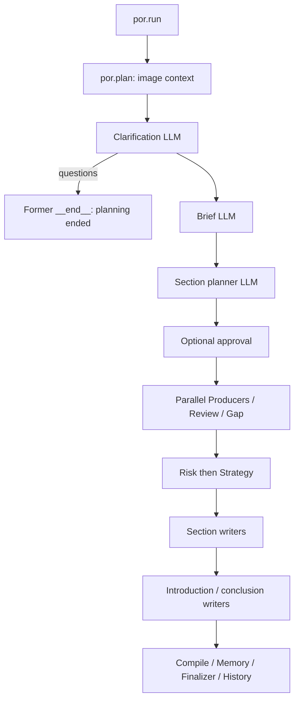
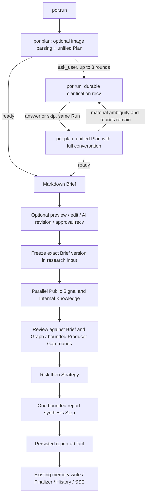

# Markdown Research Brief workflow

Native human interaction uses application version
`dbosrunner-native-interaction-v1` with DBOS 3.3.0 and DBOSRunner 0.3.0.
See the [cutover steps](dbos-deployment.md#原生人机交互版本切换).
DBOS owns execution and recovery, Runner owns the four business Agent loops, and
Research Graph owns evidence. Markdown carries research intent, never execution control.

## Before and after





`por.plan` remains a BUSINESS child workflow, with no human wait inside its queue
slot. `por.run` owns native `recv` for clarification and approval on CONTROL.
Reservations are released after each planning segment and reacquired for research.
Up to four planning segments use stable child IDs `:planning:1` through
`:planning:4` and corresponding `:plan:N` unit IDs. The parent replays the
versioned replies already recorded by native `recv` and appends one message per
reply with a stable ID. The planner derives the completed count and skip decision
from this conversation. DBOS reuses completed child results and model Steps.
Planning releases its reservation on recovery as well as on the first execution
because the existing business stage can reacquire it while rebuilding state.

## Plan and Markdown contract

`workflow/brief.py` defines a strict Pydantic `PlanDecision`:

```json
{"action":"ready","questions":[],"brief_md":"# Research title\n\n## Research objective\n..."}
```

`ask_user` requires 1–4 displayable questions, unique bounded IDs, kinds `single`,
`multiple`, or `text`. Choice questions have 2–8 unique options; text questions
have no options. Its `brief_md` must be empty. `ready` requires readable Markdown
with a title and substantive sections and no questions. No duplicate objective,
scope, constraints or research-question JSON fields exist.

The prompt recommends five sections (objective, scope, core questions, constraints,
completion criteria) and 600–1200 Chinese characters. Headings are not parsed as a
machine control protocol. `validate_brief` enforces a title/sections, substantive
content, and at most **2500 estimated tokens** using `estimate_text_tokens`.
The counter is an application approximation, not a provider tokenizer claim.
An overlong generated Brief gets at most one additional shortening invocation;
another oversize or invalid result fails explicitly. No string truncation or raw
query fallback can bypass validation. The shortening prompt preserves all user
constraints. Structured parsing attempts and shortening share existing Budget,
Usage and Trace accounting. The structured Plan output allowance is at least
4096 tokens to accommodate Markdown plus its decision envelope.

Images retain the existing limits, isolated temporary message and usage capture.
Only the first planning segment parses images, and every later decision sees that
context, the original request and all preceding questions and answers. Ask only
when resolving a material ambiguity changes the research scope, evidence or
business decision. The Brief can mark other details as unspecified. With
clarification disabled, after a skip or after three replies, `ask_user` fails the
planning stage. The usual request takes one Plan decision. Each reply adds one
decision and its accumulated conversation to the prompt, for at most four
decisions before accounting for existing structured parsing attempts and one
optional Brief shortening call.

## Persistent human interaction

`GET /api/runs/{id}` includes either pending `clarification` or `plan`, independently.
Native phase is `awaiting_clarification` or `awaiting_approval`; neither is terminal.
SSE emits a durable status, closes that delivered waiting prefix, and the observer
continues polling. Refresh/reconnect reads the current `round`, `max_rounds` and
questions from the native event. A submitted answer can remain visible until
`por.run` receives it and changes the phase.

`POST .../clarification` accepts `{version, answers, skip}`. Answers are validated
against the pending question IDs/kinds/options. Partial answers are allowed; skip
must have empty answers. Unknown information stays unspecified. Each challenge
gets its own `RUN_APPROVAL_SECONDS` deadline. Brief approval gets a separate
deadline and its edits keep that deadline. The default is up to 24 hours per
interaction, or 72 hours across three clarification rounds plus up to 24 hours
for optional approval. Expiry settles as cancelled. `RUN_TIMEOUT_SECONDS` stays
start-to-completion for each planning or research child. The parent has no
overall wall-clock deadline, so queue time and human waits are separate.
Cancellation uses the existing persisted intent, native cancellation and Finalizer.

`POST .../approval` accepts `{version, decision}` and retains the `plan_version` input
alias for existing callers. An `edit` supplies `brief_md` and publishes a new version
after validation. The user then approves that exact version in a separate command.
Unsaved edits disable the UI approval button.

RunClient checks the owner, accepted configuration and application version,
native workflow status, phase, interaction version and deadline. It then calls
`DBOSClient.send()`. Clarification, edit, approve and reject use a message key
derived from the topic and canonical command, which includes the version and owner.
DBOS deduplicates identical sends to the destination workflow and journals each
receive. `por.run` discards messages for an earlier version or the wrong owner
and waits within the original deadline. It checks the database clock after a
receive because a message may be queued when the wait times out.

A successful POST acknowledges native submission and returns a current snapshot.
Admission reads and send occur separately. A request can be rejected when the
interaction has advanced even if DBOS accepted the original message. Studio and
Classic reread the Run after submission or refresh. After an ambiguous network
failure they prompt the user to check the current state.

## AI revision during approval

Send `{"version":"…","decision":"revise","feedback":"Compare product quality"}`
with an `Idempotency-Key` header to the same approval endpoint. The key accepts
1–128 characters from `[A-Za-z0-9_.:-]`. Feedback must be nonempty after trimming
and is limited to 4,000 characters. The Run snapshot shows the pending flag, success
count, limit and any settled error.

AI revisions use the digest of the Run, owner and request Key in the
`approval:revise:<key_hash>` native message identity. DBOS retains the message
that first used that identity while its native record exists. The API does not
compare historical bodies or replay an earlier HTTP response. Each explicit
submit or retry in Studio and Classic creates a new Key. A refresh reads current
state and never resends a revision on its own.

Concurrent requests with different Keys can both enter the mailbox before the
phase changes. `por.run` processes them in sequence and a new Brief version
invalidates queued commands for the old version. A settled AI failure preserves
the version, so an already queued command for that version can still execute
and incur usage. A fresh request during the observed revision phase is rejected.

The DBOS approval message carries the scoped key digest. `por.run` uses it to
enqueue `{run_id}:brief-revision:{key_hash}` on BUSINESS as a revision-mode `por.plan`
child. The model sees the current saved Brief, original conversation, image and
clarification context, and feedback as task data beneath fixed instructions.
Only the full validated result creates a new Brief revision and consumes one
of the three AI successes. The parent then waits for approval of that version.
Clarification rounds and manual version increments do not consume the AI quota.

The original approval deadline covers the queue, execution and return to
preview. A new provider call checks the database clock at admission, and the
parent checks it before accepting the result. The parent bounds its wait on
native child completion and cancels the child at expiry, including while it is
still queued. Native cancellation and the Finalizer settle and archive the Run.
Already issued provider requests can still incur charges.

### Cost and persistence

Without AI feedback, planning uses its existing calls and no revision child.
A normal feedback attempt adds one provider call. Structured retries and the
single allowed compaction are billed separately. Failed attempts can also
incur usage. The compaction input includes the candidate, current Brief and
explicit feedback. Provider context limits can reject large inputs. The
planner retains the original context and surfaces that failure to the user.

The native DBOS message and child journal preserve request and execution
identity. `por_domain` still owns reservations, physical usage, external operation
receipts and settlement. The native plan event publishes the current Brief,
success count and error for preview.

Committed model Steps are reused after Executor restart. If a provider returned
before its native result committed, the external-effect guard blocks automatic
reissue when it has an intent receipt but no native result. The earlier request
may have been billed, and any later authorized provider call incurs its own
cost. The Run retains its prior Brief and follows the existing reconciliation
boundary for unconfirmed effects.

One local PostgreSQL run with scripted inference measured 341 estimated text
input tokens for the initial plan and 281, 285, and 289 for three revisions.
Those historical measurements used the earlier Brief revision release and
exclude provider schema overhead. Submit to preview took 1.57–1.86 seconds per
revision in that sample, including the queue and status reads.

## Brief persistence and context

Markdown remains the single `workflow.brief` string. Step artifacts and DBOS's
native `plan` event preserve it; no Markdown filesystem database exists. Plan
metadata has `revision` (starting at 1), `content_hash` (SHA256 of normalized UTF-8
Markdown), and `version` (digest binding Run ID, revision and content hash).
Editing back to earlier text still creates a different version. Approval state is
derived from native phase and plan events; research records `brief_locked` and copies
`brief_version`, `brief_hash`, `brief_revision` into its immutable workflow input.
The existing reducer preserves those fields across research and Gap packets.

`_build_business_agent_assignment` injects this same Markdown and version as user
task data, once in each role's initial SDK input. Fixed AgentSpec/System instructions
and tool admission remain unchanged. SDK history compaction keeps the pre-response
input head verbatim; it compacts response/tool units, not that initial assignment.
Graph context is refreshed separately by Harness. Follow-up Producers receive the
original Brief plus their scoped Gap tasks. ResearchWorkspace/Graph Evidence,
Finding and source ownership are unchanged. Long initial assignments still fail
the existing protected-context capacity guard rather than silently dropping constraints.

Old plain-string Briefs and archives remain readable. Old journals require their
matching release; they are not migrated or replayed by this release.

## Review and reporting

Review checks actual Graph findings/evidence against the Brief, with existing task
deduplication, round limits, budget and deterministic role merge. It creates no
free scheduling Agent. Risk runs after the last review and Strategy after Risk.

Default `report_mode="synthesis"` does not invoke section planning/writing or
separate introductions/conclusions. `generate_final_report` receives the complete
Brief, bounded evidence/Graph context, all four formal role reports including
Risk/Strategy, and unresolved Review gaps. It uses `report_structure` and requires
question coverage, source/evidence references and explicit uncertainty. Evidence
is allocated bounded context with omission markers; original artifacts remain.
Unknown model aliases use an application window of 32768. Insufficient input/output
budget, model errors, empty or token-limited results fail explicitly. There is no
hidden report request retry. Finalizer can authorize a retry of this pure model
Step without replaying already committed roles/tools.

The generated report artifact is committed **before** `compile_final_report`
performs the existing external memory effect. That boundary retains the original
unknown-effect guard; it is not declared a safe replay unit. Finalizer, archive
compensation and terminal delivery manifest remain authoritative. The manifest also
waits for committed SDK event IDs from each unit artifact/error before acknowledging
terminal delivery. IDs are receipt metadata, with no new table or execution authority.
They remain known across retry generations; no role/tool invocation is replayed
merely to complete trace delivery. Snapshots read native phase before the payloads
it fences, preventing a waiting status with a missing Brief/challenge.

Advanced `report_mode="sections"` reuses the existing planner, parallel writers,
completed section artifacts, budget and context fallback code. It plans after the
approved Brief is frozen. No secondary runtime or mode router was introduced.
This preserves long-report capability with one configuration field and one branch.
Legacy intake helper exports still have assessed reference-runner/external-script
consumers; they are excluded from production OPERATIONS, not fallback paths.

## Deployment and rollback

`por.run` and `por.plan` have new command sequences. Finish or explicitly cancel
and settle unfinished `dbosrunner-clarification-v1` and earlier Runs with their original
API and Executor before admitting new Runs. The new release refuses incompatible
unfinished journals at Executor startup and at admission. See the
[deployment and rollback procedure](dbos-deployment.md).

For verification, measurements and remaining limitations see
[the implementation audit](../audits/research-brief-spec.md).
