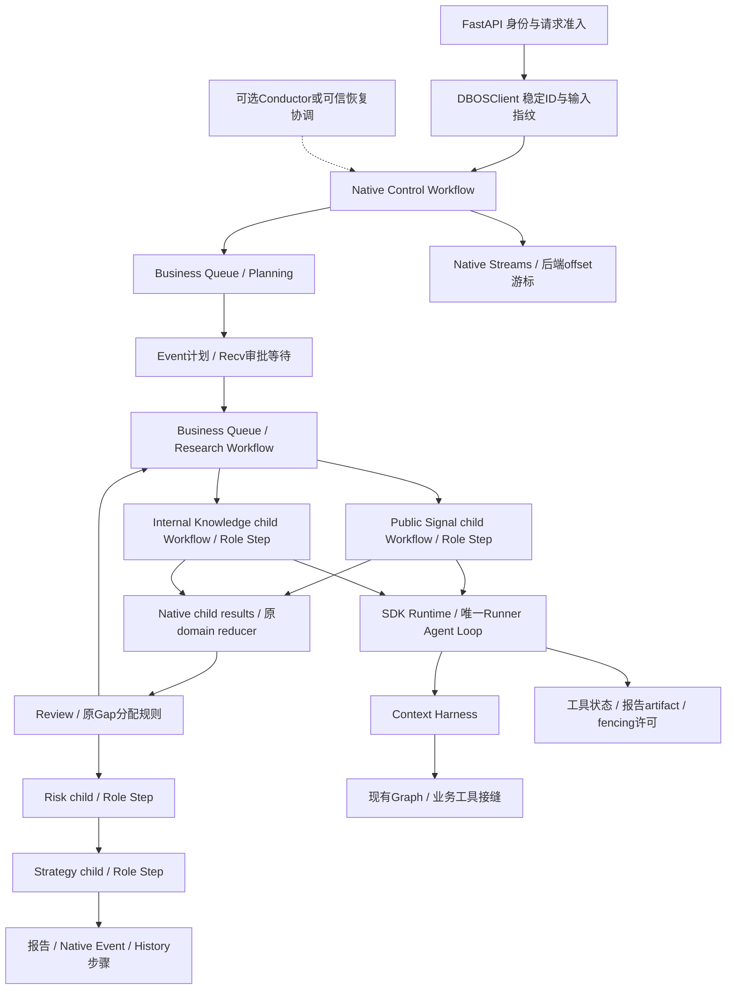

# DBOS 原生架构与扩展能力深度 POC（第二轮）

日期：2026-10-22，Asia/Shanghai。生产基线 `5ca71c12f15013654a26f619071218a2be151a00`；评估资料基线 `31764e646a71675cec7c1a3d98cd39d671343391`。开始时重新核实 PR #24 仍 open、未合并，HEAD 与生产基线一致。实验分支 `codex/dbos-native-architecture-poc`，所有新实现位于 [experiments/dbos_native](../../experiments/dbos_native/README.md)。

## 1. 结论与上一轮前提的修正

上一轮证明的是“保留 PythonWorkflow Cursor 后的兼容包装收益有限”，不能外推为 DBOS 原生架构不能简化。**本轮证实：DBOS 可以直接承接绝大部分通用执行机制，原 RunStore、RunWorker、PythonWorkflow 和 Run API 四个模块可以退出候选执行链；严格 Agent 对象身份判断也不是不可改变的业务不变量。**

但完整 Phase 4 等价与最小原型仍有差距。按不扣除测试推理夹具的保守口径，候选路线 A 替换代码为 **1,248 SLOC**，对应原四模块 **1,997 SLOC**；原型差额 **749 SLOC**。补齐旧 API/SSE、session/未知效果容量、取消确认、配置准入及归档补偿后，预计净减少约 **99–379 SLOC**，并新增 PostgreSQL 与相应恢复协调运维。这比上一轮结论更积极，但尚不足以证明完整系统大幅变简单。

**总体建议：当前保留 Phase 4，不直接启动正式迁移；若后续接受 PostgreSQL/分布式恢复运维投入，技术路线优先选择“DBOS 原生业务 Step + 原生 SDK Runner”（本轮路线 A）。** DBOSRunner 的合法 clone 已适配，不能再将对象身份报错作为否定它的理由；不过带 Graph/滚动上下文的任意 SDK turn 持久恢复仍需额外设计，不应为此引入更大的状态恢复层。

本文的 RUN 指本次真实运行，SOURCE 指核对安装发行包/项目源码，DOC 指官方说明，UNVERIFIED 指尚未验证。生产源、根锁、前端、main、Phase 4 分支/PR 和上一轮评估分支均不改动。生产实际删除0行；下面的移除量指经过可执行原型验证的替代方案范围，不能混写成已迁移。

## 2. 版本、资料和原生扩展审计

本次重新读取用户附件、AGENTS、上一轮报告/实验、Phase 4 审计，以及 business_agent、PythonWorkflow、SDK Runtime/Harness、预算、Graph、Memory/report compiler 和相关回归。实际环境为 Python3.11、SDK `0.24.0`、OpenAI Python `3.31.0`、DBOS `3.3.0`、dbos-openai-agents `0.3.0`、SQLAlchemy `2.1.6`、psycopg `3.3.6`。当日再次查询 PyPI，DBOS/集成最新稳定版仍为3.3.0/0.3.0；根 uv.lock 未更改。[DBOS发行](https://pypi.org/project/dbos/3.3.0/)、[集成发行](https://pypi.org/project/dbos-openai-agents/0.3.0/)

PostgreSQL 使用独立 `postgres:17.6`，镜像 digest `sha256:00bc86618629af00d2937fdc5a5d63db3ff8450acf52f0636ec813c7f4902929`；Neo4j 使用独立 `5.26.31`。均为 loopback、带任务标签的新容器，无原数据库挂载，不读取操作方凭据。

| 能力 | 公开 API / 可配置范围 | 原生提供与应用边界 | 本次证据 |
| --- | --- | --- | --- |
| Workflow / Step | `DBOS.workflow(name,max_recovery_attempts,serialization_type,validate_args)`；`DBOS.step` / `run_step_async` | 原生 journal、步骤输出、子流程身份；工作流必须保持确定的命令顺序。业务 if/while 不需 DAG DSL | RUN：父/子流程与真实角色步骤；SOURCE：decorator/core |
| Retry / Timeout | Step 的 `retries_allowed/should_retry/max_attempts/interval_seconds/backoff_rate/timeout_seconds`，enqueue 的 `workflow_timeout` | 重试可按异常过滤；不能把 crash 后未完成步骤重入等同 exception retry；外部幂等仍是应用责任 | RUN：安全读重试、归档失败重试、审批超时；其他超时配置SOURCE/DOC |
| Cancellation | `cancel_workflow(cancel_children=True)`、async Step `preemptible=True` | 当前 async Step 可主动取消并等待其 cleanup；非 preemptible 工作不是物理强杀。引擎 CANCELLED 不等于 SDK 清算已确认 | RUN：模型等待及工具结果等待取消；SOURCE：watchdog |
| Recovery / ownership | 同版本 executor startup recovery；公开 `resume_workflow(queue_name=...)` | journal ownership 阻止旧执行提交；旧外部请求仍需业务 fence。自动跨 executor 失活发现需 Conductor/其他可信协调 | RUN：进程kill/restart、活旧executor手工恢复；自动检测UNVERIFIED |
| Queue / concurrency | `register_queue(global_concurrency,worker_concurrency,partition_concurrency,partition_worker_concurrency,limiter,on_conflict)`，`SetEnqueueOptions(queue_partition_key,priority,deduplication_id,...)` | 原生全局/worker/单partition流控。owner、session、未知效果占位的三维联合业务约束不能直接当成同一partition | RUN：两个Executor、global2/owner1；session/隔离容量未实现 |
| Executor 隔离 | `DBOS.listen_queues`（launch前）、`executor_id`、`app_version` | 可以将可信恢复投到专门队列，避免仍活着的旧执行器又领取任务。不能用两个活动进程共享executor ID模拟正常部署 | RUN：新旧executor不同ID、专用recovery队列 |
| 状态 / 属性 | `DBOSClient.list_workflows`、handle `get_status/get_result`、workflow attributes/authenticated_user | native status 是执行权威；业务报告是否存在、清算是否完成是独立领域事实，不再维护另一份Run状态机 | RUN：API读取、跨owner拒绝、报告已生成但归档ERROR |
| Events / Streams | `set_event/get_event`；`write_stream/close_stream/read_stream(offset)/read_stream_offset` 及async版本 | Event是最新值，Stream是有序持久值；offset可映射SSE游标。脱敏、权限、旧事件协议兼容仍由应用负责 | RUN：计划/phase/report、最小SSE及游标重放 |
| Communication / transaction | `send/recv`；`DBOSClient.send_in_transaction/enqueue_in_transaction` | 可以与同一PG事务中的领域决定一起提交，不必再建一个通用SQL outbox；不能扩展为Neo4j/MCP跨库事务 | RUN：版本审批CAS+send，事务rollback；SOURCE：client/datastore |
| ID / 版本 | `SetWorkflowID`、enqueue workflow_id/reuse policy、app_version、patch/versioning | stable business ID可复用为workflow ID；输入指纹/owner仍需校验。代码版本不自动冻结外部工具和业务配置 | RUN：请求去重/冲突、恢复同ID；跨版本upgrade/patch未演练 |
| Serializer / 数据模型 | `DBOSConfig.serializer`、公共 `Serializer`；可选portable JSON/原生格式 | 默认pickle可以替换；本次使用白名单JSON。Datasource的serializer默认与DBOSConfig独立，采用时也须显式指定 | RUN：消息、领域类型、ModelResponse/Usage、异常kind；拒绝任意对象 |
| 异步边界 / SDK | 原生async Workflow/Step；SDK `Runner.run`、RunHooks、input filter；集成 `DBOSRunner.run` | Role步骤可保留原Agent Loop；DBOSRunner只负责其模型/工具持久接缝，不持久化live Harness的全部可变状态 | RUN：路线A/B；标准策略细粒度replay；Graph细粒度恢复未完成 |

对应官方来源：[decorators](https://docs.dbos.dev/python/reference/decorators)、[配置](https://docs.dbos.dev/python/reference/configuration)、[Queue](https://docs.dbos.dev/python/reference/queues)、[Client](https://docs.dbos.dev/python/reference/client)、[context方法](https://docs.dbos.dev/python/reference/contexts)、[通信/Streams](https://docs.dbos.dev/python/tutorials/workflow-communication)、[Datasource](https://docs.dbos.dev/python/reference/datasources)、[认证](https://docs.dbos.dev/python/tutorials/authentication-authorization)。能力存在与本项目已完成适配分开记录，未把默认行为写成不可配置限制。

## 3. 本次真正重设计的执行层

[DESIGN.md](../../experiments/dbos_native/DESIGN.md) 在实现前写入。原型没有调用旧 Worker、没有包装 `PythonWorkflow.ainvoke`，没有借原 RunStore 保存另一套状态。

Control Workflow不占用business容量等待审批。规划和研究子流程使用**同一个**business queue，因此不会各自形成一套互不相干的全局执行上限。研究期间两个角色是独立子Workflow，真正并行；完成结果分别持久化，再用原 `merge_research_patches` 合并。Review/Gap继续使用原 `followup_assignments`，Risk→Strategy顺序不变。

执行恢复由native journal重建业务步骤结果，不是读自定义cursor。失败join使用公开wait_first并取消兄弟子Workflow；SDK清算仍由原Runtime/Harness负责，应用等待清算事实，不把native取消请求当成外部工具已停止。

| 旧机制 | 原生方案的去留 |
| --- | --- |
| SQL Run状态机/Attempt表 | 不使用。DBOS native workflow状态与child身份提供执行信息；不再复制 queued/running/failed 等权威状态 |
| SQL Queue / Worker claim / heartbeat / lease | 不使用。DBOS queue/executor协调承担；executor仍是需要部署的Python进程 |
| State+Cursor checkpoint | 不使用cursor。业务State/reducer保留，作为native步骤/child返回值重建 |
| SQL Outbox/seq | 不使用。公开阶段事件用native Stream offset；只在最小后端协议范围内验证，不冒称旧SSE全部兼容 |
| 自建审批暂停状态 | native Event+recv等待；计划hash、owner、期限与一次性决定仍为领域规则 |
| 工具Intent/Receipt | 简化为业务操作key、参数指纹、started/returned/uncertain，加外部幂等服务；不带Run lease/attempt生命周期 |
| Attempt fencing | 保留每角色可撤销执行许可，用于模型/工具准入和artifact提交。无计时、无租约、无Attempt历史。它保护外部效果，不与native journal状态竞争 |
| History | 仍用真实Neo4jHistoryStore；调度/重试放DBOS。旧completed+archive_pending完整语义未复制，见差距表 |

领域表是 `roles(id,permit,artifact)`、`operations(id,role_id,fingerprint,status)`、`facts`、`decisions`。其中facts主要是清算确认/POC证据；**不是公开事件outbox**。另一个schema的external_authority只是可核对、显式支持幂等键的测试服务。role artifact保存已结清的角色报告/预算/引用patch，用于成功业务结果已提交但引擎ACK丢失的窗口；不保存Run状态、队列、租约或cursor。不得将它描述为“应用完全不需要任何持久领域信息”。

## 4. SDK / Harness 的两条路线

### 路线 A：业务 Step + 原生 SDK Runner

正常角色用原 `SDKAgentRuntime`、原 `SDKContextHarness`、原 `Runner.run`。真实AgentSpec、权限schema、工具调用、图抽取/回执、工作上下文和滚动压缩保持原逻辑，未新增Agent Loop。完整角色是最小可确认恢复边界；native子流程使一个已完成Producer不会因另一个失败而重做。

不允许未确认的opaque SDK角色重入，即使还没有工具receipt：它可能已经发生模型费用或其他未知效果。`Domain.acquire`仅复用明确已结清artifact；其余未确认结果标记usage_complete=false并拒绝盲重放。专门的幂等ownership探针显式选择允许未完成步骤重入，不把这个许可开放给业务SDK角色。

### 路线 B：DBOSRunner + 可扩展 Harness

上一轮的 `data.agent is self._agent` 同时把“一次受信角色调用”与“同一Python对象”绑定。真正必要的不变量是 run/role/task/context、工具策略与调用所有权；合法clone并不必然破坏它们。

本次 [runtime_ext.py](../../experiments/dbos_native/runtime_ext.py) 提供显式Runner与Harness工厂接缝：

1. 固定SDK调用的canonical Agent policy，包含name、完整instructions、output契约、工具名字/description/schema/strict配置与guardrail身份；schema快照变为不可变值，不能通过原地修改蒙混。
2. SDK公开 `RunHooks.on_agent_start` 在当前调用窗口接纳受信Runner提供的clone，同时检查原 `context/run/role/task` 绑定，不允许handoff/MCP server绕入其他角色。
3. input filter先验证clone确实由本次Hook接纳、策略仍一致，再把filter参数中的Agent归一为canonical Agent，调用原业务filter。原scope检查、过滤、压缩和工具权限闭包保留。
4. DBOSRunner使用其公开run API；没有修改SDK/DBOS全局Runner，没有调用vendor私有wrap/recovery函数。测试中故意注入的攻击Runner是显式依赖替身，仅用于负例。

结果：四角色正常/滚动路径可运行，5类伪造指令/name/schema/foreign context/handoff负例被拒绝。**这证明了原对象身份限制可以安全收窄，不能再把clone错误作为架构否决理由。** 不宣称防御任意同进程恶意Python代码；原is检查同样不能提供这种沙箱。闭包保持依据受信固定版本集成源码及真实工具调用验证，而不是比较工具名字就授权任意实现。

DBOSRunner `0.3.0` 会替换model_provider、clone Agent并包裹FunctionTool invoker，但保留其他RunConfig字段和传入的Hooks/context。其工具wrapper仍调用原invoker；项目的权限/预算/Context闭包保持。[集成源码](https://github.com/dbos-inc/dbos-openai-agents/blob/main/dbos_openai_agents/runner.py)、[官方说明](https://docs.dbos.dev/integrations/openai-agents)

本原型对自有项目protected helper有源码级复用，并复制了SDKRuntime.run方法，仅将Harness构造点变成工厂；这些复制行在统计中单列，不伪装成引擎新增能力。正式实现应在自有Runtime公开小型工厂/Runner参数，避免保留重复方法。DBOS/SDK侧仅使用公开接口，不依赖第三方私有实现打补丁。

### 模型输出replay、Hooks和上下文

两种粒度不能混淆：完整四角色路线B当前仍在角色Step内，内嵌模型Step归属于外层业务Step，并不自动获得每个turn的独立耐久性。额外的 [probe.py](../../experiments/dbos_native/probe.py) 把DBOSRunner置于独立native Workflow，工具和报告收尾各自是Step；在standard非Graph策略下，真正kill后重建SDK循环，验证模型/工具缓存及Hook逻辑预算。

细粒度探针结果为 **RUN通过（定向包含在4 passed / 19 deselected，125.56s中）**：预期实际provider2次、实际tool1次、逻辑model_calls2、28 fixture tokens，完成的模型/工具不再进入invoker。这个结果不能外推到Graph模式：Graph输入过滤会读取/写入证据、更新WorkingContext/receipts、压缩历史，还包含SDK之外的模型调用与可变状态。只缓存SDK ModelResponse并不持久化这些状态；完整Graph turn replay尚未适配/验收。

因此本轮推荐路线A。路线B已解除clone集成限制，并有窄范围原生replay证据，但若为了全面Graph turn恢复引入复杂snapshot/hydration层，会重新增加维护成本。无需为本次实验升级 `openai-agents==0.24.0`。

## 5. 运行结果、故障与真实语义

最终原生矩阵：**29 passed / 0 skipped / 0 xfailed / 150 warnings，641.81s，退出0**。原生产离线全量：**820 passed / 6 deselected / 156 warnings，138.74s**。不使用付费模型；没有Mock框架持久化/恢复，没有通过skip/xfail掩盖失败。

| 场景 | 实际运行与结论 |
| --- | --- |
| 四角色 A/B | PostgreSQL原生Workflow/Step；Producer barrier证明并行，Consumer模型首轮实际看到Graph Evidence；Strategy看到风险分析，私有记忆不串角色 |
| 预算 | normal夹具20次模型调用、158 input、66 output、224 total，A/B一致。是本夹具账本；规划/报告比完整产品简化，不能拿来与上轮28/311比较模型成本 |
| Review/Gap A/B | 两个真实任务进入第2轮，两Producer补查，效果数4；沿用原followup分配和patch合并 |
| Rolling A/B | 实际reasoning/tool历史触发原Harness压缩；回执和Evidence引用仍有效，不替换filter为恒等函数 |
| 完成Producer后kill | 在native child结果已确认后的下一Step阻塞，kill并同executor/version启动；已完成角色不重做，后续Consumer读真实持久Neo4j |
| 审批等待kill | native计划/等待恢复，批准后不重算Planning；拒绝/超时终止，不开始角色工具 |
| 工具成功但未持久回执 | 外部authority先独立commit，再在receipt前kill；恢复保留unknown并ERROR，不盲重放。另核对invoker witness，不能仅凭幂等表去重掩盖重复请求 |
| 旧Executor活着 | 旧Step显式non-preemptible模拟不能立即停止的执行。公开cancel/resume(queue_name=recovery)，旧进程不监听该队列，新进程取得native结果所有权；旧进程释放后被领域permit拒绝，不能多发效果/覆盖artifact |
| 模型/工具等待取消 | 真实SDK取消与Harness结清；工具等待场景已提交效果的操作保持uncertain，不把Graph collector已排空等同外部成功/全局清算 |
| PostgreSQL stop/start | 只停止本次容器；API返回数据库不可用而不伪称SUCCESS。恢复后未准入效果不会执行，native执行最终ERROR；不是抛Mock异常 |
| 报告与归档状态 | 真实报告Event可以在archive失败/native ERROR时存在；API分别展示事实，不覆盖/丢失报告。完整旧archive_pending自动补偿仍是差距 |
| API/SSE | 真正auth owner、幂等body冲突、版本审批/重复决定拒绝、native事务消息；Streams offset映射连续后端游标，重放不调用角色 |
| 并发 | 两个独立Executor上native business queue global2/owner partition1实际限制；未声称session/隔离容量已有等价实现 |
| 事务扩展 | 同一PG事务内enqueue回滚不投递；审批决定与native send共同提交；没有另建通用outbox relay |
| 安全读重试/失败join | native Step按异常种类重试；Producer模型失败会取消兄弟并等待SDK清算，不运行Consumer或把部分结果当成功 |

外部服务只在synthetic authority里显式实现幂等。DBOS保证完成步骤的journal/replay，**不提供跨MCP、Neo4j、Memory、模型供应商的exactly-once**。领域fence能阻止后续模型/工具准入，不能撤销失效前已发出的远程请求或同步线程。

### 失败记录（不删除失败断言）

- 初次driver给公共client handle传了不存在的timeout参数；改用正确API，测试进程自身有超时拥有权。
- sync Step返回float却被await；改为async Step。native将该异常持久成ERROR，没有假成功。
- 首次完整矩阵 **15 passed / 4 failed，778.14s**。Gap夹具只分配一个补查角色却要求效果4；改为真实双角色缺口，保留4次效果和第2轮断言。API的长Windows路径导致transcript失败；日志目录缩短、由服务端派生。恢复默认又被旧Executor领取；用公开listen_queues+resume queue路由，未访问私有recovery接口。
- 数据库停机时默认client连接可能长等。通过公开system_database_engine注入有界连接池/connect timeout，并关闭API连接错误重试；不能把默认等待行为说成不可配置限制。
- 源码审查发现报告夹具曾直接序列化agents域；改为读取有界已提交Graph上下文，增加私有标记不能进入报告prompt的断言。Scope policy也改为不可变schema快照，避免原地修改逃过比较。
- 修正后上述场景定向 **8 passed / 11 deselected，242.92s**；后续静态自动修复误删Workflow注册导入，造成一轮任务未注册/PENDING，已中止且不计有效验证；显式注册检查和可选B/probe加载修正后定向 **4 passed / 19 deselected，125.56s**。scope/serializer单测 **6 passed**。完整最终结果另列，不把定向通过写成全量通过。
- 一次宽范围cancel清理被自动审批拒绝，命令未执行；后续仅核对明确的孤立测试ID、类型与专用目录再处理。没有取消任意其他任务或修改原数据库。

## 6. 代码量：实际原型与等价生产分别计算

统计脚本 [inventory.py](../../experiments/dbos_native/inventory.py) 从固定Git SHA读取基线，AST识别docstring，SLOC排除空白、独立注释、docstring；不是语句数或复杂度评分。格式化会影响行数。运行日志/JSON数据库不提交。

| 指定模块 | 基线SLOC | 本次候选处理 |
| --- | ---: | --- |
| web/run_store.py | 1,022 | 整文件退出原型调用链；native权威状态，必要领域信息重设计到新模块 |
| web/worker.py | 423 | 整文件退出；DBOS executor bootstrap取代claim/lease/polling，不保留execute外壳 |
| workflow/python_workflow.py | 344 | 整文件退出；直接native业务steps/children，原领域helper/reducer保留 |
| web/runs.py | 208 | 原API实现退出候选链；最小新API170量级，完整旧协议未等价 |
| workflow/execution.py | 63 | 保留；SDK observer和既有业务owned cleanup仍有用途，不能整文件算删除 |
| runtime/sdk_runtime.py | 631 | 路线A原样保留；路线B工厂接缝另算 |
| runtime/sdk_context.py | 728 | 原样保留；B有scoped extension，不通过删除原保护造通过 |
| **被替代四模块** | **1,997** | 当前生产实际删除0；候选已不依赖四模块 |
| **其余保留三模块** | **1,422** | 不计引擎收益 |
| **七模块分母** | **3,419** | 固定审计口径 |

A. 已实现真实代码量（默认入口对B及probe采用显式可选加载；已实际检查A入口不加载它们和旧四模块）：**12个Python文件、2,658物理行 / 2,370 SLOC（A路径1,248、可选B/探针360、测试672、统计脚本90）**。其中路线A功能文件：env、codec、domain、business、engine、api、executor，共 **1,248 SLOC**；它没有扣除受控推理/诊断代码，属于保守口径。B的scope/SDK方法复制和细粒度probe、测试、计数脚本分别单列，不能混作生产减少量。具体各文件物理行/SLOC由脚本完整打印。

相同七模块范围：原3,419 → 保留1,422 + A原型1,248 = **2,670 SLOC**，原型差额 **749 SLOC**。这是真正重写后的可执行差异，而非把RunWorker包一层再估删除量；但原型未完全恢复所有产品合同，不能据此立即批准生产迁移。

B. 达到Phase4功能等价的补齐预算（工程估算，不是已实现）：

| 缺口 | 新/重写预算SLOC | 不可漏计的内容 |
| --- | ---: | --- |
| 完整旧API/SSE和失败费用投影 | 100–150 | /api/runs协议、body/key/cursor约束、阶段事件、错误/usage、清算完成确认、兼容导出 |
| session与unknown效果容量 | 50–100 | 全局/owner/session联合约束，quarantined继续占位与受信核对；native普通队列限额不能代替 |
| 有效配置/SDK版本与SDK Session | 40–80 | 接纳策略指纹、漂移拒绝、私有Session生命周期；app_version并不自动覆盖这些 |
| 完整业务步骤/真实provider/MCP生命周期接缝 | 60–130 | 图片/澄清/规划、原章节和报告路径、Memory、模型/工具client拥有权与关闭；保留现有领域源码 |
| 旧归档补偿/公开事件语义 | 70–120 | completed+archive_pending、独立幂等重试、较新版本投影、断线后的后续归档通知 |
| 生产部署与数据管理 | 50–70 | schema初始化/权限、保留清理、可信恢复/隔离工具、健康/停止宽限；不含基础设施配置文件的人力成本 |
| **合计** | **370–650** | 仍需真正实现并复验才能收敛 |

因此A执行层预计 **1,618–1,898 SLOC**，相对被替代1,997净减少 **99–379 SLOC**。不扣除原型推理夹具可能偏保守，但比遗漏必要功能后声称删上千行可靠。不能把角色Step的短实现当任意turn无损恢复，更不能把RAG、Graph、Memory、业务预算、Golden Sets计作可删除。

### 层级与工程概念

按同一“含业务调用函数的自研逻辑职责链”口径，原路径为 route→RunStore→RunWorker→PythonWorkflow→_step→business_agent→SDKRuntime→Harness→Runner；新路径为 route→Gateway→control Workflow→research Workflow→role Workflow→role Step→Business.role→SDKRuntime→Harness→Runner。层级没有显著变少；native child包装承载独立持久身份，少量纯转发可再验证合并，本文不提前计收益。

真正消失的是自研通用SQL队列/claim、Worker轮询Task池、lease/heartbeat、Workflow cursor恢复、公开事件SQL outbox五类机制。持久审批等待/步骤结果/重试由引擎承担。应用仍维护授权/输入指纹、效果幂等/未知状态、工具前fencing、SDK预算/清算、角色与证据、归档业务语义；版本、serializer、queue路由、引擎历史/保留与恢复控制成为团队必须掌握的新概念。

原型没有用Adapter/Manager包装旧控制层，但也不是“零适配”：Gateway负责身份与原生调用，Domain负责外部效果/报告事实，Business负责业务依赖；职责都有实际约束。路线B复制的方法是可比较实验副本，正式实现不能把它永久保留为第二套SDK Runtime。

## 7. PostgreSQL、Executor 与可靠性边界

本次PG已实际覆盖队列、native步骤结果、消息/事务、独立进程重启、两个executor并发、活旧执行者手工转移、数据库stop/start。不是SQLite演示，也不是用单进程异常代替崩溃。[执行所有权说明](https://docs.dbos.dev/explanations/concurrent-executions)

自动跨Executor失活发现没有运行Conductor。原生同executor启动恢复可用；多机自动恢复还需要Conductor或受信协调者，且要处理错误判死/旧线程仍活着。公开resume支持queue_name，配合launch前listen_queues可避免旧进程再领取；这次失败修正说明应先用扩展配置再判断限制。[Distributed Recovery](https://docs.dbos.dev/conductor/distributed-recovery)

新增PG不能替代现有MySQL长期记忆或Neo4j证据/History。生产需要备份/PITR、连接/锁等待、schema权限、升级和监控；POC使用superuser只是隔离测试，并非生产权限方案。Conductor不是安装库的前提；如果要求自动多机失活恢复，则其部署/服务或自有协调成本应明确计入。没有测量团队运维成本，不能声称免费，也不能根据框架benchmark宣称项目吞吐/HA。

UNVERIFIED：生产PG HA/网络分区、真实跨主机角色分发、Conductor自动故障探测、远程MCP幂等、不可取消同步线程极晚结果、所有SQL回执提交竞争、完整旧前端/SSE合同、隔离容量与完整多租户ACL、SDK Session接线、Graph细粒度turn hydration、生产大状态/历史保留和真实供应商。原820项通过只证明保留的生产路径回归，不等价新原型已覆盖这些。

native status是执行事实，领域报告/清算是另一个维度。尤其取消请求可以先使引擎状态变CANCELLED，SDK仍在清算；API应明确返回清算事实，不能把它硬编码成“全部完成”。归档失败而报告存在的POC也不能冒充旧completed/archive_pending等价行为。两者均已计入生产补齐预算。

## 8. 验证与交付边界

| 检查 | 结果 |
| --- | --- |
| Phase4完整离线回归 | 820 passed / 6 deselected，138.74s；socket guard、禁dotenv/tracing |
| 原生全矩阵首轮 | 15 passed / 4 failed，778.14s；失败记录保留 |
| 失败定向复验 | 8 passed / 11 deselected，242.92s |
| scope/serializer单测 | 6 passed，真实SDK Hook负例与白名单codec |
| 最终原生/扩展矩阵 | 29 passed / 0 skipped / 0 xfailed / 150 warnings，641.81s，退出0 |
| lint/format/compile | 原CI E/F/I全范围、12文件format与compileall通过；依赖检查仍有唯一既有markitdown-mcp/mcp冲突，未通过 |
| 生产代码/前端/根锁/配置 | 无修改；不合并main或修改#24/#25 |
| paid model / paid API | 0 |

复现见README；日志、junit、transcripts与缓存保留在忽略目录，不提交运行DB。临时PG/Neo4j数据仅在本次专用容器卷中，验收后核对容器ID和任务标签再清除；原MySQL/Neo4j不触碰。代码/统计方法/审计报告进入独立未合并PR。依赖检查的既有markitdown-mcp/mcp冲突单列，未将其写成通过。

## 9. 后续正式迁移顺序与回滚

1. 先决定是否愿意承担PG及分布式恢复协调运维；不要只据“删了一个类”做决策。固定使用本轮路线A的native业务步骤，不继续兼容包装旧Cursor。
2. 先补齐上表的功能差距并迁移原Phase4合同，特别是unknown占位、session、部分费用、取消确认与归档。保留全部业务回归，新增PG/分区/配置漂移/旧执行仍活着/迟到结果/大状态验收。
3. 把native journal与领域数据所有权写清楚；SDK/Harness不序列化live context。公开自有Harness工厂，避免长期保留实验复制方法。若要路线B的Graph turn恢复，另立精确合同，不附带扩大本次迁移。
4. 仅新Run灰度，受信服务端固定engine/version与输入指纹，保持业务Run/Graph/History身份；已有Phase4 Run、审批暂停、unknown和archive_pending继续由原版本通道处理，禁止跨引擎盲重投。
5. 回滚停止接纳新DBOS任务，保留对应executor版本排空/核对；不将DBOS Run重新交给原Worker。业务报告和证据仍可读取，外部效果不因回滚重新执行。
6. 排空旧任务、补偿和隔离记录并完成兼容导出评估后，才按真实diff删除旧控制模块；再评审LOC/故障路径净收益。此过程不包含Phase5旧LangGraph/Runtime退役。

## 10. 必须回答的八个问题

**Q1 能否大幅简化？** 原生机制可显著替代自研通用机制，原型独立性已经证明；完整Phase4等价后的净减量未证明达到“大幅”。不能再用上轮保守包装的数字否定原生设计，也不能用缺功能原型的差额直接批准迁移。

**Q2 RunStore/RunWorker能删多少？** 两文件1,445 SLOC均退出本原型路径；状态、调度、checkpoint、事件由DBOS提供。授权、业务效果/报告和fencing仍需新实现，不是所有原代码都免费消失。当前生产文件按范围全部保留。

**Q3 Harness限制能改吗？** 能。is检查保护了过强的对象约束；本轮用受信调用窗口、不可变policy、公开Hook注册和原context/role/task检查接纳clone，并有真实正常/压缩和5类负例证明。不是简单删掉检查。

**Q4 用哪个Runner？** 推荐本轮路线A：DBOS业务Step+原生Runner；B的clone兼容可行，但完整Graph turn持久恢复成本和风险较高。标准策略原生replay的成功范围明确，不外推。

**Q5 原生Queue/Workflow/Step/Events/审批/恢复能替代大部分控制吗？** 能，已执行验证，不需要再保留原Run状态机/SQL Queue/Cursor/Outbox。计划授权、未知效果、联合资源限制、SDK清算和归档业务语义仍由应用负责；自动多机恢复未验收。

**Q6 实际减少多少？** 旧四模块1,997 → A原型1,248，路径差额749；当前Git生产删除0，新增完整实验束12个Python文件、2,658物理行 / 2,370 SLOC（A路径1,248、可选B/探针360、测试672、统计脚本90）。等价补齐后预计净减99–379 SLOC；层级未显著下降，自研队列/租约/轮询/cursor/outbox五类机制退出。

**Q7 新运维成本抵消吗？** 尚无生产SLO/团队成本数据证明收益覆盖新增PG/恢复协调。对保守净减量而言，它会显著影响收益判断；单机不用Conductor，不代表自动多机HA也无需协调。

**Q8 最终推荐？** **当前保留Phase4，不直接发起正式迁移。DBOS原生业务Step+原生SDK Runner已成为技术成立的优先后续方案；接受运维投入并补齐等价差距后，再按第9节灰度。** 本次不自动实施，不因旧决策或已投入POC而预设采用/排斥。
