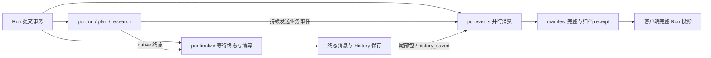

# DBOS SQL / Event Relay 性能专项审计

本轮仅诊断冻结的三 PR 组合及一个公开连接配置实验；不合并 main，不修改
#34–#36，不改变持久化、清算、重试、归档与终态回执语义。所有推理使用原有模拟模型。
性能诊断与正式计时分开，原门槛保持不变。原始组合本轮汇总正式门禁全部通过；参数候选收益方向不稳定，未推广，生产源码不变。

## 1. 冻结基线与环境

2026-10-29 再次读取远端：main 仍为
`9b479fa4fd4ee412305d81ddba3bf2ecb62b364c`；以下 PR 均 open / Draft / unmerged：

| PR | 冻结 HEAD |
| --- | --- |
| [#34](https://github.com/kkaaakk/public_opinion_research/pull/34) | `ef282a3a25dddc6add6187935dc7e95a726823fe` |
| [#35](https://github.com/kkaaakk/public_opinion_research/pull/35) | `a831f36f656af2a5babce83d6dadd92ef9679b58` |
| [#36](https://github.com/kkaaakk/public_opinion_research/pull/36) | `5ee7e3db72e5eceae99dd2bda2debaaea3167dc7` |

独立 worktree / 分支 `codex/dbos-sql-event-performance`，冻结基线分支
`codex/dbos-sql-event-baseline` 的 commit
`2291002f2d867734d63e75d6d0a28dc53e96676a`，tree
`5c73abc60c69e7b009fe5390c7382d103af11a08`。它在已验收组合
`5705768fb954787fbcef2c5b0a6d11aba3ce5ed5` 上加入最新 #36 的测量修正；
`src/` 与原始组合相同，未包含上轮未推广的清洗缓存候选。116 个生产 Python 文件的
规范化 SHA-256 为 `d16878720c457796908a0b2f0d0a48276252188caf8ee0ff11a5ac3e75c88c9d`。
专项 Draft PR 以此冻结组合为 base，使 diff 只包含本轮工作；这不是三 PR 的合并授权。

使用根 `uv.lock` / Python 3.11.9 / 根 `.venv`，DBOS 3.3.0、SQLAlchemy 2.1.6。
隔离服务沿用上一轮容器与数据卷：PostgreSQL 17.6 / 512MiB、Neo4j 5.26.31 / 1GiB
（heap 256–512MiB / page cache 128MiB），官方 Langfuse 4.70.1 Web / Worker、
ClickHouse、Redis、MinIO。PG / Bolt / Langfuse 仅 loopback 的 35437 / 37692 / 33080。
不读取生产 `.env`；测试账号和项目 API keys 仅按用户此前明确授权从同一隔离 fixture
复用，不输出、不提交。原有其他数据库容器未参与测量。

诊断在这个专用测试 PG 启用 `pg_stat_statements` preload、planning、I/O 和 WAL I/O
计时；没有修改 `fsync=on`、`synchronous_commit=on`、`full_page_writes=on`、
`wal_level=replica`。正式计时关闭额外统计计时，两组配置一致。服务重启仅限本任务 PG。
不重置全局统计；每个单元创建/删除自己的 `por_test_UUID`，通过前后差分测量。

## 2. 测量方法与解释边界

`evaluation/observability/run_sql_diagnostics.py` 是显式 opt-in 的测试入口，
复用同一 `run_benchmark.py` 的 NativeCase / MockTransport / 业务 fixtures。
SQLAlchemy 公开事件测 cursor 执行；公开 Pool / Connection / dialect 方法仅包装计时，
每次仍恰好调用原方法一次。没有修改 DBOS 私有实现、SQL、事务或命令顺序。

记录规范化 SQL 指纹、源码文件/函数名、workflow 上下文、调用量、cursor wall 分布、
可见 rowcount、事务尝试与异常类型/SQLSTATE。绑定参数从不读取或格式化；字符串、
注释、dollar quotes、数值被移除，quoted identifiers 哈希化；不能可靠解析的 SQL
整条 opaque。没有记录 locals、exception message、业务输出或 `pg_stat_activity.query`。
by_run 表示调用时的执行上下文；后台调度和批量状态读取不能强行分摊给目标 Run。

PG 统计以 `(userid, dbid, toplevel, queryid)` 完整键差分，数据库 OID、重置、条目淘汰、
负差分均使该窗口无效。cursor 计时不包含 checkout / commit；
Connection.execute 含 cursor，另报扣除 cursor 的剩余部分，二者不能再次相加。
Pool.connect 含 ping，另报扣除 ping 的剩余部分，后者仍含新建连接/校验/队列，
不能叫作纯池等待。初次 pool 映射前的 checkout 不在这一分项内。

启动/预热不计入测量；第一次实测提交前建立服务端快照并清空客户端探针。
实测阶段与 destroy 排空分别标记，destroy 后立即冻结客户端，再等 1.1s 让 PG 累计
统计发布并取终点快照；后续 EXPLAIN、清理与 drop DB 不混入计数。
客户端/服务端快照并非原子共同边界，dbstats 存在发布滞后；cluster WAL 包含后台活动。
公开 hooks 的首个新连接边界、跨时钟和服务端快照误差均保留为限制。

PG activity / locks 每 0.5s 采一次聚合状态；容器资源与宿主 CIM 约每 5s 采样。
不重新引入 50ms 完整 Run 轮询。正式完成条件仍为 archive receipt 后完整投影确认
completed / settled / saved / events_complete，不能提前结束。
额外 workflow/step 清单读取仅用于诊断，其开销不进入正式计时。

服务端聚合不提供区间内 p50/p95/p99 或可相减的 min/max，本文的 SQL 分位数来自客户端
样本。服务端执行、planning、commit wall、WAL I/O、网络/驱动/Python 等等待存在嵌套
或不同归属，不能相加成单个 Run 的关键路径。
重试次数不能用重复指纹推断；分别列可观察 SQL 失败与持久 Step 记录，未观察到不等于
证明所有底层重试为零。

官方语义依据：[PG pg_stat_statements](https://www.postgresql.org/docs/17/pgstatstatements.html)、
[PG monitoring statistics](https://www.postgresql.org/docs/17/monitoring-stats.html)、
[SQLAlchemy events](https://docs.sqlalchemy.org/en/20/core/events.html)、
[SQLAlchemy pooling](https://docs.sqlalchemy.org/en/21/core/pooling.html)。

## 3. 实际 Event / Stream 依赖

创建 Run 同一事务提交 `por.run`、`por.events`、`por.finalize`。后两者与业务并行，
不是根完成后才启动。业务/SDK 在执行时不断 send 事件；relay 每包执行 recv →
public_event Step（PG 时间戳）→ writeStream → cursor event，状态包还写 phase。
每个持久命令同时需要 DBOS journal 与执行所有权检查。

Finalizer 用 completion_facts / 原生 sleep 等待 native 终态与领域清算，随后发送
settlement、report、usage、run_status、done，保存 Neo4j History，再发送 history_saved。
History 与尾部包的 relay 消费可以重叠；history_saved 到达并不代表终态 manifest 已齐。
relay 必须看到所需类型，写最终 done / cursor / done receipt / history receipt 并关闭
stream 后才完成。基准等待 history receipt，再读取一次完整 Run 投影。



`workflow_status.updated_at` 是 DBOS 记录的状态时间，不能当作客户端收到提交 ACK 的
精确物理时刻；Step start/end 和 Python monotonic markers 分别保留，不能将跨时钟
的小间隔解释为因果倒序。根终态到 relay 终态之差表示交付尾段，不等于全部空等。

## 4. SQL 指纹、调用量及成本

分类分位数使用独立 v2 补采的四并发 ON：4 次实测 /1 次预热，**19,987** 次 cursor 调用。
所有分位数从原始样本重算；没有平均各指纹 p95。以下 wall 均为多线程累计，不能视作单 Run 关键路径。

| SQL 类别 | 次数 | 次数/Run | 累计 wall s | p50/p95/p99/max ms |
| --- | ---: | ---: | ---: | --- |
| dbos_step_journal | 5,865 | 1466.25 | 13.730 | 1.671/5.932/9.840/413.839 |
| dbos_workflow_status | 5,664 | 1416.00 | 20.922 | 2.670/9.244/14.876/413.975 |
| dbos_event | 4,328 | 1082.00 | 16.470 | 2.677/9.444/15.815/419.831 |
| dbos_queue_scheduler | 1,326 | 331.50 | 5.484 | 3.132/10.296/16.741/76.239 |
| application_facts | 1,068 | 267.00 | 5.612 | 4.105/12.205/18.402/273.756 |
| application_timestamp | 937 | 234.25 | 3.927 | 2.950/10.986/17.931/22.954 |
| dbos_stream | 485 | 121.25 | 1.049 | 1.679/4.680/8.085/17.293 |
| other_unclassified | 168 | 42.00 | 2.557 | 3.259/90.117/312.283/346.561 |
| application_control | 102 | 25.50 | 0.570 | 4.853/12.326/14.694/16.297 |
| connection_configuration | 44 | 11.00 | 0.069 | 1.324/2.277/4.036/5.057 |

归类是 SQL/调用源码维度。Finalizer、History 和 Run 投影另按执行上下文分析，
不能与上述类别再次相加。v1 的 12 个四并发 ON Run 平均：relay **3305** 次/Run、
业务工作流 **650.58**、Finalizer **340**；其余 **665.17** 是无 workflow 的 API、
观察器、后台调度上下文，不能强行归给某个目标 Run。relay 占全部 cursor 调用约 **66.62%**。

v2 同一次四并发 ON 的前八个客户端指纹（完整规范化 SQL 在本地原始 JSON）：

| 指纹 | 次数 | wall s | p50/p95/p99/max ms | 已知行数 | SQL失败 |
| --- | ---: | ---: | --- | ---: | ---: |
| `8f00ff84464aed041fb3` | 2,664 | 11.300 | 3.088/9.774/16.906/413.975 | 2,664 | 0 |
| `1f844fc39ad659fa1144` | 2,688 | 7.717 | 2.084/7.891/12.518/39.167 | 2,688 | 0 |
| `ef8259f944bd03cf1194` | 2,640 | 6.030 | 1.623/5.433/8.539/413.839 | 2,640 | 0 |
| `9c3780a9cbc1354b0776` | 2,664 | 5.653 | 1.528/5.596/9.207/45.618 | 0 | 0 |
| `7adbea5617854b4289b0` | 937 | 3.927 | 2.950/10.986/17.931/22.954 | 937 | 0 |
| `b6029240600d116950f3` | 789 | 3.884 | 3.371/9.785/19.212/415.520 | 1,001 | 0 |
| `8b76492470f5d7e014e9` | 583 | 2.749 | 3.631/11.949/16.356/23.353 | 234 | 0 |
| `973e5c1c4782c0e8b2f9` | 477 | 2.410 | 3.274/9.231/15.962/419.831 | 18,314 | 0 |

依序是执行状态检查、owner 行锁、journal INSERT、journal 重放查找、PG 时钟、
批量 pg_notify 调用、原生 Event 读取、notification 消费读取。首四类是 DBOS 持久
执行协议；不能简单删除检查或合并 journal 来美化计数。已知 rowcount 均由 cursor
报告；它不是业务记录数，poll/重放查找返回 0 也可以成功。每指纹保留完整 by_run /
by_workflow 与 measurement / drain 分段。

PG 对 `EXTRACT(epoch FROM ...)` 的常量规范化与客户端模板不同，故服务端指纹不必
等于客户端指纹；只有同一标准化文本才直接匹配，不将未匹配者当作服务端耗时 0。
server delta 排名另外保存 userid/dbid/toplevel/queryid。v2 四并发 ON 的服务端语句
执行累计 **3.520s**、planning **0.512s**，不是 cursor wall 的互斥组成。

- off：cursor 20,650，PG exec 943.558ms /plan 306.472ms；客户端事务尝试 {'commit_attempt': 8989, 'rollback_attempt': 952}。
- healthy：cursor 20,658，PG exec 844.577ms /plan 382.851ms；客户端事务尝试 {'commit_attempt': 8962, 'rollback_attempt': 980}。
- concurrent_off：cursor 20,120，PG exec 4344.763ms /plan 498.382ms；客户端事务尝试 {'commit_attempt': 8523, 'rollback_attempt': 1072}。
- concurrent：cursor 19,987，PG exec 3519.728ms /plan 511.754ms；客户端事务尝试 {'commit_attempt': 8428, 'rollback_attempt': 1107}。

v2窗口服务端事务/WAL差分（同一测试实例，计时为ms）：

| 场景 | PG xact_commit / rollback | WAL records / bytes | WAL write / sync 次数 | write / sync ms |
| --- | ---: | ---: | ---: | ---: |
| off | 20700 / 952 | 30446 / 4057784 | 3263 / 3259 | 340.357 / 6558.604 |
| healthy | 20663 / 980 | 30413 / 4075856 | 3264 / 3262 | 228.230 / 7029.123 |
| concurrent_off | 19750 / 1070 | 31194 / 4171044 | 3040 / 3039 | 432.910 / 9565.027 |
| concurrent | 19428 / 1108 | 30517 / 4097226 | 3025 / 3025 | 317.889 / 7475.632 |

这些是累计统计视图的窗口差分，存在发布滞后，不能严格对齐客户端commit_attempt；
WAL是实例级且含后台活动，不能按Run唯一归属，也不能与commit wall相加。
它们支持实际提交/刷盘成本及波动的存在，不能用普通statement exec较低推断PG无成本。

同一事务可能包含状态、Event、journal 多类语句，不能唯一归给一种 SQL 类；事务按
Run/调用上下文另计。commit/rollback hook 是尝试，do_rollback 包含池归还时的 no-op；
PG xact_commit/xact_rollback 是另一服务端统计口径。正常只读连接退出也会 rollback，
不把它当 SQL 失败。所有这些健康诊断的 cursor/方法边界可观察失败为 0，未发重试授权；
底层重试次数未独立测量，不能用重复指纹推断。

三轮 v1 四并发 ON 的公开方法计时（共 12 Run）：

| 边界 | n | 累计 s | p50/p95/p99/max ms |
| --- | ---: | ---: | --- |
| do_ping | 27,903 | 61.701 | 1.554/5.396/9.667/467.006 |
| pool_connect_inclusive | 28,100 | 66.743 | 1.598/5.761/13.402/467.031 |
| pool_connect_excluding_ping | 28,100 | 5.042 | 0.032/0.058/0.259/43.043 |
| connection_execute_inclusive | 59,529 | 200.781 | 2.411/8.121/13.627/478.934 |
| execute_excluding_cursor | 59,529 | 14.739 | 0.201/0.414/0.662/447.288 |
| do_commit | 24,890 | 139.538 | 1.877/9.113/82.329/1137.216 |
| do_rollback | 28,100 | 6.789 | 0.007/1.595/4.458/63.832 |

pool 扣除 ping 后累计仅 **5.042s**，p95 **0.058ms**；尚包含连接建立/校验，
不能认作纯排队。首次新池 checkout 可能漏记，不能据此证明池等待严格为零；
现有证据不支持扩大 pool。commit wall 包含 WAL/协议/调度等待，峰值 **1.137s**；
PG statement exec 统计不能代替事务 ACK latency。

v2 在完全属于本 runner、已静止的测试 DB 上做只读 `EXPLAIN (ANALYZE, BUFFERS, WAL)`。
实际四并发 ON 快照中：workflow_status 为45行小表 Seq Scan，返回1行/过滤44行，
EXPLAIN Execution Time为0.044ms；operation_outputs（真实 function_id=1）为 Index Scan，0.048ms；
stream MAX(offset) 为 Result/Limit/Index Only Scan，0.052ms；application request
为 Index Only Scan，0.040ms。没有足够证据支持新增索引；小表 Seq Scan 本身不是缺索引
证明。计划和实际行数保留，未在共享业务库执行、未对写入/锁语句做有副作用的 ANALYZE。
静止时计划不能解释并发提交/通知锁等待。

无法准确拆分的部分：网络 RTT、psycopg 序列化/延迟 fetch/解码、Python GIL/线程/
事件循环与锁等待仍未互斥测量。不能把 cursor 减 server exec 的差额全部叫网络。
execute 扣 cursor 含编译及本诊断器开销，不能叫纯序列化。

## 5. Tracing ON/OFF 因果对照与资源

v1 计划 seed `20261029`：3 个随机平衡块 × 原始/公开配置实验 ×串行 OFF / ON /
四并发 OFF / ON，共 24 新进程、96 个实测 Run、24 次预热。同一时刻仅一个负载。
以下每格 12 Run，所有延迟含诊断探针与额外 workflow/step 观察查询，**不是正式 gate**。

| 版本/场景 | Run p95 s | CPU s/Run | SQL次/Run | cursor累计 s/Run | PG exec/plan ms/Run |
| --- | ---: | ---: | ---: | ---: | --- |
| baseline/concurrent | 25.117 | 6.040 | 4960.75 | 15.503 | 336.99/126.40 |
| baseline/concurrent_off | 23.890 | 5.267 | 4850.83 | 13.103 | 318.50/100.00 |
| baseline/healthy | 15.027 | 5.710 | 5125.33 | 7.187 | 225.60/81.01 |
| baseline/off | 14.362 | 5.000 | 5137.33 | 6.565 | 205.75/78.37 |
| experiment/concurrent | 26.185 | 5.585 | 4953.67 | 16.997 | 516.23/125.25 |
| experiment/concurrent_off | 18.867 | 4.763 | 4792.83 | 13.975 | 303.83/95.31 |
| experiment/healthy | 15.746 | 6.016 | 5225.83 | 8.137 | 230.05/85.51 |
| experiment/off | 12.397 | 4.634 | 5086.08 | 6.738 | 205.18/77.81 |

原始四并发 ON/OFF：p95 差 **5.14%**，CPU/Run **14.68%**，SQL次数/Run **2.27%**。
四并发 ON 相对串行 ON 的 SQL 次数/Run 放大比仅 **0.9679**，
并非 4 倍。串行 4 Run 的总墙钟更长，后台轮询摊销不同；每个 relay 的业务包与持久命令
结构相同。在本 DBOS 测试库的捕获范围内，Tracing 没有直接新增 SQL 类别；轮询/调度计数随执行时长变化，不能把全部
SQL 算作 Tracing。CPU 差含官方插桩、metadata-only ACK/关键 Span 验证及共享资源竞争，
未把它完全归给某个 callback。

三轮原始四并发 ON 的根终态→relay 终态 p50/p95/max 为 **13.465/14.337/14.472s**；
根→Finalizer p95 **2.588s**，History.save p95/max **49.911/51.613ms**；
History.save 返回→archive receipt p95 **13.408s**，receipt→完整投影 p95 **110.991ms**。
所以这轮长尾主要仍在原生交付链路，而非 Neo4j 保存或最后一次客户端投影。
同样尾段在 OFF 存在（p95 **12.710s**），不能称为追踪专属延迟。

另在无SQL/CIM诊断探针的正式ON Trace `62d8a430…` 中，原生Span实际为por.run
**8.408s**、por.finalize **9.422s**、por.events **15.588s**，根Span结束后relay仍运行
**7.179s**。这确认交付尾段并非完全由诊断观察器制造；它是单例Span生命周期，
不是p95或PG物理提交时间，也不能用它推算诊断器固定增加了多少秒。

每 Run relay 记录 120 recv、120 内部 sleep journal、121 public_event、121 writeStream、
128 setEvent、1 closeStream，共611项原生命令。内部 sleep 条目不代表每包固定睡1秒。
Finalizer 同时在业务期间读取完整投影；v1 四并发 ON 共138次 full projection（包括
API初次、最终读与 Finalizer），其调用 wall p95 **424.668ms**。这是生产/测试观察器
不同上下文的总量；额外诊断清单读取发生在 visible marker 后，仅污染诊断 elapsed，
未进入正式脚本。保留 archive+manifest 完成条件，未提前返回。

四并发 ON 的粗粒度 PG backend-sample 计数中有 WalSync 45、WALWrite 121、
advisory 3、object lock 27；这些是“backend×采样点”计数，不是等待总秒数或独立故障数。
多数连接是 ClientRead，表示服务端在等客户端，不能证明网络饱和。

补充 metadata-only observer 在 **v2 concurrent_off 实测窗口** 确认 object / database=0 /
classid=1262(pg_database) / objid=0 / objsubid=0 / AccessExclusiveLock，3个持有、
2个未授予的 backend-sample。此锁匹配 [PG17.6 PreCommit_Notify](https://github.com/postgres/postgres/blob/REL_17_6/src/backend/commands/async.c#L852)
的提交串行化锁，并持有到 commit/abort。结合原生 pg_notify 调用路径，锁签名支持存在
通知提交竞争的判断；没有采到 PG 函数栈，抽样也不足以给出其占整个尾段的精确百分比。
未修改 NOTIFY、DBOS SQL 或持久化级别。

v1 原始四并发 ON 的容器 CPU 样本中位/max：PG **32.92/40.64%**、Neo4j
**0.62/37.90%**、LF Web **1.58/33.79%**、Worker **2.50/16.88%**、ClickHouse
**17.37/57.21%**；宿主 **42/76%**，磁盘字节率中位约 **47.23MB/s**。
Docker 是按核百分比，CIM 是宿主百分比，不能混成一张 CPU 份额图。样本稀疏、含后台
活动，Windows/Docker IO 明显波动；没有逐包网络或存储设备 fsync tail 的独立测量。
v1 资源结束标签先于在途 CIM 返回的边界问题已修，v2 使用完整 bracket，四并发 ON
保留并剔除了1个越界资源点；上述 v1 资源仅作环境背景，不用于精确阶段归因。

v1 初版 probe 仍有后经 review 修复的通用 SQL lexical、freeze/reset 边界缺陷。
固定负载使用参数化模板；77个已保存规范化模板在新 lexer 中重算不变（不冒称重解析
了未保存的原 SQL）。v2 补采原始分类样本、原子 freeze、WAL reset 元数据；
最终差分函数复算28个原始窗口，calls/plans/plan time/exec time/rows总量全部一致，
未发现实际 planning-only 被遗漏的行。v1 未采 WAL reset，仍不能事后证明该字段稳定。
所有失败用例和方法源副本保留，正式计时完全不安装这些诊断探针。

## 6. 最小候选与推广判定

公开连接配置实验只在 ignored 测试源码副本中实施以下差异：

```diff
--- original/src/open_deep_research/web/executor.py
+++ experiment/src/open_deep_research/web/executor.py
@@ -44,6 +44,7 @@
             "otel_attribute_format": "semconv",
             "log_level": "WARN",
             "db_engine_kwargs": {
+                "pool_pre_ping": False,
                 "pool_timeout": 3,
                 "connect_args": {"connect_timeout": 3},
             },
```

DBOS native executor pool 的 `pool_pre_ping` 由官方默认 true 改为 false，领域 facts /
API engine 仍为 true。没有修改 pool 大小、事务、持久 Step、ACK、Finalizer、CAS 或
版本。SQLAlchemy 2.1.6 psycopg 的 ping 使用 `;` 空查询，不出现在常规 pgss 排名中。
v1四并发 ON 的 ping 累计从61.701s降至19.835s，但这是12 Run跨线程累计，不能直接
当作每Run latency收益；健康正式结果必须另外衡量。

| 平衡块 | 原始四并发p95 s | 候选四并发p95 s | 候选变化 |
| --- | ---: | ---: | ---: |
| 1 | 16.553219 | 15.575444 | -5.91% |
| 2 | 16.562558 | 17.542273 | +5.92% |
| 3 | 18.619079 | 14.947936 | -19.72% |

候选汇总四并发p95低 **5.68%**，但第2块回退，第3块收益远大于第1块；
诊断阶段ON候选的汇总方向又相反。三块/12 Run不足以证明健康收益稳定；没有挑选有利
轮次、平均p95或把累计ping时长宣称端到端收益。因此本轮 **不推广候选**，生产 `src/`
继续保留原始配置。串行改善与健康gate通过，均不能代替多轮稳定收益及故障等价验证。

关闭ping将失效连接发现从checkout移至首条实际命令；DBOS SDK连接错误重试有自己的
backoff，不能假定故障表现相同。该候选未进入生产，因此没有把原配置下的101项故障
合同冒充候选的stale idle/PG restart/外部效果后journal断连证明。若后续重提，必须先
专门验证这些路径和旧池连接、未知效果、归档/manifest、重试generation的行为。

其他未采用的方向：现有pool扣除ping后的等待不是主导，没有扩池证据；public_event
的PG交付时间戳与生产事件 observed_at 含义不同，不能直接复用；Finalizer完整投影、
资源advisory lock与manifest是正确性边界，减少/缓存它们需要独立语义与版本审计。
不移除LC/OI插桩、不删关键Span、不降低采样、不改变PG可靠性来换分数。

## 7. 正式性能回归

2026-10-29约13:34–14:07 UTC，根锁/venv，Windows 10.0.26200、16逻辑CPU。
Python3.11.9；dbos3.3.0、agents0.24.0、Langfuse Python4.18.0、OTel SDK1.45.1、
Core1.6.11、OI Agents2.6.0、OI LC0.1.80。官方Langfuse服务端为4.70.1。

正式计时不导入SQLProbe、不采SQL/容器/CIM/额外workflow清单。测试PG已恢复preload空、
track_io_timing/track_wal_io_timing off，fsync/synchronous_commit/full_page_writes始终on。
同一获准本地执行环境、相同服务资源、一个受控负载；30新进程、每格1预热+4实测，
seed20261029三块平衡随机，**120实测+30预热**。每版本/场景12 Run。
基准强断言每Run21次模拟模型调用/2 Tool（6 SDK MockTransport、15 Core fake lifecycle）、
含夹具初值的28 calls/311 tokens；Stage原始
样本为每格84 LLM/16 Agent/8 Tool。没有改变完成条件或请求预算。

保留原门槛：串行p95≤OFF×1.25+100ms；四并发p95≤健康串行p95×2；额外RSS≤256MiB；
健康queue drop=0；关键Span/Usage/服务端完整；shutdown≤3.5s；隐私出口通过。

| 版本/配置 | Run p50/p95/p99 s | CPU s/Run | peak RSS MiB | 完成Run/s |
| --- | --- | ---: | ---: | ---: |
| original/off | 8.278/9.769/10.191 | 4.0599 | 791.38 | 0.1161 |
| original/healthy | 8.949/9.843/10.351 | 4.3099 | 808.61 | 0.1123 |
| original/concurrent_off | 14.429/15.550/15.583 | 4.1589 | 789.87 | 0.2749 |
| original/concurrent | 16.548/18.593/18.622 | 4.8333 | 808.46 | 0.2318 |
| original/unavailable | 8.909/9.496/9.633 | 4.3034 | 822.88 | 0.1131 |
| candidate/off | 7.786/9.299/9.304 | 3.5312 | 790.80 | 0.1300 |
| candidate/healthy | 8.287/9.289/9.296 | 4.2109 | 809.38 | 0.1183 |
| candidate/concurrent_off | 13.508/16.502/16.517 | 3.7995 | 789.77 | 0.2757 |
| candidate/concurrent | 15.549/17.537/17.543 | 4.3008 | 808.32 | 0.2496 |
| candidate/unavailable | 8.308/9.491/9.670 | 4.2240 | 820.64 | 0.1174 |

| 门禁 | 原始组合 | 参数候选（未推广） |
| --- | --- | --- |
| 串行ON p95 | 通过 | 通过 |
| 不可达p95 | 通过 | 通过 |
| 健康/不可达/并发额外RSS | 通过 | 通过 |
| 健康/并发queue、ACK与服务端完整 | 通过 | 通过 |
| 四并发容量 | 18.592943 ≤ 19.686254s，通过，余量1.093311s | 17.537006 ≤ 18.577847s，通过，余量1.040841s |
| 全场景shutdown最大 | 2.046056s，通过 | 2.054801s，通过 |

三块的健康串行/四并发原始p95与容量比另列（各4 Run，仅作稳健性观察，不替换
预先定义的12样本汇总门禁）：

| 版本/块 | 串行ON p95 s | 四并发ON p95 s | 并发/串行比 |
| --- | ---: | ---: | ---: |
| original/1 | 9.274325 | 16.553219 | 1.7848 |
| original/2 | 10.304846 | 16.562558 | 1.6073 |
| original/3 | 8.582526 | 18.619079 | 2.1694 |
| candidate/1 | 8.288225 | 15.575444 | 1.8792 |
| candidate/2 | 9.295695 | 17.542273 | 1.8871 |
| candidate/3 | 8.312640 | 14.947936 | 1.7982 |

原始组合第3块同口径比值超过2，说明当前环境仍有批次稳定性风险；汇总通过不等于
每次四并发都稳定达标。旧失败和这项波动一起保留，不能据此宣布容量问题已被消除。

两个版本的所有原有gate均true；表中“通过”来自逐项重算全部gate，而非只看容量。
原始组合并发ON相对同并发OFF的p95 **+19.57%**、CPU/Run **+16.22%**；候选为
**+6.27% /+13.19%**。这些是完整工作负载及其验证探针的差分，不能全部归某一个
OTel/LC callback。健康RSS增量远低于256MiB，正常出口无队列drop。

Stage分布（每行48 Agent、252 LLM、24 Tool，ms）：

| 版本/配置 | Agent p50/p95/p99 | LLM p50/p95/p99 | Tool p50/p95/p99 |
| --- | --- | --- | --- |
| original/off | 332.321/529.881/574.426 | 1.653/9.098/11.550 | 0.585/0.751/0.760 |
| original/healthy | 448.998/607.826/628.315 | 2.405/11.646/13.599 | 0.611/0.823/0.825 |
| original/concurrent_off | 1247.109/2288.991/2431.438 | 14.619/65.165/88.757 | 2.752/16.860/17.351 |
| original/concurrent | 986.474/2667.260/2762.368 | 15.452/65.750/97.269 | 0.846/10.063/16.349 |
| original/unavailable | 364.619/585.381/607.351 | 2.248/10.970/14.803 | 0.557/0.692/0.767 |
| candidate/off | 345.078/554.404/1052.305 | 1.911/9.586/14.144 | 0.571/1.161/1.894 |
| candidate/healthy | 369.654/1000.000/1102.219 | 2.667/11.519/15.585 | 0.573/2.056/4.081 |
| candidate/concurrent_off | 1182.551/2386.705/2508.771 | 13.441/58.603/83.392 | 1.184/13.072/20.822 |
| candidate/concurrent | 1119.529/2566.880/2616.870 | 16.276/59.295/88.379 | 1.013/9.430/18.223 |
| candidate/unavailable | 366.864/873.227/1433.420 | 2.768/10.913/13.303 | 0.569/2.037/2.304 |

新原始组合18.593s/19.686s门槛通过，不撤销上一轮23.190s/22.872s的失败。生产源
指纹相同，本轮没有生产性能改动，**不能宣称已用代码修复旧容量回退**。连续保留的
Neo4j/Langfuse卷、热缓存、桌面/VM IO与进程权限状态未逐项复刻旧cohort；跨cohort
差值不作代码因果。当前最慢块、串行基线和容量余量均保留。12 Run只有3个并发批次，
局部p99不是生产尾延迟SLO。容量门槛保持原公式，本轮汇总数值缺口为0；第3块单独
同口径超出1.454026s，作为稳健性风险保留，不替换预先定义的汇总门禁。

DBOS固有成本已在OFF中显现：原始四并发OFF p95 15.550s，ON为18.593s。
容量gate测试整个持久化链路的并发扩展性，不能单独给Tracing定罪；同并发ON/OFF
才是本轮追踪影响的控制对照。以后可以另议生产SLO，本轮没有修改门槛。

## 8. 正确性、隐私与独立 Review

新增回归覆盖 SQL lexical 组合、未知 quoting fail-closed、PG17 数值形式、Unicode
dollar tags、poison bind parameters、异常不输出消息、完整 PG 统计键/重置/淘汰、
探针冻结与 hook 恢复。独立 review 暴露的初版 redaction 和统计窗口问题均保留失败
记录，修复后再验证；不将初次失败算通过。

最终诊断代码的定向矩阵为 **82 passed**（47项 SQL/窗口新合同 +35项原有 benchmark
合同）。review 的后续10项边界先实测 **10 failed /36 passed**，再修复；独立追加
584个小型 lexical 组合未见明文泄漏，timing/failure/cursor 在途写入均不能越过 freeze。
planning-only counter 的最后 P2 另先复现失败，再纳入82项通过结果。

Windows全offline为 **1028 passed /2 POSIX skipped /107 deselected，217.73s**，
禁dotenv/tracing、socket guard仅允许loopback。首次在Windows沙箱下为
3 failed /1025 passed：两项缓存原子重命名被拒绝、一项 taskkill 被拒绝；确认无残留
测试进程后在获准的本地执行环境重跑，未改断言/选择规则。根Ruff E/F/I与compile通过。
固定依赖/生产源码未改；Pydantic/异步callback/SWIG既有warnings不算失败被跳过。

[初版专项CI](https://github.com/kkaaakk/public_opinion_research/actions/runs/40883854384)
的quality、Linux **1030 offline /107 deselected**、**101 native /25 deselected**全部通过；
原生矩阵实际包含kill/restart、Finalizer、重试/CAS、取消/未知效果、History/终态与SDK合同。
仓库Claude Review动作的模型步骤实际skipped，不计作独立review。
只读独立review已确认上述源代码修复，另从120个原始Run/Stage样本独立复算两版本
各19项门禁、逐块容量比、两个116文件来源指纹及36份证据哈希，均一致；没有剩余
数据/门禁阻断项。不推广候选与保留第3块风险的结论经独立复核。


真实服务端追加全字段出口复核48个健康Trace，共**29,366 observations**，与客户端
ended/ACK **29,366/29,366**完全守恒。每Run21 Generations/234 tokens、父闭合及内容
检查通过；测试API keys、PG/Neo测试口令及全部内容哨兵无泄漏。business层3936（每Run82）、
framework层25430；instrumentation scope=dbos-tracer为25910（每Run502–546，包含部分
业务编排Span，不等于framework层）。没有删Span或降低采样。Native插桩独立CPU成本
尚未隔离；不能把这些Span的持续时间或ON/OFF总CPU差当作它自己的CPU份额。

新原始组合Run `4e2203bd4bbc4133a82e05333825cef2` /Trace
`62d8a4301d118aa78aebbd46a0099681` 的真实UI复验：官方4.70.1、1600×1000 Chrome，
604条观测、21 Generations、8 Agent/2 Tool、234 tokens；打开真实LC Generation
`14d5f695da328d1c`，页面显示fixture-service、10 tokens，点击用量控件实际呈现7 input/
3 output，Input/Output为undefined。页面非空、Tree/详情正常、无框架错误覆盖或横向溢出。
控制台1条ERR_FAILED对应隔离路由主动拦截的img.shields.io外部徽标，无pageerror；
不把它写成console全绿。使用现有Playwright，未安装新依赖；截图在本次visualizations
目录：`sql-event-lf-trace.png`、`sql-event-lf-generation.png`、`sql-event-lf-usage.png`。
同一隔离账号的密码仅按既有授权用于本地登录，未输出。页面操作没有创建研究/付费调用。

本PR不改生产UI；Classic协议由本次CI通过，旧报告9.6的Classic实流与Studio证据对应
相同生产源码。最终HEAD的CI与既有Studio workflow浏览器复核，记录见
[#37 checks](https://github.com/kkaaakk/public_opinion_research/pull/37/checks)及PR描述中的运行链接。

## 9. 原始证据与复现

当前worktree ignored `.tmp/sql-event/` 保留原始样本、日志、方法副本、来源diff与失败，
此前worktree/未推广清洗候选/所有卷和历史实验均未删除。输出与凭据不入Git。
本地 `evidence-index.json` 索引222个文件，逐文件bytes/SHA-256/用途标签；其SHA-256：
`986813c9a9d2a65a581c8086fa7e58c87fef1fc9d2611ea06a0b15a33b2d5dbb`。索引是实验数据快照，后续CI证据通过链接另列。

| 核心证据 | bytes | SHA-256 |
| --- | ---: | --- |
| `sql-study-plan.json` | 2043 | `80d86c4a280b5b5b0f97afdc8b9916966eb2de2d37826faff415f8472289253a` |
| `study-summary.json` | 1603557 | `818faa45c03e8de4573ea84f958264c0035691ec3292a1d4fd498b20cb67782a` |
| `diagnostic-v2-plan.json` | 201 | `4488dab641ef0fc5ff0900f80a82ac9e6916806dfcef78279eaae68ef52a55a3` |
| `v2-summary.json` | 83548 | `603eb67e50fb44cbbdf357aaf9a7f17b7e2947389a044259983ee9f1d23ada16` |
| `formal.json` | 302819 | `32d36af259f68d61736b5f899e64f1e5f47c5af3a65f7f1b121403ed78f28236` |
| `formal-validated-summary.json` | 25571 | `838cdf6c1b9d0182bc1cfdf48434c18e4ab8f89ca214dbdc833442cd2920312f` |
| `langfuse-privacy-summary.json` | 11441 | `8c77b6b47be4f1ef379a3c170020dfb38fa12efd1f93d5d8e9271a6d5813a4b1` |
| `lock-identity.json` | 15777 | `3e2c50a8651b757388a56376a9f89943b311e19768d5d9638cc5010335996616` |
| `formal-server-settings.json` | 242 | `f34074a47f2a32b5d9a9b0a617aab0cb9dda91ae38b8c2d2ad118515b70c9e3a` |

追加只读取证 `native-ui-timeline.json`（无诊断探针正式Trace）保留在同目录，777 bytes，
SHA-256 `90b167aeabee251f3b316dcae14aaabd54cda0a27e9663b61d77d2fdcb612a58`；逐块容量表由已冻结formal.json复算，
不是新增负载。追加文件与后续CI不改上述冻结索引。

`run_matrix.py` /`run_v2.py` /`run_formal.py` 是留存的本地launcher；只从已授权测试
fixture取本地keys并剥离业务环境。通用可复现入口是提交的run_sql_diagnostics.py与
原有run_benchmark.py，参数/环境说明见evaluation/observability/README.md。
诊断使用独立PG扩展与计时设置；正式恢复原设置。相同模拟工作流、三轮、每格四实测/
一预热、seed20261029、公开连接选项候选的1行diff与两个来源指纹均留存。
不能混用有探针的诊断与正式计时，不能平均分位数或丢弃较慢块。

## 10. 结论与三 PR 后续建议

1. **慢在哪里：** 最大已测路径是611项relay原生命令带来的SQL/提交/协议往返及交付尾段。
   History保存和最终一次完整Run读取不是秒级主要尾段。PG普通statement执行/规划小于
   客户端累计等待，WAL/通知锁存在竞争；尚未独立量出driver、网络、GIL/调度的份额。
2. **固有还是Tracing：** 大量owner/status/journal/Event SQL及长尾在OFF就存在。Tracing
   确有额外进程CPU与同并发p95成本；本轮原始组合为+16.22%/+19.57%，不把固有SQL全部
   算作Tracing，也不把差值全部算给LC/OI。队列未溢出，不支持靠扩大队列/降低采样解决。
3. **是否造成旧门槛失败：** SQL/relay是本轮支持最强的主要延迟路径；本轮原始组合已通过，
   未做原生命令或WAL/NOTIFY干预实验，不能精确宣称它们占旧失败差额的百分比。
4. **最小优化：** 公开no-ping配置确实减少探测，但正式收益方向不稳定，未进入生产；
   不以健康通过冒充断连语义已验证。当前不值得为约1.056s的汇总差额增加尚未验证的
   故障面，更不值得普通微优化式重排持久Step、终态manifest或Finalizer。
5. **是否继续：** 当前无需强行修改生产。若后续容量回退，最小下一步是在部署目标环境
   保持原代码/门槛，重复平衡块并补测commit/WAL/通知锁等待与实际RTT；先核实环境
   再决定是否对公开连接配置做stale-idle/重启/未知效果专项。该建议不更改本轮验收标准。
6. **三PR处理：** #34、#35、#36保持Draft、未合并、HEAD不变；建议先收敛环境并复测
   批次容量稳定性，再决定顺序合并。本轮可供后续顺序集成
   参考的生产源码是冻结组合2291002f（规范化指纹d1687872…），不含任何未推广候选；
   合并时应对照此组合的冲突处理和完整测试，而非整体替换main或自动合并。专项#37基于
   独立冻结分支，只交付诊断/回归/审计；后续正式合并三PR后再按实际main重定其base。

本轮无生产部署、无main合并、无付费推理；不删除任何已有worktree/分支/stash/卷/历史数据。
