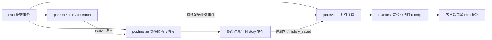

# DBOS SQL / Event Relay 性能专项审计

本轮仅诊断冻结的三 PR 组合及一个公开连接配置实验；不合并 main，不修改
#34–#36，不改变持久化、清算、重试、归档与终态回执语义。所有推理使用原有模拟模型。
性能诊断与正式计时分开，原门槛保持不变。本文在实验完成后给出最终数据与结论。

## 1. 冻结基线与环境

2026-10-29 再次读取远端：main 仍为
`9b479fa4fd4ee412305d81ddba3bf2ecb62b364c`；以下 PR 均 open / Draft / unmerged：

| PR | 冻结 HEAD |
| --- | --- |
| [#34](https://github.com/kkaaakk/public_opinion_research/pull/34) | `ef282a3a25dddc6add6187935dc7e95a726823fe` |
| [#35](https://github.com/kkaaakk/public_opinion_research/pull/35) | `a831f36f656af2a5babce83d6dadd92ef9679b58` |
| [#36](https://github.com/kkaaakk/public_opinion_research/pull/36) | `5ee7e3db72e5eceae99dd2bda2debaaea3167dc7` |

独立 worktree / 分支 `codex/dbos-sql-event-performance`，冻结基线分支
`codex/dbos-sql-event-baseline` 的 commit
`2291002f2d867734d63e75d6d0a28dc53e96676a`，tree
`5c73abc60c69e7b009fe5390c7382d103af11a08`。它在已验收组合
`5705768fb954787fbcef2c5b0a6d11aba3ce5ed5` 上加入最新 #36 的测量修正；
`src/` 与原始组合相同，未包含上轮未推广的清洗缓存候选。116 个生产 Python 文件的
规范化 SHA-256 为 `d16878720c457796908a0b2f0d0a48276252188caf8ee0ff11a5ac3e75c88c9d`。
专项 Draft PR 以此冻结组合为 base，使 diff 只包含本轮工作；这不是三 PR 的合并授权。

使用根 `uv.lock` / Python 3.11.9 / 根 `.venv`，DBOS 3.3.0、SQLAlchemy 2.1.6。
隔离服务沿用上一轮容器与数据卷：PostgreSQL 17.6 / 512MiB、Neo4j 5.26.31 / 1GiB
（heap 256–512MiB / page cache 128MiB），官方 Langfuse 4.70.1 Web / Worker、
ClickHouse、Redis、MinIO。PG / Bolt / Langfuse 仅 loopback 的 35437 / 37692 / 33080。
不读取生产 `.env`；测试账号和项目 API keys 仅按用户此前明确授权从同一隔离 fixture
复用，不输出、不提交。原有其他数据库容器未参与测量。

诊断在这个专用测试 PG 启用 `pg_stat_statements` preload、planning、I/O 和 WAL I/O
计时；没有修改 `fsync=on`、`synchronous_commit=on`、`full_page_writes=on`、
`wal_level=replica`。正式计时关闭额外统计计时，两组配置一致。服务重启仅限本任务 PG。
不重置全局统计；每个单元创建/删除自己的 `por_test_UUID`，通过前后差分测量。

## 2. 测量方法与解释边界

`evaluation/observability/run_sql_diagnostics.py` 是显式 opt-in 的测试入口，
复用同一 `run_benchmark.py` 的 NativeCase / MockTransport / 业务 fixtures。
SQLAlchemy 公开事件测 cursor 执行；公开 Pool / Connection / dialect 方法仅包装计时，
每次仍恰好调用原方法一次。没有修改 DBOS 私有实现、SQL、事务或命令顺序。

记录规范化 SQL 指纹、源码文件/函数名、workflow 上下文、调用量、cursor wall 分布、
可见 rowcount、事务尝试与异常类型/SQLSTATE。绑定参数从不读取或格式化；字符串、
注释、dollar quotes、数值被移除，quoted identifiers 哈希化；不能可靠解析的 SQL
整条 opaque。没有记录 locals、exception message、业务输出或 `pg_stat_activity.query`。
by_run 表示调用时的执行上下文；后台调度和批量状态读取不能强行分摊给目标 Run。

PG 统计以 `(userid, dbid, toplevel, queryid)` 完整键差分，数据库 OID、重置、条目淘汰、
负差分均使该窗口无效。cursor 计时不包含 checkout / commit；
Connection.execute 含 cursor，另报扣除 cursor 的剩余部分，二者不能再次相加。
Pool.connect 含 ping，另报扣除 ping 的剩余部分，后者仍含新建连接/校验/队列，
不能叫作纯池等待。初次 pool 映射前的 checkout 不在这一分项内。

启动/预热不计入测量；第一次实测提交前建立服务端快照并清空客户端探针。
实测阶段与 destroy 排空分别标记，destroy 后立即冻结客户端，再等 1.1s 让 PG 累计
统计发布并取终点快照；后续 EXPLAIN、清理与 drop DB 不混入计数。
客户端/服务端快照并非原子共同边界，dbstats 存在发布滞后；cluster WAL 包含后台活动。
公开 hooks 的首个新连接边界、跨时钟和服务端快照误差均保留为限制。

PG activity / locks 每 0.5s 采一次聚合状态；容器资源与宿主 CIM 约每 5s 采样。
不重新引入 50ms 完整 Run 轮询。正式完成条件仍为 archive receipt 后完整投影确认
completed / settled / saved / events_complete，不能提前结束。
额外 workflow/step 清单读取仅用于诊断，其开销不进入正式计时。

服务端聚合不提供区间内 p50/p95/p99 或可相减的 min/max，本文的 SQL 分位数来自客户端
样本。服务端执行、planning、commit wall、WAL I/O、网络/驱动/Python 等等待存在嵌套
或不同归属，不能相加成单个 Run 的关键路径。
重试次数不能用重复指纹推断；分别列可观察 SQL 失败与持久 Step 记录，未观察到不等于
证明所有底层重试为零。

官方语义依据：[PG pg_stat_statements](https://www.postgresql.org/docs/17/pgstatstatements.html)、
[PG monitoring statistics](https://www.postgresql.org/docs/17/monitoring-stats.html)、
[SQLAlchemy events](https://docs.sqlalchemy.org/en/20/core/events.html)、
[SQLAlchemy pooling](https://docs.sqlalchemy.org/en/21/core/pooling.html)。

## 3. 实际 Event / Stream 依赖

创建 Run 同一事务提交 `por.run`、`por.events`、`por.finalize`。后两者与业务并行，
不是根完成后才启动。业务/SDK 在执行时不断 send 事件；relay 每包执行 recv →
public_event Step（PG 时间戳）→ writeStream → cursor event，状态包还写 phase。
每个持久命令同时需要 DBOS journal 与执行所有权检查。

Finalizer 用 completion_facts / 原生 sleep 等待 native 终态与领域清算，随后发送
settlement、report、usage、run_status、done，保存 Neo4j History，再发送 history_saved。
History 与尾部包的 relay 消费可以重叠；history_saved 到达并不代表终态 manifest 已齐。
relay 必须看到所需类型，写最终 done / cursor / done receipt / history receipt 并关闭
stream 后才完成。基准等待 history receipt，再读取一次完整 Run 投影。

`workflow_status.updated_at` 是 DBOS 记录的状态时间，不能当作客户端收到提交 ACK 的
精确物理时刻；Step start/end 和 Python monotonic markers 分别保留，不能将跨时钟
的小间隔解释为因果倒序。根终态到 relay 终态之差表示交付尾段，不等于全部空等。

## 4. SQL 指纹、调用量及成本

分类分位数使用独立 v2 补采的四并发 ON：4 次实测 /1 次预热，**19,987** 次 cursor 调用。
所有分位数从原始样本重算；没有平均各指纹 p95。以下 wall 均为多线程累计，不能视作单 Run 关键路径。

| SQL 类别 | 次数 | 次数/Run | 累计 wall s | p50/p95/p99/max ms |
| --- | ---: | ---: | ---: | --- |
| dbos_step_journal | 5,865 | 1466.25 | 13.730 | 1.671/5.932/9.840/413.839 |
| dbos_workflow_status | 5,664 | 1416.00 | 20.922 | 2.670/9.244/14.876/413.975 |
| dbos_event | 4,328 | 1082.00 | 16.470 | 2.677/9.444/15.815/419.831 |
| dbos_queue_scheduler | 1,326 | 331.50 | 5.484 | 3.132/10.296/16.741/76.239 |
| application_facts | 1,068 | 267.00 | 5.612 | 4.105/12.205/18.402/273.756 |
| application_timestamp | 937 | 234.25 | 3.927 | 2.950/10.986/17.931/22.954 |
| dbos_stream | 485 | 121.25 | 1.049 | 1.679/4.680/8.085/17.293 |
| other_unclassified | 168 | 42.00 | 2.557 | 3.259/90.117/312.283/346.561 |
| application_control | 102 | 25.50 | 0.570 | 4.853/12.326/14.694/16.297 |
| connection_configuration | 44 | 11.00 | 0.069 | 1.324/2.277/4.036/5.057 |

归类是 SQL/调用源码维度。Finalizer、History 和 Run 投影另按执行上下文分析，
不能与上述类别再次相加。v1 的 12 个四并发 ON Run 平均：relay **3305** 次/Run、
业务工作流 **650.58**、Finalizer **340**；其余 **665.17** 是无 workflow 的 API、
观察器、后台调度上下文，不能强行归给某个目标 Run。relay 占全部 cursor 调用约 **66.62%**。

v2 同一次四并发 ON 的前八个客户端指纹（完整规范化 SQL 在本地原始 JSON）：

| 指纹 | 次数 | wall s | p50/p95/p99/max ms | 已知行数 | SQL失败 |
| --- | ---: | ---: | --- | ---: | ---: |
| `8f00ff84464aed041fb3` | 2,664 | 11.300 | 3.088/9.774/16.906/413.975 | 2,664 | 0 |
| `1f844fc39ad659fa1144` | 2,688 | 7.717 | 2.084/7.891/12.518/39.167 | 2,688 | 0 |
| `ef8259f944bd03cf1194` | 2,640 | 6.030 | 1.623/5.433/8.539/413.839 | 2,640 | 0 |
| `9c3780a9cbc1354b0776` | 2,664 | 5.653 | 1.528/5.596/9.207/45.618 | 0 | 0 |
| `7adbea5617854b4289b0` | 937 | 3.927 | 2.950/10.986/17.931/22.954 | 937 | 0 |
| `b6029240600d116950f3` | 789 | 3.884 | 3.371/9.785/19.212/415.520 | 1,001 | 0 |
| `8b76492470f5d7e014e9` | 583 | 2.749 | 3.631/11.949/16.356/23.353 | 234 | 0 |
| `973e5c1c4782c0e8b2f9` | 477 | 2.410 | 3.274/9.231/15.962/419.831 | 18,314 | 0 |

依序是执行状态检查、owner 行锁、journal INSERT、journal 重放查找、PG 时钟、
workflow 状态批量读取、原生 Event 读取、notification 消费读取。首四类是 DBOS 持久
执行协议；不能简单删除检查或合并 journal 来美化计数。已知 rowcount 均由 cursor
报告；它不是业务记录数，poll/重放查找返回 0 也可以成功。每指纹保留完整 by_run /
by_workflow 与 measurement / drain 分段。

PG 对 `EXTRACT(epoch FROM ...)` 的常量规范化与客户端模板不同，故服务端指纹不必
等于客户端指纹；只有同一标准化文本才直接匹配，不将未匹配者当作服务端耗时 0。
server delta 排名另外保存 userid/dbid/toplevel/queryid。v2 四并发 ON 的服务端语句
执行累计 **3.520s**、planning **0.512s**，不是 cursor wall 的互斥组成。

- off：cursor 20,650，PG exec 943.558ms /plan 306.472ms；客户端事务尝试 {'commit_attempt': 8989, 'rollback_attempt': 952}。
- healthy：cursor 20,658，PG exec 844.577ms /plan 382.851ms；客户端事务尝试 {'commit_attempt': 8962, 'rollback_attempt': 980}。
- concurrent_off：cursor 20,120，PG exec 4344.763ms /plan 498.382ms；客户端事务尝试 {'commit_attempt': 8523, 'rollback_attempt': 1072}。
- concurrent：cursor 19,987，PG exec 3519.728ms /plan 511.754ms；客户端事务尝试 {'commit_attempt': 8428, 'rollback_attempt': 1107}。

同一事务可能包含状态、Event、journal 多类语句，不能唯一归给一种 SQL 类；事务按
Run/调用上下文另计。commit/rollback hook 是尝试，do_rollback 包含池归还时的 no-op；
PG xact_commit/xact_rollback 是另一服务端统计口径。正常只读连接退出也会 rollback，
不把它当 SQL 失败。所有这些健康诊断的 cursor/方法边界可观察失败为 0，未发重试授权；
底层重试次数未独立测量，不能用重复指纹推断。

三轮 v1 四并发 ON 的公开方法计时（共 12 Run）：

| 边界 | n | 累计 s | p50/p95/p99/max ms |
| --- | ---: | ---: | --- |
| do_ping | 27,903 | 61.701 | 1.554/5.396/9.667/467.006 |
| pool_connect_inclusive | 28,100 | 66.743 | 1.598/5.761/13.402/467.031 |
| pool_connect_excluding_ping | 28,100 | 5.042 | 0.032/0.058/0.259/43.043 |
| connection_execute_inclusive | 59,529 | 200.781 | 2.411/8.121/13.627/478.934 |
| execute_excluding_cursor | 59,529 | 14.739 | 0.201/0.414/0.662/447.288 |
| do_commit | 24,890 | 139.538 | 1.877/9.113/82.329/1137.216 |
| do_rollback | 28,100 | 6.789 | 0.007/1.595/4.458/63.832 |

pool 扣除 ping 后累计仅 **5.042s**，p95 **0.058ms**；尚包含连接建立/校验，
不能认作纯排队。首次新池 checkout 可能漏记，不能据此证明池等待严格为零；
现有证据不支持扩大 pool。commit wall 包含 WAL/协议/调度等待，峰值 **1.137s**；
PG statement exec 统计不能代替事务 ACK latency。

v2 在完全属于本 runner、已静止的测试 DB 上做只读 `EXPLAIN (ANALYZE, BUFFERS, WAL)`：
workflow_status PK、operation_outputs PK（真实 function_id=1）、stream MAX(offset)、
application request PK 均使用现有索引/索引扫描。计划和实际行数保留，未在共享业务库
执行、未对写入/锁语句做有副作用的 ANALYZE。静止时的计划只能排查明显缺索引，
不能解释并发提交/通知锁等待。

无法准确拆分的部分：网络 RTT、psycopg 序列化/延迟 fetch/解码、Python GIL/线程/
事件循环与锁等待仍未互斥测量。不能把 cursor 减 server exec 的差额全部叫网络。
execute 扣 cursor 含编译及本诊断器开销，不能叫纯序列化。

## 5. Tracing ON/OFF 因果对照与资源

v1 计划 seed `20261029`：3 个随机平衡块 × 原始/公开配置实验 ×串行 OFF / ON /
四并发 OFF / ON，共 24 新进程、96 个实测 Run、24 次预热。同一时刻仅一个负载。
以下每格 12 Run，所有延迟含诊断探针与额外 workflow/step 观察查询，**不是正式 gate**。

| 版本/场景 | Run p95 s | CPU s/Run | SQL次/Run | cursor累计 s/Run | PG exec/plan ms/Run |
| --- | ---: | ---: | ---: | ---: | --- |
| baseline/concurrent | 25.117 | 6.040 | 4960.75 | 15.503 | 336.99/126.40 |
| baseline/concurrent_off | 23.890 | 5.267 | 4850.83 | 13.103 | 318.50/100.00 |
| baseline/healthy | 15.027 | 5.710 | 5125.33 | 7.187 | 225.60/81.01 |
| baseline/off | 14.362 | 5.000 | 5137.33 | 6.565 | 205.75/78.37 |
| experiment/concurrent | 26.185 | 5.585 | 4953.67 | 16.997 | 516.23/125.25 |
| experiment/concurrent_off | 18.867 | 4.763 | 4792.83 | 13.975 | 303.83/95.31 |
| experiment/healthy | 15.746 | 6.016 | 5225.83 | 8.137 | 230.05/85.51 |
| experiment/off | 12.397 | 4.634 | 5086.08 | 6.738 | 205.18/77.81 |

原始四并发 ON/OFF：p95 差 **5.14%**，CPU/Run **14.68%**，SQL次数/Run **2.27%**。
四并发 ON 相对串行 ON 的 SQL 次数/Run 放大比仅 **0.9679**，
并非 4 倍。串行 4 Run 的总墙钟更长，后台轮询摊销不同；每个 relay 的业务包与持久命令
结构相同。Tracing 没有直接新增 SQL 类别，轮询/调度计数随执行时长变化，不能把全部
SQL 算作 Tracing。CPU 差含官方插桩、metadata-only ACK/关键 Span 验证及共享资源竞争，
未把它完全归给某个 callback。

三轮原始四并发 ON 的根终态→relay 终态 p50/p95/max 为 **13.465/14.337/14.472s**；
根→Finalizer p95 **2.588s**，History.save p95/max **49.911/51.613ms**；
History.save 返回→archive receipt p95 **13.408s**，receipt→完整投影 p95 **110.991ms**。
所以这轮长尾主要仍在原生交付链路，而非 Neo4j 保存或最后一次客户端投影。
同样尾段在 OFF 存在（p95 **12.710s**），不能称为追踪专属延迟。

每 Run relay 记录 120 recv、120 内部 sleep journal、121 public_event、121 writeStream、
128 setEvent、1 closeStream，共611项原生命令。内部 sleep 条目不代表每包固定睡1秒。
Finalizer 同时在业务期间读取完整投影；v1 四并发 ON 共138次 full projection（包括
API初次、最终读与 Finalizer），其调用 wall p95 **424.668ms**。这是生产/测试观察器
不同上下文的总量；额外诊断清单读取发生在 visible marker 后，仅污染诊断 elapsed，
未进入正式脚本。保留 archive+manifest 完成条件，未提前返回。

四并发 ON 的粗粒度 PG backend-sample 计数中有 WalSync 45、WALWrite 121、
advisory 3、object lock 27；这些是“backend×采样点”计数，不是等待总秒数或独立故障数。
多数连接是 ClientRead，表示服务端在等客户端，不能证明网络饱和。

补充 metadata-only observer 在 **v2 concurrent_off 实测窗口** 确认 object / database=0 /
classid=1262(pg_database) / objid=0 / objsubid=0 / AccessExclusiveLock，3个持有、
2个未授予的 backend-sample。此锁匹配 [PG17.6 PreCommit_Notify](https://github.com/postgres/postgres/blob/REL_17_6/src/backend/commands/async.c#L852)
的提交串行化锁，并持有到 commit/abort。因而原生通知提交竞争是已观察到的固有路径；
抽样不足以给出其占整个尾段的精确百分比。未修改 NOTIFY、DBOS SQL 或持久化级别。

v1 原始四并发 ON 的容器 CPU 样本中位/max：PG **32.92/40.64%**、Neo4j
**0.62/37.90%**、LF Web **1.58/33.79%**、Worker **2.50/16.88%**、ClickHouse
**17.37/57.21%**；宿主 **42/76%**，磁盘字节率中位约 **47.23MB/s**。
Docker 是按核百分比，CIM 是宿主百分比，不能混成一张 CPU 份额图。样本稀疏、含后台
活动，Windows/Docker IO 明显波动；没有逐包网络或存储设备 fsync tail 的独立测量。
v1 资源结束标签先于在途 CIM 返回的边界问题已修，v2 使用完整 bracket，四并发 ON
保留并剔除了1个越界资源点；上述 v1 资源仅作环境背景，不用于精确阶段归因。

v1 初版 probe 仍有后经 review 修复的通用 SQL lexical、freeze/reset 边界缺陷。
固定负载使用参数化模板；77个已保存规范化模板在新 lexer 中重算不变（不冒称重解析
了未保存的原 SQL）。v2 补采原始分类样本、原子 freeze、WAL reset 元数据；
最终差分函数复算28个原始窗口，calls/plans/plan time/exec time/rows总量全部一致，
未发现实际 planning-only 被遗漏的行。v1 未采 WAL reset，仍不能事后证明该字段稳定。
所有失败用例和方法源副本保留，正式计时完全不安装这些诊断探针。

## 6. 最小候选与推广判定

唯一实测配置实验：通过公开 `db_engine_kwargs.pool_pre_ping=False` 只关闭 benchmark
executor 原生 DBOS engine 的 checkout ping，领域 facts / API engine 仍保持 ping。
生产配置暂未变更。SQLAlchemy 2.1.6 psycopg 的 ping 使用 `;` 空查询，不出现在
pg_stat_statements 的常规语句排名中；不能因此把它当作零成本。

关闭 ping 将失效连接的发现从 checkout 移至首条实际命令。即使健康实验更快，也不能
直接宣称故障行为等价；需要 stale idle / PG restart / 多旧连接 / 外部效果后 journal
或 ACK 断连 / archive 与 retry generation 的专项验证，才能考虑生产推广。

## 7. 正式性能回归

保留原门槛：串行 p95 ≤ OFF × 1.25 + 100ms；四并发 p95 ≤ 健康串行 p95 × 2；
额外 RSS ≤256MiB；健康队列 drop=0；关键 Span / Usage / 服务端完整；shutdown≤3.5s；
隐私出口通过。正式计时不安装 SQL/资源/时间线探针。

## 8. 正确性、隐私与独立 Review

新增回归覆盖 SQL lexical 组合、未知 quoting fail-closed、PG17 数值形式、Unicode
dollar tags、poison bind parameters、异常不输出消息、完整 PG 统计键/重置/淘汰、
探针冻结与 hook 恢复。独立 review 暴露的初版 redaction 和统计窗口问题均保留失败
记录，修复后再验证；不将初次失败算通过。

## 9. 原始证据与复现

原始诊断、正式计时、日志和历史候选保留在各 worktree 的 ignored `.tmp/`，不将本地
输出/凭据/数据库提交 Git。最终索引记录文件名、SHA-256、方法版本及成功/失败状态。

## 10. 结论与三 PR 后续建议

最终结论等待正式计时与 review；本轮无 main 合并或生产部署。
