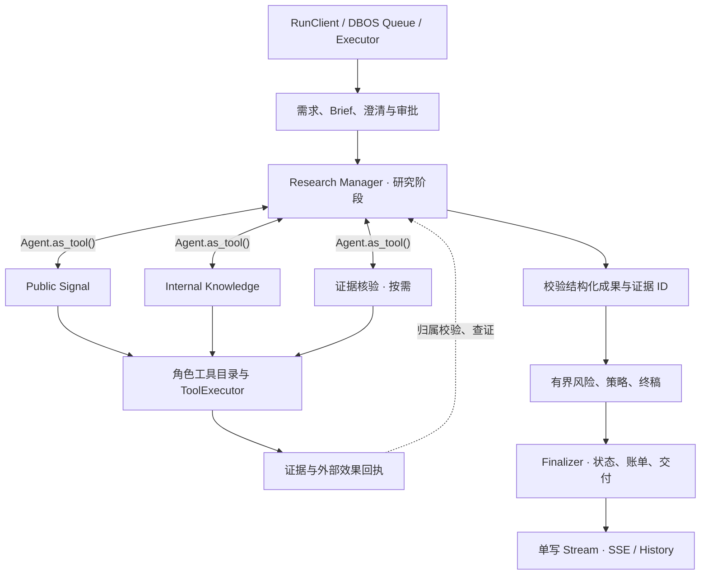

# POR Manager Agent 可行性验证

2026-11-27，Asia/Shanghai

**建议继续评估方案 A，暂不切换生产。** 锁定的 SDK 能接手 Manager 的选角、并行调度、补研、历史隔离和本轮 Usage 汇总。阶段级 DBOS 检查点保留了终稿入口和业务恢复边界。进程若死在阶段内部，恢复需重跑 Manager；能否接受重跑成本，取决于业务证据复用率和安全准入。方案 B 能复用已提交的角色 Workflow，但保留了额外编排。方案 C 在并行嵌套时有可复现的错误和结果串换，排除作为正式候选。

## 基线和验证范围

核对远端引用、PR 状态、提交记录和本地 Worktree。PR #72 为开放 Draft，head 为 `codex/frontend-rebuild@b7a2a1b7545763a1d273b1fa2eef55a069d602d6`，base 为 `main`，有 10 个提交。PR #73 为开放 Draft，head 为 `codex/mcp-actor-tools@a104e626e737c1295e248c832f6b0bfd8c788ff3`，base 为 #72 的分支。Git 祖先检查确认 #73 在 #72 上多一个提交。实验从远端核实的 #73 SHA 创建 `codex/manager-agent-poc`，PR base 采用 `codex/mcp-actor-tools`。 [PR #72](https://github.com/kkaaakk/public_opinion_research/pull/72) · [PR #73](https://github.com/kkaaakk/public_opinion_research/pull/73) · [基线](https://github.com/kkaaakk/public_opinion_research/commit/a104e626e737c1295e248c832f6b0bfd8c788ff3)

| 检查 | 环境与结果 |
| --- | --- |
| SDK Mock | 根锁 `openai-agents 0.24.0`、`openai 3.31.0`，20 项通过 |
| 独立安装 | Python 3.11.9，SDK Mock 20 项通过，演示输出 12 次调用。阶段结果复用和命名 Provider 回放 2 个 PostgreSQL 用例通过。 |
| 稳定版对照 | 独立 Python 环境 `openai-agents 0.26.0`，相同 SDK Mock 20 项通过 |
| PostgreSQL 恢复 | 根锁 `dbos 3.3.0` 和 `dbos-openai-agents 0.3.0`，Docker PostgreSQL 17.6，12 项通过 |
| 实验代码质量 | Ruff E/F/I、格式检查、Python 编译和 Git diff 检查 |

SDK 用例用官方 `ScriptedModel`、Mock Tool 或进程内 HTTP transport，计数点在实际进入模拟模型时。PostgreSQL 用例经 DBOS Queue 启动 Executor，等待确定的提交窗口，强杀该进程后另起同版本 Executor。原生 journal、工作流状态、预算、证据与回执均写入隔离库。采集端的副作用由独立事务模拟，允许重复副作用，以便测试确实能捕获重复。 [复现命令](../../experiments/manager_agent/README.md) · [SDK 实验](../../experiments/manager_agent/tests/test_sdk_manager.py) · [恢复实验](../../experiments/manager_agent/tests/test_postgres_recovery.py)

## 现状与候选架构

现行版本 `por-resume-v1` 在 `por.run` 锁定获批 Brief，由 `por.research` 调度两个 `por.role` 子 Workflow。归并角色结果后，以 bounded SDK Step 执行 Review，再根据缺口发起下一轮。Risk、Strategy、终稿同样走有界模型调用。专业角色已经由 SDK 管循环，`DBOSRunner`、`SDKContextHarness` 和 `ToolExecutor` 负责步骤检查点、输入压缩、用量和工具效果。工作流状态和恢复权限分别由 DBOS 与 Finalizer 控制。 [工作流源码](../../src/open_deep_research/workflow/dbos_workflow.py) · [角色 Runtime](../../src/open_deep_research/runtime/sdk_runtime.py) · [部署与历史](../architecture/dbos-deployment.md)

Manager 根据 Brief 和已知证据提出任务、决定补研与停止，返回摘要、覆盖情况、证据 ID 和未解决问题。应用校验实际存在的证据、Run 归属、权限和最低覆盖条件。POC 第三个专业 Agent 用于可重复的证据核验。若核验只需一次有界判定，可做 bounded Step。风险评估与应对策略沿用明确输入、一次生成和结构校验，当前没有证据证明两者需要自主循环。 [现行分析函数](../../src/open_deep_research/workflow/research.py) · [POC 装配](../../experiments/manager_agent/manager.py)

## SDK 原生调度与版本兼容性

| 归类 | 能力与证据 |
| --- | --- |
| 0.24.0 原生 | `as_tool`、Pydantic 参数、`input_builder`、`output_type`、`custom_output_extractor`、同轮并行、同一角色再次调用、`max_turns`、子运行事件均已验证。还支持用于按 Context 选择工具的 `is_enabled`。 [Agent.as_tool 源码](https://github.com/openai/openai-agents-python/blob/v0.24.0/src/agents/agent.py#L606-L788) |
| 0.24.0 原生 | `Usage`、请求级条目、共享应用 Context、模型过滤、Session、从已捕获的 RunState 暂停点继续。 [Usage](https://github.com/openai/openai-agents-python/blob/v0.24.0/docs/usage.md) · [人工审批与恢复](https://github.com/openai/openai-agents-python/blob/v0.24.0/docs/human_in_the_loop.md) |
| 升级后原生增强 | 0.25 增强带输出 guardrail 的嵌套审批恢复、更新 RunState schema 至 1.22，并改进失败或不完整 Responses 的供应商用量保留。0.26 延续该快照 schema，另处理输入 guardrail 拒绝后的排队工具。稳定版已跑同一 SDK 套件，发布说明中的新增分支未逐项实测。当前场景无需为了 Manager 基础能力升级。 [0.25.0](https://github.com/openai/openai-agents-python/releases/tag/v0.25.0) · [0.26.0](https://github.com/openai/openai-agents-python/releases/tag/v0.26.0) |
| 应用实现 | 跨进程预算、最终报告预留、Run 归属与权限、证据引用校验、效果核对、失败授权、SSE 交付。 [当前业务可靠性](../architecture/agent-loop.md#可靠性设计) |
| 官方能力存在，当前 POR 不选用 | Handoff 会移交控制及历史。共享子 Session 会混合专业历史。Responses 压缩受模型和协议限制。直接接管 MCP 工具声明会改变现有授权、效果保护和账本入口。 [Agent.as_tool 与 handoff](https://github.com/openai/openai-agents-python/blob/v0.24.0/src/agents/agent.py#L629-L666) · [工具恢复与插件](tool-execution-recovery.md#5-mcp-与插件) |

原型的 Manager 首轮发出 Public 和 Knowledge 两个同轮工具调用，两者在各自模型入口通过屏障证实重叠。Manager 根据首批结果的 `gap` 字段选择再次调用 Public，或直接调用 Analysis。三个专业 Agent 只看到自己的业务工具。测试让 Public 请求内部工具，SDK 在提供给该角色的工具集合中拒绝它，业务函数没有执行。SDK 先验证 `parameters`，再把归一化数据交给 `input_builder`。专业结果经 Pydantic 验证，由 extractor 明确投影成小 JSON。无补研 9 次调用，有补研 12 次，其中 Manager 3 或 4 次。 [调度与权限断言](../../experiments/manager_agent/tests/test_sdk_manager.py) · [工具执行源码](https://github.com/openai/openai-agents-python/blob/v0.24.0/src/agents/run_internal/tool_execution.py#L1548-L1722)

未指定子工具 `run_config` 时继承父配置，包括模型输入过滤和全局 model settings。显式子配置取代这一继承。Manager 的 `RunHooks` 在 Manager 运行生效，子运行需用 `as_tool(hooks=...)` 显式装配。默认嵌套模型异常生成通用工具错误，Manager 会继续。禁用 formatter 后，该错误中止父运行，普通 Python 异常经 `UserError.__cause__` 保留，`AgentsException` 可原样传播。已验证预算耗尽、未知工具效果、`MaxTurnsExceeded` 和 `CancelledError`，以及真实 DBOS 取消抢占研究 Step。POR 应在业务工具和子 Agent 工具两层传播控制失败，只将明确可恢复的失败写成结构化结果。在 DBOS 边界把控制失败映射为稳定、可序列化的错误，保留因果链供本地诊断。 [嵌套 Runner 调用](https://github.com/openai/openai-agents-python/blob/v0.24.0/src/agents/agent.py#L921-L1125) · [错误包装源码](https://github.com/openai/openai-agents-python/blob/v0.24.0/src/agents/run_internal/tool_execution.py#L1828-L1862)

一个 Manager 调用 ID 标识对子 Agent 的委派。子运行可通过 `agent_tool_invocation` 和 `on_stream` 关联该 ID。父流只看见自身的 SDK 项和投影后的子工具结果。配置子 `on_stream` 会切换该子运行到流式 Model 路径。实验验证流式子事件及最小公开投影，含 `agent_started`、角色和父调用 ID。正式设计可用显式装配的 Hooks 发布脱敏生命周期，关联 `run_id`、阶段尝试、角色、父调用 ID 及本地工具 ID，由现有 `por.events` 负责排序、游标和终态。同一阶段重跑应显示为新的尝试，游标继续由 DBOS Stream 决定。子事件 callback 的异步投递适合观察，终态和账单来自业务收据。 [SDK 流事件与回调](https://github.com/openai/openai-agents-python/blob/v0.24.0/src/agents/agent.py#L928-L1040) · [POR SSE 入口](../../src/open_deep_research/web/runs.py)

## 预算最简设计

固定每次成功调用返回 11 input、3 output、14 total。含补研共 12 requests、168 tokens、12 个请求条目。并行和再次调用都准确累计。各运行有独立 wrapper，`context` 和 `Usage` 对象共享。模型失败或取消前已累加的用量仍可观察，失败或中断请求可能只有开始记录。子运行达到 `max_turns` 时已完成的调用仍在用量中，Manager 自己的轮数仍按自身计数。`ModelSettings.max_tokens` 约束单请求输出，`parallel_tool_calls` 影响模型协议，SDK 运行时处理已发出的同轮工具。 [Usage 实现](https://github.com/openai/openai-agents-python/blob/v0.24.0/src/agents/usage.py#L196-L314) · [模型用量累加](https://github.com/openai/openai-agents-python/blob/v0.24.0/src/agents/run_internal/run_loop.py#L2960-L3067) · [实测](../../experiments/manager_agent/tests/test_sdk_manager.py)

`on_llm_start` 可以拒绝逻辑模型回合。一次 SDK retry 的离线用例观察到 **1 次 Hook、2 次 Model 调用**，SDK 将失败尝试以 0 Token 条目附在成功 Usage 中。请求已经发出时，0 Token 不能证明供应商没有收费。全局物理准入应在 Model 包装器内，管理厂商 HTTP 重试，每个真实尝试获取新准入。PostgreSQL 样例在行锁下统计已有准入与未结算记录，原子保留报告额度。进程重启仍计算已发生和未结算的记录。 [SDK 重试与 Usage](https://github.com/openai/openai-agents-python/blob/v0.24.0/src/agents/run_internal/model_retry.py#L338-L350) · [现有预算源码](../../src/open_deep_research/budget.py) · [实验账本](../../experiments/manager_agent/postgres_lab.py)

| 职责 | 建议 |
| --- | --- |
| SDK Usage | 作为本次 SDK 执行内的诊断统计和成本明细线索。可替代角色私有的 SDK 成功用量累加。请求明细为计数，角色归属与持久化 attempt ID 由模型入口记录。 |
| BudgetManager | 复用 `budget.py` 现有事务准入，统一 Run 的模型次数、Token 保守占用、工具与搜索额度、最终报告预留和降级策略。可将 `_RunBudget`、角色投影与局部预检收敛为读模型或删除重复估算，按入口逐步验证。 |
| MeteredModel | 让 Manager、专业 Agent、bounded 生成和必要压缩共用一个物理调用入口。调用前插入尝试、返回后写供应商用量，取消或超时时保留未结算状态或按已知事实结算。合并重复的模型准入路径，保留完成状态与取消处理。 |
| ToolExecutor | 保留业务域校验、工具与搜索准入、effects、Operation 和取消清算。并发额度检查与实际调用记录使用事务。 |
| 持久化账单 | `model_attempts` 与 `tool_calls` 是历史用量来源。原生 Step 重放、SDK snapshot 恢复和 Usage 投影只读已有账目。阶段重跑时新发出的物理请求记新 attempt。 |

Chat Completions HTTP fixture 复现了 DeepSeek 的通用 Token 字段、扩展缓存字段及缺失 Usage 三种形态。通用字段进入 SDK 汇总，标准 details 可入 SDK，DeepSeek 的 `prompt_cache_hit_tokens` 出现在 `preserve_raw_usage` 快照中，与标准 details 分开。省略 Usage 时 SDK 仍记录 1 request、0 Token、0 个明细条目，应持久化为用量未知。保留 POR 的 provider completion 采集、缺失字段策略和账单对账。真实 DeepSeek 严格 JSON schema、并行工具、流式最后一帧用量和实际计费尚待授权验证。 [DeepSeek Chat Completions](https://api-docs.deepseek.com/api/create-chat-completion) · [锁定版适配器源码](https://github.com/openai/openai-agents-python/blob/v0.24.0/src/agents/models/openai_chatcompletions.py#L288-L389) · [POR SDK Model](../../src/open_deep_research/models/sdk.py) · [协议测试](../../experiments/manager_agent/tests/test_provider_protocol.py)

## 上下文最简设计

| 层 | 实测与建议 |
| --- | --- |
| SDK 运行历史 | 子运行读自己生成的工具调用和结果。Manager 只收到显式投影及自己发出的参数。第二次调用同一角色从新的结构化输入进入，实验靠证据 ID 延续任务。保留调用/返回配对，给每角色设输入输出限额。 |
| Python 共享 Context | 各 wrapper 指向同一业务对象，可读取 Run ID、冻结配置、预算与证据服务。工具权限仍由角色注册与运行时校验决定。锁住共享写入或通过幂等业务服务写入。为每次委派记录调用 ID。 |
| Session | 须显式传入，父 Session 不自动进入子运行。给并行子 Agent 同一个 SQLiteSession 时，它们会从相同前缀起步，随后写出混合历史，下一个运行能读取两者内容。新研究默认无子 Session。确有跨调用会话需求时，按角色和逻辑任务隔离并串行写入同一 Session。 |
| 过滤与压缩 | `session_input_callback` 合并本次新输入和 Session 历史，可从本次输入排除旧历史，同时保留已写入记录。`call_model_input_filter` 对每次即将发给模型的输入生效，实验中保留历史原文。优先裁剪工具输出、引用证据 ID、限定成对历史及简单窗口，再为超长输入启用有界摘要。 |
| 持久化业务 State | 保留获批 Brief、阶段结果、证据引用、已审核报告和业务账本。用已有 State/历史查询投影支持 API 和 UI。抓取全文留在业务证据所有者处，按权限加载并限制大小。 |

原型以 JSON 跨越嵌套审批暂停点。0.24.0 的 `RunState.to_json()` 保存可序列化快照。用同等 Agent 定义、从恢复后的 state 取待批项并执行批准或拒绝，两层已完成的模型回合均未重放，Usage 从 2 增至 4，工具仅在批准时运行。SDK 支持捕获已知的流式 `after_turn` 状态。进程被强杀时，如未写入合适快照，RunState 无从提供恢复；已写快照还需匹配工具定义、可信存储、重建 Python 服务和核对独立的外部效果。POR 继续使用 DBOS 承担归属、失败授权及阶段恢复。 [版本化 RunState 源码](https://github.com/openai/openai-agents-python/blob/v0.24.0/src/agents/run_state.py#L2423-L2466) · [流式取消](https://github.com/openai/openai-agents-python/blob/v0.24.0/src/agents/result.py#L941-L976) · [上下文测试](../../experiments/manager_agent/tests/test_sdk_context.py)

`OpenAIResponsesCompactionSession` 实际向 `/responses/compact` 发请求，Mock transport 验证了压缩项替换和用量。构造器拒绝 `deepseek-chat`，Chat Completions 模型响应也没有自动压缩所需的 Responses ID。Responses API 的 `context_management` 同样依赖协议。SDK 内建 Responses 压缩可用于符合条件的 OpenAI 路径。POR 的 DeepSeek 路径仍需有界输入过滤，长上下文摘要在质量数据支持时保留。可将 `SDKContextHarness` 拆减到轮次裁剪、观察投影及退出 drain 等实际职责。应用证据和角色结果替代跨角色传输的长报告与原始工具文本。 [Compaction 源码](https://github.com/openai/openai-agents-python/blob/v0.24.0/src/agents/memory/openai_responses_compaction_session.py#L73-L156) · [Session 压缩触发](https://github.com/openai/openai-agents-python/blob/v0.24.0/src/agents/run_internal/session_persistence.py#L713-L769) · [现行 Harness](../../src/open_deep_research/runtime/sdk_context.py)

## DBOS 适配实测

以**实际安装的** `dbos-openai-agents 0.3.0` 为准。wheel 中 `runner.py` 的 SHA-256 为 `af3e9f7ce20bdf14b463ad2e8f3dcaaccf7514027f83cbe53e4128468c0e0ae4`。可定位 `Turnstile` L25、`_State` L48、`_model_call_step` L60、`DBOSModelProvider` L73、`DBOSModelWrapper` L85、`_create_tool_wrapper` L118、`_wrap_agent` L136、`DBOSRunner` L186。DBOS 的嵌套 Step 依据安装版 `dbos/_core.py:2523–2551`，只有当前 context 为 Workflow 时才进入持久化分支。 [DBOSRunner 0.3.0 发布包](https://pypi.org/project/dbos-openai-agents/0.3.0/) · [DBOS 3.3.0 发布包](https://pypi.org/project/dbos/3.3.0/) · [DBOS Steps](https://docs.dbos.dev/python/tutorials/step-tutorial)

### A 外层 Workflow 与研究阶段 Step

| 强杀或取消窗口 | 实测 |
| --- | --- |
| 研究 Step 已提交，报告未开始 | 复用研究结果，只新增一次报告模型调用。研究 9 次，报告 1 次。 |
| 已保存证据，研究 Step 未提交 | 两个角色的已保存证据复用，Manager 从研究阶段入口重新执行 9 次模型调用。已有 5 次模型准入保持原状，其中 1 条尚未结算。重跑后再消耗 1 次报告额度。模拟供应商只有 1 次副作用。 |
| 外部引用已写，证据尚未保存 | 按引用执行一次只读查询补证据。模拟供应商只有 1 次副作用。 |
| 供应商提交后强杀，引用未知 | 重启预检返回 `UnknownEffect`。与强杀前相比，模型账本行不增加，外部效果只有 1 次，报告 Step 未进入。 |
| 中途强杀且预算上限为 10 | 账本跨进程继续限制研究，达到 9 个准入后失败。测试另行验证 1 次预留报告准入。失败的研究不会自动生成报告。 |
| 取消正在研究的 Workflow | 原生状态为 `CANCELLED`，目标子模型收到取消，报告未开始。 |

在研究 Step 中调用被 `@DBOS.step` 装饰的 probe，其函数体内联运行，没有独立 journal。阶段重跑时 probe 再次执行。生产若采用 A，`ToolExecutor` 应从同一受控执行逻辑提供阶段内入口，保留权限、事务准入和回执，避开依赖 `por.agent_tool` 提交顺序和内部 Step ID 的逻辑。明确模型物理 attempt 身份和账本，证据以 Run、获批 Brief 版本及业务任务键绑定。对于受保护的操作，在产生新效果前检查全 Run 未决回执，已确认的外部引用只查询。无法证明未发起或结果未知时转人工核对。POC 的固定采集键只证明这组受控输入能复用，生产需校验归属、输入规范化和工具版本。保留已有预算中的未结算占用和重复请求警告。用户主动重试仍由 Finalizer 根据当前失败代次、原生状态和受保护回执授权。 [A 实现](../../experiments/manager_agent/dbos_worker.py) · [工具执行恢复](tool-execution-recovery.md#4-恢复规则)

### B 子 Agent 独立 Workflow

普通 FunctionTool 启动固定 ID 的子 Workflow，子 Workflow 内由 DBOSRunner 跑专业 Agent。强杀父进程前子 Workflow 已提交，重启直接读取原结果与 1 次角色 Usage。父 Manager 一共发生 3 次物理调用，恢复后的 SDK 运行含 2 次调用。当前 `por.role` 的角色绑定、工具回执与 journal 可复用，仍需为任务派发定义稳定身份并显式传递参数、必要上下文和角色结果。父子没有共享 Python 对象、SDK Usage 或 Hooks。父调度若受模型影响，重启变更任务时需另管任务与回执关联。只有硬性要求跨进程复用每个专业任务时才考虑此取舍，此时应先与现有 Workflow 编排比较。 [B 实现](../../experiments/manager_agent/dbos_variants.py) · [现行 por.role](../../src/open_deep_research/workflow/dbos_workflow.py)

### C 原生 as_tool 组合 DBOSRunner

| 检查 | 实测与结论 |
| --- | --- |
| Provider 与闭包 | DBOSRunner 替换入口 `RunConfig.model_provider`，包装入口和 handoff，`as_tool` 闭包仍执行原子 Agent。显式子 Model 走普通 SDK 入口，父模型第一步可复用，子模型在重启时再次执行。字符串子模型继承 DBOS provider，会生成并复用子模型 Step。测试替换 `MultiProvider` 返回的模型，验证的 runner、wrapper 与 journal 均为实际安装版本。 |
| 配置绕过 | 子工具显式 `run_config` 会改变继承链。锁定 SDK 模型选择按 `RunConfig.model`、`Agent.model` 的 Model 实例优先级取值，显式实例可能绕过 provider。 [模型选择源码](https://github.com/openai/openai-agents-python/blob/v0.24.0/src/agents/run_internal/turn_preparation.py#L134-L143) |
| Turnstile | 让父兄弟工具等待第一子模型响应。子响应替换共享 Turnstile，父兄弟读取新表时出现缺失的 `knowledge-call`，研究终止。 |
| 模型和工具 Step 身份 | 分别令两个嵌套任务在重启前后交换同名 Step 的抵达顺序。两例均返回 `knowledge-call=public evidence; public-call=knowledge evidence`。Step 函数体各只执行一次，错配来自 journal。单靠同名 Step 和位置不能保证并发角色身份。 |
| Hook 与预算 | 父 Hook 在原执行和恢复时各触发 2 次，物理父模型一共只执行 2 次。命名子 Hook 执行 2 次，物理子模型仅 1 次。显式子模型实际 2 次。准入放在真实物理 Model 入口才能在此重放路径避免重复扣减。 |
| SDK RunState | 可保存受控暂停点和使用量，未覆盖上述 DBOS 命令顺序、模型与工具效果身份，以及强杀后的未知状态。 |

当前 POR 的 DBOSRunner 在独立角色 Workflow 内工作。C 反例说明将并行子 Agent 放进同一个 Runner 并共享按位置分配的 Step 的风险。该实验止于最小反例。修复这条路径需对子 Run 分区调度状态、稳定命令身份并重测效果窗口，预期会抵消简化收益。 [C 实现](../../experiments/manager_agent/dbos_variants.py) · [C 断言](../../experiments/manager_agent/tests/test_postgres_recovery.py)

## ADR 与模块取舍

**状态为 Proposed，等待人工评估。** 选择 A 进入离线影子评估。研究阶段原生 SDK 支持动态调度，换取较粗的恢复粒度。若阶段重跑的实际成本超出业务容忍度，保留现行角色 Workflow。B 可作为有确定任务清单的局部候选。C 需要先解决已复现的正确性问题。

| 模块 | 正式候选的变更范围 |
| --- | --- |
| 保留 | RunClient、Queue、Executor、审批与澄清、DBOS 终态、Finalizer 的重试许可、报告生成、State 最小投影、RAG、插件声明、MCP transport、业务工具注册与角色 Prompt。 |
| 简化 | `SDKAgentRuntime` 收敛为组装和启动。研究阶段的 `SDKContextHarness` 使用共享 Context、显式 Hooks、剪裁和必要 drain。用一个物理模型入口结算账目，合并 budget 的角色私有累计与重复投影。 |
| 可删除 | 新版本完成验收和排空后，删除研究分支的确定性 Review 补研循环、逐角色模型与 Context 的 journal glue、供角色报告生成的历史转换，以及与已保留权威数据重复的聚合。运行时留用的 Token 窗口和工具结算按测量决定。 |
| 新增 | Manager Prompt、子任务与证据协议、小型研究阶段与安全错误映射、以业务任务为键的证据引用与验证、父子调用的公开事件投影。 |

基线 `sdk_runtime.py` 364 行、`sdk_context.py` 889 行、`budget.py` 931 行、`tool_executor.py` 593 行、`dbos_workflow.py` 1,032 行，均为物理行数，包含应保留的职责。A 预计减少每角色模型与 Context 检查点、预算 delta 拼接和恢复分支，增加可验证的效果身份与证据复用合同。阶段级失败的重跑、回执对账和覆盖验证仍有运维成本。没有生产 diff 可给出净减行数，POC 的 9/12 次调用也无法推断整体成本下降。建议用同 Brief 对照记录质量、各类调用次数、实际费用、并行延迟、恢复后的重复调用与人工核对。 [现行恢复机制](../architecture/dbos-deployment.md#故障恢复和用户重试)

## 工具、RAG、前端与迁移顺序

- ToolManager 继续发现和绑定每个角色的合法工具，ToolExecutor 每次调用仍核实权限与效果。保留 RAG 查询和索引所有权、Apify MCP 与插件 Skills 组装。按证据 ID 优先引用后再查全文会改变上下文和检索调用模式。正式改动前用 `dataset-v1` 检查评估指纹与基线，比较召回、排序、引用完整性、费用与延迟。 [Tools 架构](../architecture/tools.md) · [RAG 评估要求](../../.agents/skills/rag-evaluation/SKILL.md)
- Web 保留 Run API、Brief、历史和 SSE offset。Studio 的固定角色轮次假设需要实测，给动态委派显示角色、父调用、尝试和降级状态。历史旧 Run 仍由版本匹配的结果与业务事实展示。终态只由 Finalizer 和 relay 交付。 [Studio 协议](../architecture/agent-execution-studio.md)
- 先冻结结构化任务/证据合同与基线跑分，再在隔离环境用 A 替换编排，验证质量、费用、效果核对和失败场景。压缩与预算简化在同一评价条件下逐步验证。只有上述验收达标后才制定新 DBOS application version、旧 journal 排空及回滚方案，由人工授权正式迁移。 [版本切换](../architecture/dbos-deployment.md#应用版本切换)

## 失败记录与未验证事项

初版测试用有状态 Model 脚本模拟 C 的父推理，DBOS 命中缓存时不会推进模拟模型的响应游标，导致恢复后多发一次调度。将模拟响应改为根据本轮历史决定分支后继续断言实际调用次数。预算异常最初将携带 `run_data` 的 `UserError` 直接交给 DBOS，持久化失败，原因是局部 Agent 工具闭包无法 pickle。改为将已识别的控制失败映射到稳定的应用异常，并验证真实 Workflow 保持 `ERROR`。队列初始化按 3.3.0 的 `register_queue_async` 修正。预期的拒绝、取消和 C 错配都保留精确断言。根环境 PostgreSQL 套件退出时出现一条 PyReadline3 终结日志，pytest 退出码为 0。

本轮尚无付费模型或真实 Apify/RAG 证据质量数据，未验证生产业务数据库、整套 POR 的 API 到 SSE 端到端迁移、跨 Executor 主机接管、网络或 PostgreSQL 故障、外部服务幂等保证和线上安全阈值。PostgreSQL 结果适用于同版本同 Executor ID 的进程强杀与重启。0.26 对照限于 SDK Mock，生产依赖和部署决策由后续评审确定。
