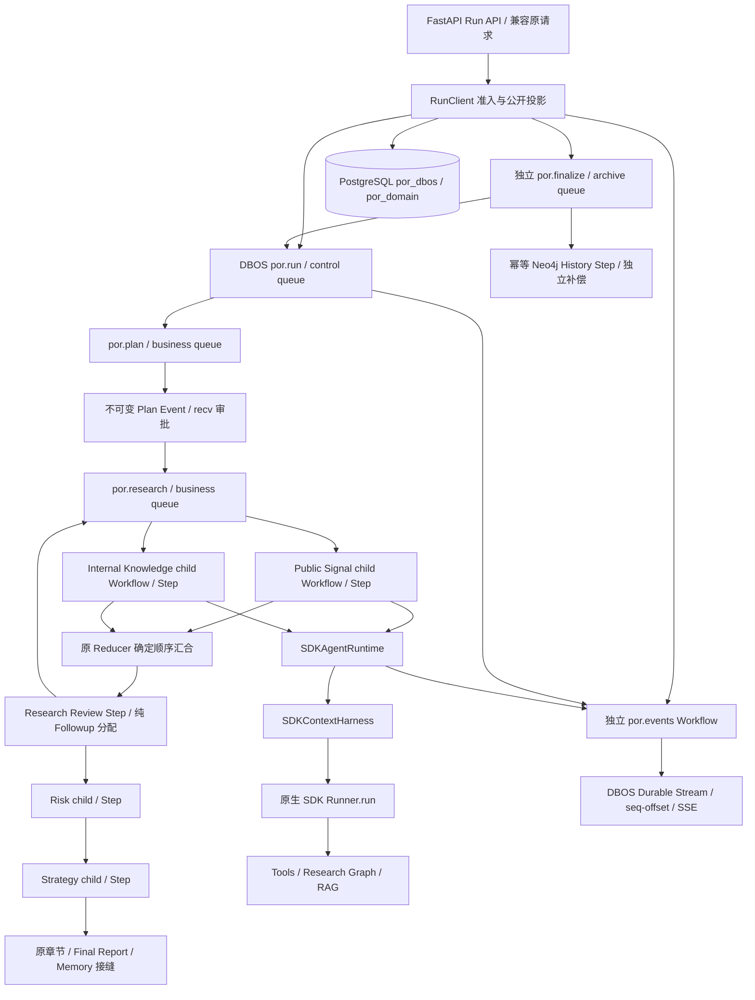

# Phase 4 DBOS Integration 审计

日期：2026-10-23（Asia/Shanghai）。生产基线 `5ca71c12f15013654a26f619071218a2be151a00`，分支 `codex/dbos-phase4-integration`，替代原 PR #24 的执行层。开始时确认 #24 open / 未合并 / HEAD 未变；从该 SHA 创建独立 worktree。此前评估/实验通过 Git 引用读取，未假定它们存在于本分支：[第一轮](https://github.com/kkaaakk/public_opinion_research/blob/31764e646a71675cec7c1a3d98cd39d671343391/docs/audits/workflow-engine-evaluation.md)、[第二轮](https://github.com/kkaaakk/public_opinion_research/blob/8894b67158cf5782e03f56eab9761fcda38cae8a/docs/audits/dbos-native-architecture-poc.md)。

**本地功能与故障验收已通过。交付为指向 main 的替代性 Phase 4 PR；最终合并还需 PR checks 通过，并由操作方接受下述部署/恢复边界；本任务保持未合并，不部署生产。**

## 1. 已实施架构与职责

DBOS 负责编排、队列、持久步骤/子结果、执行权、恢复、消息与 Stream。SDK 仍是唯一 Agent Loop；Context Harness 和原业务 reducer 继续负责证据、私有上下文、预算和清算。没有在旧 PythonWorkflow/RunWorker 外套 Adapter，没有导入 DBOSRunner、实验 Runtime 副本、Agent clone 包装或 SDK turn hydration。

`por.run` 的 native status 是执行权威。`awaiting_approval` 是原生 Event 对 PENDING 的业务解释；`cancelling/settlement` 区分取消意图、native CANCELLED 和实际 SDK 清算。报告是否已生成、History 是否已归档是不同事实，不把它们硬塞回一套竞争的 Run 状态转换图。

### 源码与调用链

| 模块 | 实际职责 |
| --- | --- |
| `web/runs.py` | 原 `/api/runs`、`/api/research` durable 分支的请求/响应/SSE 兼容边界；单操作员 Token |
| `web/durable.py:RunClient` | 幂等、Session owner、配置准入、审批/取消/安全重试命令；读取 native status/Events/Stream，输出原协议 |
| `workflow/dbos_workflow.py` | `por.run/plan/research/role/events/finalize` 原生 Workflow；`business_step`、归档、准入/清算 Steps |
| `workflow/run_facts.py:RunFacts` | 领域资源预留、可撤销执行许可、工具操作指纹/回执、已结清业务 artifact 和 usage |
| `workflow/dbos_config.py` | DBOS 名称、版本、Queue 名称、PostgreSQL/容量/期限/SDK Session 配置 |
| `web/executor.py` | 注册/launch DBOS、初始化、DB 健康检查、受信人工核对；没有 claim/heartbeat/task-pool 调度 |
| `workflow/business_steps.py` | 原步骤超时、异常费用捕获和安全读分类；没有 Workflow cursor |
| `runtime/sdk_runtime.py` | 原 SDK Runtime，Agent/Runner/工具授权与费用逻辑保留 |
| `runtime/sdk_context.py`、`workflow/execution.py` | 原清算与上下文逻辑；增加可选效果提交 guard 和 owned SQL I/O 接缝 |

调用主链为 `Run API → RunClient → DBOS run/plan/research → role child → business_step → 原角色函数 → SDKAgentRuntime → SDKContextHarness → Runner.run → 原业务工具/Graph`。不是更短的纯函数栈；子 Workflow 提供可独立持久化的角色身份，API 投影与领域保护也都有实际职责。不能把层级包装数量当作已减少的复杂性。

## 2. 业务流程与持久边界

- Planning 复用 `intake.enrich_query_images/clarification_step/research_brief_step/section_plan_step`，保留原模型、结构化重试、预算和澄清行为。Web 原有默认不澄清的准入策略保留。
- Planning 和 Research 使用同一个 native business queue，以免分成两套互不相关的全局上限。Control 的审批等待不占业务容量。
- 两个 Producer 是独立 native 子 Workflow，各自拥有完整 SDK 角色 Step。使用 `wait_first_async`；失败取消兄弟并等待领域清算，不以一份部分 State 运行 Consumers。
- 成功 patch 使用原 `merge_research_patches` 固定角色顺序提交；Review 仍调用原业务实现，并在同一持久 Step 内冻结原 `followup_assignments` 的决策/packets；Workflow 不在 replay 时重新读取环境。子角色按固定角色顺序启动，不依赖 JSON 还原后的字典顺序；纯 reducer 不新增 Step。
- Risk → Strategy 顺序保留；Strategy 读取风险报告与前序 Graph，私有角色记忆不串扰。
- 原 `section_writer/write_final_sections/compile_final_report(fail_on_error=True)` 保留，报告 Memory 写入加领域效果 guard。
- 缺失消息 ID 在准入或持久 Step 内补齐，不能由 Workflow replay 生成随机 UUID。非确定的模型、工具、Graph、SQL、History I/O 位于 Step；业务 State 由 journal 返回值和原 reducer 重建，没有自定义 cursor/resume interpreter。

## 3. 删除与替换映射

| 原实现 | 处理 |
| --- | --- |
| `web/run_store.py` | 整文件删除；Run/Attempt 状态机、SQL queue/claim、lease、checkpoint 和公开事件 outbox 退出生产；JSON/脱敏协议工具迁至 `web/run_data.py` |
| `web/worker.py` | 整文件删除；Task 池轮询、续租/失租扫描、SQL 任务领取被 DBOS Executor 替代；归档成为独立 native Workflow |
| `workflow/python_workflow.py` | 整文件删除；不再有 `PythonWorkflow.ainvoke` 的生产入口；业务调用/Reducer 复用，失败费用捕获迁至小型 `business_steps.py` |
| `workflow/execution.py` | 保留 SDK observer、owned 子任务清算；增加 commit guard；不引入执行状态机 |
| `web/runs.py` | 保留 API 校验/事件格式，后台实现改为 RunClient；没有两套完整 Run 后端 |
| `workflow/__init__.py:get_workflow` | 原 in-process Python 入口明确要求使用 durable Run API；默认 legacy 图兼容仍在，禁止 SDK 错误后回退 |
| `scripts/sdk_phase3_smoke.py` | 删除失去生产消费者的独立编排入口；Phase4 smoke 改为正式 native service/fault contracts |

生产引用审计包括 `src/`、`scripts/`、导出、Web 生命周期和测试。`tests/reference_workflow.py` 是固定基线的**测试比较基准**，不被生产导入，不领取 Run，不将其通过数量冒充 DBOS 链路证明。旧实现白盒测试由公开 native 合同取代；并未用旧 Worker 的测试替新引擎背书。

## 4. 领域可靠性与执行身份

### 领域数据与 native journal 的区别

`por_domain.requests` 保存准入身份、owner/Session、请求与有效配置指纹、原始业务输入、资源预留、取消意图和核对记录。`units` 保存角色/业务调用的可撤销许可、已结清结果、实际费用和清算事实；`operations` 只存稳定业务操作键、参数哈希和 started/returned/not_executed/uncertain。`approvals/retries` 是授权决定及幂等控制请求。

这些表没有 Workflow Cursor、运行 lease、下一任务位置或可领取任务状态；没有 SQL 调度扫描。业务 artifact 用于成功业务提交但 journal ACK 丢失的窗口，以及部分失败后的报告/费用保留；不能据此宣称没有任何重复存储成本。DBOS 的内部历史不充当 Memory、Graph 或 History。

Run ID = 根 Workflow ID = Research Graph run_id = History 稳定 ID 的输入。研究 Session ID 保留既有可信 owner 归属；SDK SQLiteSession 私有到 role invocation，单独文件只用于会话记录，不是 Workflow checkpoint，不跨角色恢复 opaque SDK 工作。

### 外部效果与 fencing

事实写入最多15s重试，仅重试同一许可下的幂等 artifact/错误回执，不重试 SDK/工具；已确认 artifact 不会被后续错误写入清除。持久控制故障使用明确 ExecutionControlError 退出，不作为普通工具错误交给模型继续。

工具 op_id 由 Run/业务单元、role/task/round/native call/name 确定，不依赖随机进程 attempt；参数只存哈希。原 SDK invoker 接缝将 op_id 放入 RunnableConfig metadata，外部服务是否实际支持幂等仍由协议决定。已经存在/未知的操作不能靠引擎 retry 重新执行。

模型/工具准入、Graph/Memory 提交和 artifact 提交均受可撤销许可保护。Graph/Memory guard 持有许可行的事务锁，撤销等待已获准提交退出；新所有者发放许可后，旧许可不能继续写入。这不能撤销失效前已发出的远程请求，更不等于 PostgreSQL/Neo4j/MCP/provider 跨系统 exactly-once。

未确认 opaque SDK 单元恢复时先撤销旧许可，再保守拒绝；即使还没有工具回执，也可能有模型费用。已提交 native Step 直接复用 journal；已结清 artifact 可核对 ACK 丢失。只有明确的 settled 安全读允许显式重试，保留此前费用。

ERROR 的显式安全重试使用公开 `list_workflow_steps` + `rewind_workflow`，只截去失败命令及其后 journal；完成的 opaque children 保留。`resume_workflow` 对 ERROR 是 no-op，不能把它当 retry。没有应用 Cursor，也没有私自删 vendor 表。

### 取消与清算

取消意图先持久化，native cancel 负责中断执行；独立 finalizer 也核对该意图，覆盖 Web 死于事务提交与 cancel RPC 之间的窗口。SQL thread 的提交由 `owned_io` shield 至实际返回，已返回工具的 receipt 先交回原 Harness；未进入 invoker 的取消记录 not_executed。

native CANCELLED 与业务清算完成分开。未结清 SDK/工具有60s清算宽限（含原SDK有界清算与领域事实写回），仍未确认则撤销许可并保留全局/owner/session 资源占位；使用量标明不完整。人工释放要求旧进程已停止、权威外部核对、观察版本及记录说明，不使该 opaque 单元变成可重放。

## 5. API、审批、事件与归档

原请求键、状态读取、plan、cancel、approval、retry/resume、报告/usage、History 字段尽量保持；`workflow_backend=python` 是原 Web 选择值，现在指向 DBOS。增加 `execution_engine/native_status/settlement` 等说明事实，不修改前端。

API 仍是单操作员 Token，固定可信 owner=`operator`。跨 owner 的读取、订阅、审批、取消与重试均拒绝；不宣称多租户下游 ACL 已实现。请求准入保留实际 body 字节限制、受限参数和模型族/工具边界，环境默认不能绕过强制审批。

计划 hash/owner/期限绑定一次决定，`send_in_transaction` 与领域决定在同一 PG 事务提交；批准后复用原 Planning。审批 recv/Event 提供 native 持久等待。SSE 使用 protocol_version=1、run_id、attempt_id 兼容字段、seq、UTC timestamp、type；Stream offset+1 提供游标，订阅不执行业务。

独立 `por.events` 单写者将多个子 Workflow/SDK 来源的 native 消息写入一条 Stream。原因是固定版本公开 write_stream 作用于当前 Workflow，不能从外部任意写另一条 Workflow Stream；没有为此保留 SQL outbox。终态/审批等待的 HTTP EOF 以实际事件交付为界，避免 native 状态先变但报告尚未抵达 Stream 的窗口。安全输出过滤/脱敏在公开事件准备 Step 与 HTTP egress 执行。

Neo4j History 是独立幂等归档 Step。研究 native SUCCESS 与 archive pending 可以同时存在，报告/费用不会因归档失败丢失；补偿不重新运行模型/角色。安全重试的控制代次过滤过期公开事件；档案 `run_state_version=业务代次+1`，与 HTTP 的事件游标版本分开，确保迟到旧归档不能覆盖新结果。档案保留原稳定 ID、owner、Session 及版本比较。

## 6. 资源与部署

native business queue 配置 global_concurrency、owner partition_concurrency。最小 PG 业务预留补上 Session 互斥和未知效果占位的联合约束：它只接纳/释放资源，不领取、排序或调度待执行任务；等待用 native sleep，投递仍由 DBOS 完成。队列容量、共享策略和配置漂移显式拒绝，不悄悄放宽限制。

[部署说明](../architecture/dbos-deployment.md)、[Compose](../../compose.dbos.yaml)、[决策记录](../architecture/phase4-dbos-decisions.md)。DBOS3.3.0、psycopg3.3.6；SDK仍0.24.0。根锁仅增加 DBOS/PG 所需依赖；SQLAlchemy 与 croniter 的解析变化单列。PostgreSQL 两 Schema，原 MySQL Memory、Neo4j Graph/History 原职责保留；不迁移其数据。

`--initialize-only` 使用公开 DBOS.migrate 和领域 Schema 初始化。独立 Executor 必须分配同时存活时唯一的 ID；同版本旧进程确认死亡后可用原 ID restart 恢复。自动跨主机失活探测/接管需要 Conductor 或受信外部协调，本交付不宣称未配置的多机自动 HA。也没有部署到用户生产环境。

旧 SQL Run 必须先停接纳并由原发行版受控排空/核对；新版本不再领取其队列，不能跨引擎盲重投。回滚停止新 DBOS 接纳并保留匹配版本 Executor 处理自己的任务，不把 DBOS Run 交给旧 Worker。

## 7. 合同迁移与测试证据

| 原合同/测试主题 | 新验收 |
| --- | --- |
| 并发幂等 create、请求冲突、身份隐藏 | native PostgreSQL transaction、并发 POST/服务调用、跨 owner 控制参数化 |
| SQL claim / worker 全局/owner/session 上限 | native Queue + 领域占位；双实际 Executor、Session 冲突和释放后的进度 |
| lease 失效 / attempt fencing | 旧 Executor 仍活着时 public cancel/resume 专用队列；新许可拒绝旧提交 |
| checkpoint/cursor 恢复 | 真实进程树 kill/restart，完成 Producer 不重做；审批等待 kill 后计划不重算 |
| tool intent/receipt | 稳定 op_id、参数指纹、独立效果/调用见证、丢回执后不重放 |
| 取消与回执提交竞态 | SQL thread gate、native cancel、原 SDK/Harness drain、实际 Graph receipt 与预算 |
| 审批拒绝/超时/环境绕过 | 版本 CAS、一次决定、原生等待；配置/SDK 漂移前不执行角色 |
| 只读安全重试 | native Journal rewind、保留已完成角色和失败费用、幂等控制键 |
| SQL Outbox 回滚/游标 | 领域决定/native enqueue/send 同 PG 事务；单 Stream 连续 offset、重复订阅读取无模型调用 |
| 报告归档补偿 | 真实 Neo4j、独立安全重试、保留报告与原 ID，不重跑研究 |
| Context/Graph/Memory/预算 | 正常四角色、双 Producer barrier、Consumer Evidence、私有记忆、滚动压缩、Gap、未知 Memory commit |
| SQL/DB 不可用 | 实际停启本次 PG 容器，API503、不产生虚假成功、未准入效果不执行 |
| HTTP 参数/Token/SSE 安全 | 受限请求、每个控制鉴权、游标校验、脱敏、body 字节与现有前端 Node 合同 |

基线修改前全量：820 passed / 6 deselected，262.89s（原锁环境启动；随后安装迁移依赖，最终回归另列）。测试比较基准不会被生产 import。默认离线与标 integration 的实际服务/进程测试分开，CI 增加 PostgreSQL/Neo4j native job。付费模型/API调用为0。

| 验证 | 实际结果 |
| --- | --- |
| 修改前 Phase4 基线 | 820 passed /6 deselected，262.89s |
| 完整原生冻结矩阵 | **64 passed /0 skipped /0 xfailed，628.41s**；真实PostgreSQL、Neo4j、进程kill/restart、两个Executor、活旧执行者、停启PG |
| 最后History owner/版本门禁加强 | **1 passed，21.36s**；真实Neo4j迟到旧投影、异owner更高版本均不能覆盖报告/元数据 |
| 完整离线回归 | **786 passed /70 deselected，58.55s**；服务类测试分开选择，非原生失败skip |
| History及离线协议复验 | **40 passed，12.60s** |
| 原前端Node合同 | **5 passed**，前端源码相对5ca未修改 |
| 入口/静态检查 | **29入口导入、全部改动Python格式、Ruff E/F/I、compileall通过**；入口禁dotenv/tracing/非loopback网络 |
| 正式CLI | 独立UUID测试库执行initialize两次与health均成功，两个Schema已核对，仅删除该创建库 |
| 依赖检查 | **未通过**；唯一继承冲突markitdown-mcp要求mcp~=1.8.0，实际1.23.0；新增冲突0 |
| CI | `.github/workflows/ci.yml` 包含原quality/tests和独立真实PostgreSQL/Neo4j/fault作业；最终提交状态以PR checks为准 |

离线数量的变化不是放宽验收：原764项其他业务/SDK/Graph/Memory合同保留，56项旧SQL Store/Worker实现相关case由22项离线协议及64项真实native合同取代；原有6项其他外部环境测试仍保持原选择边界。`reference_workflow.py` 仅作固定旧行为比较，另有真实native与其workflow/report/agents/usage完整对照，不把reference通过数当新执行层证明。原生验收未使用skip/xfail，也未调用付费模型。

### 真实失败记录

- 原生首条四角色链路的阶段 report 使用 override 包装；History 投影曾按 str 处理。修复为原协议字符串，保留实际模型费用精确断言。
- 首轮 native 预算夹具将步骤外服务调用少数一次，修正为 intake3 + sections/final2，仍保留 normal28 model_calls /311 tokens 精确合同。
- Stream 终态/归档原生 Event 曾早于尾消息交付；修复以公开事件交付事实确定 EOF/归档可见性，而非删除断言。
- Windows venv 启动器会派生实际解释器，最初 kill 测试只终止启动器；修复为仅终止本次创建的进程树再重验。工具 RunnableConfig 注入夹具也按真实协议补充类型。
- 一次测试选项循环覆盖了独立数据库名，teardown 尝试删除不存在的 RUN_APPROVAL_SECONDS/RUN_QUEUE_CAPACITY；命令报错，未触及其他数据库。修复变量与 UUID 名称校验。
- History最初只把python_worker视为可更新的版本化来源，导致DBOS新报告的版本号未更新；补齐来源白名单，并在读取版本前取得节点写锁，旧/异owner版本整体不进入fallback字段填充。真实迟到旧报告回归保留。
- 错误事件 kind 参数与 payload kind 冲突导致 finalizer ERROR；改正接口名。ERROR resume 的 no-op 被实际测试发现，改用公开 rewind，未依赖私有表重写 journal。
- API 首次 Run 原本没有测试种子 private-memory，原模型夹具强制要求该种子而失败；改用首次运行合法的 ScriptedModel，角色隔离仍由带种子四角色合同验证。

- PG停启后的测试清理曾复用失效admin连接，改为pre_ping；故障用例进一步等待真实SQL失败见证，区分“连接阻塞后正常恢复”和“已发生持久准入错误”。控制异常不会被SDK工具格式化吞掉，SDK UserError的cause链保留公开错误类别。

- 确定性审计把消息 UUID 补齐与补查配置决策移入持久边界，补查第二轮中实际 kill/restart 检查子 Workflow 顺序、已完成角色费用与工具调用见证；没有只凭正常路径通过宣称 replay 正确。
- 21个待审批任务不会占住归档等待队列的有限名额；业务 global/owner/session 配额仍然严格生效。控制/最终化等待不按执行并发计费，避免后入任务无法归档。

## 8. 实际代码量与维护复杂度

统计脚本 [dbos_inventory.py](../../scripts/dbos_inventory.py) 对固定 Git SHA 与当前完整 `src/**/*.py` 比较，SLOC 排除空白、独立注释、docstring。同时报告物理行，测试/部署/文档另列；没有仅统计删除文件。

| 生产模块 | 原SLOC | 最终SLOC | 净变化 |
| --- | ---: | ---: | ---: |
| `runtime/sdk_context.py` | 728 | 736 | +8 |
| `web/durable.py` | 0 | 497 | +497 |
| `web/executor.py` | 0 | 104 | +104 |
| `web/history.py` | 513 | 516 | +3 |
| `web/run_data.py` | 0 | 71 | +71 |
| `web/run_store.py` | 1022 | 0 | -1022 |
| `web/runs.py` | 208 | 214 | +6 |
| `web/server.py` | 473 | 473 | +0 |
| `web/worker.py` | 423 | 0 | -423 |
| `workflow/__init__.py` | 45 | 46 | +1 |
| `workflow/business_steps.py` | 0 | 74 | +74 |
| `workflow/dbos_config.py` | 0 | 62 | +62 |
| `workflow/dbos_workflow.py` | 0 | 619 | +619 |
| `workflow/execution.py` | 63 | 92 | +29 |
| `workflow/python_workflow.py` | 344 | 0 | -344 |
| `workflow/reporting.py` | 730 | 731 | +1 |
| `workflow/run_facts.py` | 0 | 420 | +420 |

整文件生产删除 **1,789 SLOC**（2,001物理行）；7个新生产文件 **1,847 SLOC**（2,059物理行）；其余原生产文件净增 **48 SLOC**。全量 `src` 实际净变化 **+106 SLOC / +114物理行**。并未达到显著减少总代码量，不能把删除旧文件当净收益。

原RunStore/Worker/PythonWorkflow/Run API四模块共1,997 SLOC；新替换文件加保留API共2,061 SLOC。正式补齐联合配额、清算、原事件协议、错误/版本、Session及归档/重试代次后，与原型的749行差额明显不同。SDKRuntime原631 SLOC未改，不计为删除代码。

同口径职责主链约由原9层变为10层（省略两边共同内部调用），没有明显缩短。SQL claim、Task池、lease/heartbeat、Attempt执行身份、Cursor解释器、重复Run状态机、SQL公开Outbox七类通用实现退出。领域幂等、准入、许可、费用/清算、审批和业务归档仍维护；这些是七类领域失败责任，非独立异常组合总数。native消息合并/finalizer、PG、Journal/partition、版本/Executor身份、rewind及可选Conductor是新增的学习/运维成本。

实际退出的是自研 SQL queue/claim、Worker Task 池轮询、lease/heartbeat、Attempt 执行身份、Cursor/Resume interpreter、公开事件 SQL outbox。团队改为维护 DBOS 版本/Journal/Queue/Streams、PostgreSQL备份与权限、Executor 身份、可选分布式恢复协调。授权、Session/未知占位、工具效果核对、SDK清算、预算和业务归档仍是项目职责，不能计作免费删除。

## 9. 已知限制与 Phase 5

在已声明单操作员、PostgreSQL、同版本安全恢复范围内，本地功能合同与故障验收通过；PR的完整CI通过后，达到本轮替代性Phase4的可合并验收要求。生产部署/旧任务排空仍按部署说明执行，不由本任务自动开始。

已实现的可靠性范围是单操作员、PostgreSQL持久化、同版本执行恢复、两个本机Executor、业务步骤级SDK恢复、外部效果保守隔离和原API兼容。以下仍是明确边界：

- 未部署Conductor，不宣称跨主机自动判死/自动接管或生产PG HA/网络分区验收。
- SDK Session不替代checkpoint；不能从Agent任意turn/未知工具位置无损重放。跨MCP/provider/Neo4j/Memory没有全局exactly-once；远程权威核对仍需操作方。
- 受信进程停止/权威效果核对后的资源释放不改写未知结果、不恢复该opaque单元；不可取消的既发远程请求不能被软件撤销。
- 未做生产吞吐/高积压benchmark。控制Workflow不设置与业务容量重复的长期等待并发上限；元数据轮询、Journal/Stream与业务artifact的保留会增加PG读写与存储，queue_capacity须按实际SLO配置。
- 生产供应商、远程MCP、跨主机私有会话文件与数据库least-privilege角色的实际部署不是本地集成测试。原SDK/MCP本地transport回归保留，正式native故障用独立Neo4j和可核对合成工具。
- 原markitdown-mcp/mcp依赖不兼容是继承基线，没有新增冲突；未把依赖检查写成通过。
- 直接导入旧PythonWorkflow/SQL Worker的仓库外脚本需要改用Run API；仓库内活动入口已迁移，不保留一层永久包装执行器。

Phase 5 继续处理旧 LangGraph/runtime 退役：默认 legacy interactive/API/CLI 工厂、旧 graph construction/兼容导出、LangChain Agent Loop 及其依赖消费者。旧图不领取 DBOS Run ID；本次没有把它们作为 SDK 错误后的 fallback，没有提前改四角色策略/提示词/RAG/Graph 选型或前端页面。

## 10. 官方语义依据

固定包安装源码与真实运行优先，说明链接用于核对公开契约：[DBOS3.3.0](https://pypi.org/project/dbos/3.3.0/)、[Client/transaction/rewind](https://docs.dbos.dev/python/reference/client)、[Workflow/Step](https://docs.dbos.dev/python/reference/decorators)、[Queue/partition](https://docs.dbos.dev/python/reference/queues)、[Communication/Streams](https://docs.dbos.dev/python/tutorials/workflow-communication)、[Concurrent executions](https://docs.dbos.dev/explanations/concurrent-executions)、[Distributed recovery](https://docs.dbos.dev/conductor/distributed-recovery)、[OpenAI SDK](https://developers.openai.com/api/docs/guides/agents/sdk)、[Neo4j写锁与丢失更新](https://neo4j.com/docs/operations-manual/current/database-internals/concurrent-data-access/)。源码复用不等于第三方接口永不变化；版本升级需要重跑同一合同矩阵。
