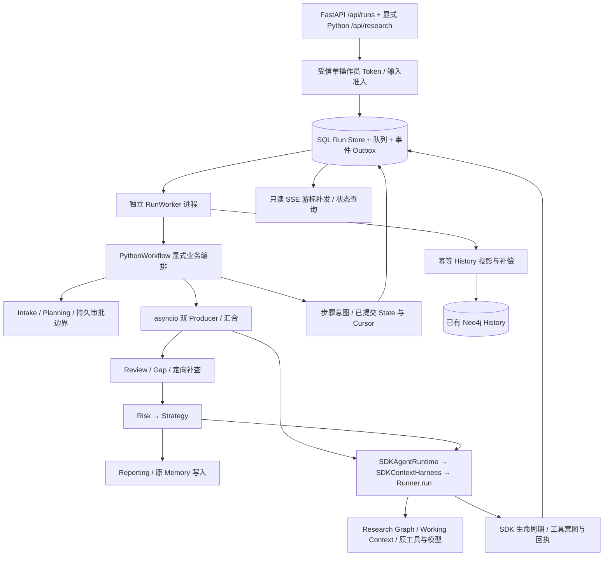
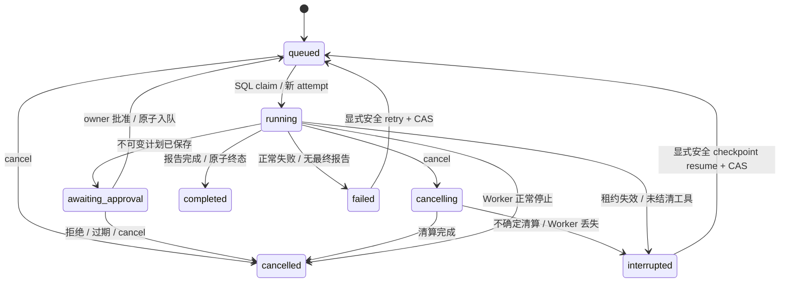

# OpenAI Agents SDK Phase 4：持久 Run 与生产运行集成

日期：2026-10-21（Asia/Shanghai）。基线：最新 `origin/main` 的 Phase 3 合并提交 `c6c6f54d5fe66972d33d29ccbc5b414c62cdc6ee`。分支：`codex/openai-agents-phase4`。

本阶段提供显式启用的 Python Workflow Web/API、独立 SQL Worker、持久 Run、阶段 SSE、审批和安全恢复。旧 `/api/research`、LangGraph、legacy Runtime 及默认值保留。SDK 仍固定 `0.24.0`，没有新增依赖，没有新增业务 Agent Loop 或工作流引擎。真实付费模型/检索调用为 **0**。

## 1. 审计结论与实际调用链

实施前读取 AGENTS、准备审计、迁移计划、Phase 0–3 审计，以及 Workflow、State、Runtime/Harness、预算、Web/History、Memory 身份、Research Graph 回执、MCP、测试和 CI。旧 Web 的研究由 SSE generator 持有，断线影响执行/归档；Semaphore 只在单个 Web 进程内生效；没有持久 Run/任务队列。Neo4j 已服务证据与历史，SQLAlchemy/PyMySQL 已服务可选长期记忆，仓库没有现成 Broker 或 Worker 部署。



真实执行主链：`RunWorker.execute → PythonWorkflow.ainvoke → _step / gather_owned → 原 business_agent → SDKAgentRuntime.run → SDKContextHarness.run → 唯一 Runner.run`。取证并行、确定性汇合、Review/Gap 循环、Risk→Strategy、报告仍完全由 Phase 3 Python 代码决定。队列不解释业务 DAG，不调用旧图，不重新封装推理循环。

## 2. 运行基础设施选型（ADR-P4-01）

**决定：SQLAlchemy 数据库任务队列；MySQL/InnoDB 用于共享数据库的多进程/多主机部署，文件 SQLite 用于本地部署与默认离线验收。** 两者执行同一 Run Store 合同。SQLite 的 WAL、FULL synchronous、`BEGIN IMMEDIATE` 和 MySQL 的 InnoDB `SELECT ... FOR UPDATE` 提供控制事务串行化。MySQL 时间列使用双精度，避免 epoch 秒在单精度浮点列中失去租约精度；标识列使用大小写敏感 collation。

| 方案 | 审计后的取舍 |
| --- | --- |
| 继续请求内 asyncio Task / Semaphore | 不耐 Web 重启，不能跨进程限额，也无法原子提交任务和 Run；不用于新链路 |
| Redis + Celery/RQ | 成熟调度、运维及吞吐能力有价值；需要新增 Broker/依赖、运行部署及 SQL/Broker outbox，还需本项目实现审批、工具核对和防重放。当前没有可直接复用的 Broker，不在本阶段新增 |
| Neo4j 同时作为任务队列 | 可写事务，但会把高频执行控制/全局调度锁/事件分页与证据、历史领域耦合；已有 SQL 库更适合这些访问模式 |
| SQL 队列（采用） | 接纳、全局配额、attempt fencing、状态/事件提交可在一个事务内完成；复用现有 SQLAlchemy/PyMySQL，无新增 Python 依赖。代价是维护小型轮询 Worker，SQL 控制行有串行化上限 |

没有用户提供的生产吞吐/SLA 数据，不假设业务只能单实例或低并发，也不宣称达到未经测量的容量。默认全局 4 个 Run、每 owner 2 个、每研究会话 1 个，均通过数据库控制；队列容量默认 1000，全局/owner 配额可由操作方配置。Worker 还单独限制本进程任务数量。长模型/工具工作不持有调度锁，控制事务只提交元数据与 Checkpoint。若未来控制事务吞吐成为实测瓶颈，可在同一 Run/回执合同外引入 Broker，或拆分 SQL 调度锁；无需替换 Python Workflow。

数据库队列不是消息中间件的通用替代实现；它只交付本项目已接纳的 Run。没有引入 Temporal/DBOS/LangGraph 编排。MySQL 运维、备份、持久卷/故障转移由部署方负责；可以复用已有 Memory MySQL 服务上的独立数据库，不能未经确认占用其他项目的数据库。没有 SQL 服务的本机可以显式选文件 SQLite；SQLite 文件不能作为跨主机共享队列。

依据：[MySQL 锁定读](https://dev.mysql.com/doc/refman/8.0/en/innodb-locking-reads.html)、[SQLite 隔离合同](https://www.sqlite.org/isolation.html)、[Celery 任务幂等与重投语义](https://docs.celeryq.dev/en/stable/userguide/tasks.html)。Celery 自身也不能判断业务是否幂等；选择 SQL 不依赖于错误的 exactly-once 假设。

## 3. Run 状态机与数据模型（ADR-P4-02）



`completed`、`cancelled` 不可重新入队。`failed`/`interrupted` 只有经过持久安全判定的请求可继续；状态集合中的合法边不等于无条件允许该操作。取消与完成竞争按 SQL 事务的线性化顺序决定，`cancelling` 已提交时不能再提交 completed。

| 表 | 权威数据 |
| --- | --- |
| `por_run_scheduler` | schema v1 与一致的队列策略；短事务调度锁。不同 Worker 配额配置不一致时拒绝启动 |
| `por_runs` | run_id、可信 owner、owner 范围幂等键、research_session_id、状态版本、事件 seq、当前 attempt、租约、隔离标志、创建/更新时间；JSON 保存经过准入的请求/config、Workflow/Runtime/SDK 版本、有效配置指纹、当前业务 State/安全 cursor、完成阶段、usage/error/settlement、不可变计划/审批、报告和归档引用、终止时间 |
| `por_run_attempts` | 每次交付的新 attempt_id、worker_id、起止时间、版本、初始/结束累计 usage、错误与清算。恢复保留原 Run 和原 research run scope，只生成新 attempt |
| `por_run_events` | `(run_id, seq)` 主键，稳定版本化公开事件；每 Run seq 连续递增 |
| `por_run_operations` | 稳定 operation_id、run/attempt、SDK invocation/native call/task/round 身份、参数指纹、意图时间和 returned/uncertain/not_executed 状态；不复制工具参数/正文 |

State 使用 JSON 和白名单数据类型（原消息、Section、ResearchTask、ResearchReview），不使用 pickle 或动态 import。完整 Snapshot 是原 `DeepResearchState` 的持久表示，不创建第二套业务 State/reducer。有效配置只存指纹用于比较，不把环境凭据复制入请求 config。配置、代码合同或已安装 SDK 版本漂移会在执行前明确失败，记录变更字段名，不自动改用另一 Runtime。

Run Store 在准入后标记受信 `accepted_run` 配置：已校验的模型/Backend/Runtime/审批等请求选项随 Run 保存，不再被进程环境默认值悄悄覆盖。操作方强制审批在首次准入取更严格值，用户不能通过关闭checkbox绕过；批准后只有已消费的审批事务能关闭同一Run的再次规划。URL/凭据、资源与预算策略仍来自操作方并参与配置核对。该规则仅用于新持久Run；旧 `Configuration.from_runnable_config` 的环境优先级保持。新增回归覆盖环境false不能绕过请求审批、环境true批准后不重算、客户端不能关闭操作方强制审批，以及预算仍受服务端控制。

所有控制写入先获取数据库调度锁；幂等唯一约束、状态版本、attempt/未过期租约复核、终态和 Outbox 在同一事务内提交。SSE 不生成 seq。数据库异常回滚全部控制变化；终态无法提交时由重启核对保留不确定状态，不能声称执行成功。

## 4. Session、Run、Attempt、Graph、History、Trace

| 概念 | 唯一职责与边界 |
| --- | --- |
| 业务 research_session_id | 可信 owner 范围内的研究会话；首次 Run 创建并返回，可显式继续同会话；同会话只运行一个 Run |
| Run / Attempt | Run 是一次接纳的研究及其安全继续；Attempt 是某 Worker 的一次租约交付；重试不会变更证据 run scope |
| Research Graph | 既有 run-scoped 原始材料、证据/发现/provenance 与确认回执；不承担任务调度。run_id 由服务端生成，Web 不接受外部 Graph run_id |
| RAG / Memory | RAG 保留知识库索引与知识图职责；长期业务记忆仍由原 writer/store 拥有。可信 user_id 和 thread_id 传入现有记忆身份解析，不以 SDK 历史替代长期记忆 |
| 角色私有记忆 / Working Context | 原 State 按 role 保存，Checkpoint 延续其作用域；仅新研究的 `research_init` 执行原清理语义；恢复到后续 cursor 不再清空 |
| SDK Session | 通过官方 `SQLiteSession` 可选保存一次 owner/run/attempt/role/invocation 的原生会话历史。`RUN_SDK_SESSION_PATH` 或 CLI 显式配置路径；每次 invocation 独立命名，退出关闭连接。多主机使用各 Worker 的本地持久路径，不能据此提供跨主机 Agent 内部恢复 |
| History | 已有 Neo4j 报告/阶段档案投影，带 owner/session/Run 版本；不是 Run 状态权威。幂等投影可升级同一 Run 的较新终态，不覆盖新版本为旧版本 |
| Trace | 诊断事实，不是 owner、队列或费用/Checkpoint 权威。原 business SDK tracing-disabled 策略保留；本阶段不把 Trace 伪作持久执行日志 |

检查 SDK 0.24.0 的 Session 协议、SQLiteSession、SQLAlchemySession 与 RunState：官方 SQLAlchemySession 使用 AsyncEngine，需要本项目尚未引入的异步数据库驱动；本阶段直接复用可用的官方 SQLiteSession，保留已有 Harness 的角色内窗口与 Working Context。RunState 可以保存 SDK 中断/usage，但不能重建本项目 live collector、已写未确认 Graph 批次、原 BaseTool/MCP 资源和外部副作用状态，因此没有声称任意 tool-call 位置恢复。[官方 SDK 运行与状态说明](https://developers.openai.com/api/docs/guides/agents/running-agents)、[结果与状态](https://developers.openai.com/api/docs/guides/agents/results)。

## 5. Web/API、SSE 与兼容（ADR-P4-03）

新链路必须同时显式选择 `workflow_backend="python"`、`business_agent_runtime="openai_agents"`。`/api/runs` 不接受客户端 owner、任意 configurable、数据库/MCP URL、密钥和本地路径。现有请求模型的模型白名单继续生效，当前 SDK Web 准入限已验证的 OpenAI/DeepSeek 与 Tavily 本地工具路径，不接受未接入 provider/hosted search 后再付费失败。

| API | 合同 |
| --- | --- |
| `POST /api/runs` | 必须提供 `Idempotency-Key`；202 接纳，完全相同重发 200 返回原 Run，不同内容同 key 为409 |
| `GET /api/runs/{id}` | 当前状态、进度、usage、计划、正式阶段/最终报告及归档引用 |
| `GET /api/runs/{id}/events` | 使用 `Last-Event-ID` 或 `after` 只订阅已有 Outbox |
| `POST /api/runs/{id}/cancel` | queued/paused 直接终止；running 记录 cancelling，Worker 传递单次取消并等待 SDK 清算 |
| `POST /api/runs/{id}/approval` | plan_version + approve/reject，一次消费 |
| `POST /api/runs/{id}/retry`、`/resume` | Idempotency-Key + 观察到的 state_version，只允许已验证安全边界 |
| 原 `POST /api/research` | 默认旧路径；显式 Python 请求转为持久 create + 同一只读 SSE，可用响应 `X-Run-ID` 后续重连 |

示例创建体：

```json
{"topic":"品牌召回研究","workflow_backend":"python","business_agent_runtime":"openai_agents","model":"openai:gpt-4.1","require_approval":true,"rag_enabled":true}
```

SSE 使用 `id: <seq>` 和 `data: <JSON>`。公开数据包含 `protocol_version=1`、run_id、attempt_id、seq、UTC timestamp、type。事件覆盖 `run_status`、`step_started/completed`、`agent_report`、`research_review/followup`、`sdk_event`（真实模型开始/完成、工具意图/回执）、`settlement`、`report/usage`、`history_saved/archive_pending`、`error/done`。原前端的 `status/stream/report/usage/history_saved/error/done` 字段保留；`stream` 是完整阶段报告，明确 `granularity="stage"`，不是 Token 流。

页面增加默认关闭的后台研究开关、计划审批、恢复进度按钮。tab-local sessionStorage 在 POST 前保存请求/幂等键，随后保存 Run ID/已消费游标；不保存访问令牌。刷新只显示恢复入口，已知 Run 仅 GET 状态/订阅；create 响应丢失时复用同一 key/body 核对。Stop 调 cancel API 并继续等待清算，不以中止 fetch 代替取消。待审批计划以 textContent 展示，批准/拒绝绑定保存的版本；终态报告在历史补偿前仍可通过保留的 Run 句柄重新打开。

重连游标只读取 SQL；重复订阅不调用 Worker/Agent。负值、未来或无效游标拒绝。每次最多读取100条后继续分页，空闲发送注释心跳。终态/审批暂停且已补发全部事件后关闭连接；后续归档补偿仍可通过再次订阅/状态查询获取。未收到终态的 EOF 只代表订阅中断。事件保留在数据库，本阶段不自动清理游标，部署方应同时备份 Run/Outbox。

事件入库只允许明确的业务字段/SDK 元数据，不发布原始 prompt、input、工具参数/输出或异常文本；公开报告再做已知操作方凭据和凭据形态脱敏。私有 State/原生 Session 不提供 HTTP 读取端点。HTTP 请求按实际接收字节限制64KiB，覆盖无 Content-Length、分块及伪造长度。

## 6. 审批与安全恢复（ADR-P4-04）

规划的 State/usage 先提交 `cursor=approval`，然后保存 brief/sections 的不可变哈希版本、usage 和过期时间，进入 awaiting_approval 并结束 planner attempt。批准同时消费 owner/version 绑定的决定、关闭再次审批、把 cursor 改为 `research_init` 并入队。没有“审批成功但未发送 Broker 消息”的窗口。拒绝/过期为 cancelled；重复审批409。批准后 Worker 没启动、退出或在开始研究前崩溃，原计划仍在数据库，恢复不重算规划。

Phase 3 的 `start_at="research"` 保持原入口合同：它会清理上次研究的角色报告、Review/tasks、Working Context，不能用于任意恢复。新受信 cursor 精确区分：intake 各步、approval、research_init、双 Producer 汇合、Review、纯 followup 判定、Risk、Strategy、章节组、最终章节、compile、done。只有首次或已批准的计划进入 research_init；后续 Checkpoint 直接继续对应步骤，不重放已完成 Producer 或清空 State。

恢复粒度是**完整工作流步骤/一次 Producer 汇合**。一组 Producer 中一个成功而另一个失败时保留成功报告和实际费用，但不凭半组 State 自动重启整组。已 settled 的无外部副作用模型/读取步骤可显式 retry；部分章节组可能重做本组纯生成，之前费用仍累计。Role/compile（可能包含工具或 Memory 写入）失败时不自动重放。没有任意 SDK turn/工具位置的无损恢复。

## 7. 失败、取消、重投和进程崩溃

- 正常异常沿用 Phase 3 的 owned 子任务与 SDK 有界清算。保存诊断 State、成功阶段报告、全部已观察费用、失败步骤/类别，不把部分成功变成 completed。
- Worker 周期续租并读取 cancelling；只发出一次取消，等待原 Workflow/SDK 子任务退出。运行超时单独记录 timeout；SDK 的30s工具/批次清算窗口继续有效。未结清工具为 interrupted/unresolved，保留隔离容量。
- 每次工具在执行前写 durable intent；operation_id 从 run/attempt/role/task/round/SDK invocation/native call 确定，参数只存哈希。操作 ID 通过原 RunnableConfig metadata 提供给工具；外部服务是否真正支持该幂等键仍由各协议决定。invoker 返回回执与 Harness 的业务成功/证据回执是不同事实。
- 取消不能停止正在提交的 SQL 线程。Worker 持有并 shield 等待真实控制事务退出；已经返回的工具先提交回执并把实际结果交还原 Harness，再完成父级取消清算。意图写入期间取消且尚未进入 invoker 时保存 not_executed。SQLite锁等待30s；MySQL/PyMySQL连接5s、读写10s，不能无限等待丢失的数据库响应。
- claim/进度/工具准入/回执/终态都检查当前 attempt 和未过期租约。失去所有权的旧 Worker 不能再提交 Run/事件/回执或开始后续模型/工具。不假设能撤销失租前已发出的远程请求、线程或 Neo4j 写入。
- 租约过期：未进入步骤的持久边界可显式 resume；执行中的步骤进入 interrupted，usage_complete=false，不自动重投。未知副作用的 Run 继续占用全局/owner/session 容量，避免旧 Worker 仍存活时启动替代执行。
- 人工核对必须先确认原 Worker 已停止、查外部权威记录，然后使用受信 Worker CLI 的 `--reconcile-run / --state-version / --worker-stopped / --note` 释放隔离容量。该操作**不会**把未知业务步骤改成可重放，也不伪造成功清算。
- SQL 终态/Outbox 事务与 Graph、Memory、History、provider 之间没有跨库事务；没有全局 exactly-once、自动回滚外部副作用或遗失供应商 usage 的精确重建保证。

## 8. 权限、并发、资源与部署

当前 FastAPI 是**单操作员 Token 认证**，新 Run 接口必须配置 `PUBLIC_OPINION_API_TOKEN`（或既有 WEB_API_TOKEN），固定映射可信 owner=`operator`。原匿名本地旧接口兼容保留；不能把这个 Token 当成多人用户身份。Run Store 与 API 有跨 owner 拒绝测试、History 有 owner 过滤，Graph ID 由服务端控制，但本阶段没有提供多租户 Supabase 身份接入、逐租户知识库/文件/外部 MCP ACL，**不宣称多租户安全完成**。未来接多用户前须统一这些下游身份，并处理 owner 不明的旧档案；旧 Supabase/LangGraph Auth 不等于新 FastAPI 认证。

部署只需现有 Web 进程、一个或多个独立 Worker、明确持久 SQL URL；证据/历史继续使用原 Neo4j。先在单独初始化步骤执行 additive schema，再启动多进程；不要让首次生产部署的多个实例竞争 DDL。数据库策略和有效业务配置必须一致；变更配置时先排空/停止已接纳任务，不静默改变旧 Run。

```powershell
# 操作方设置 RUN_DATABASE_URL 与 Token；不要把真实凭据写入版本库。
# 本地示例目录 data/runs/ 已忽略；生产可使用 mysql+pymysql URL。
New-Item -ItemType Directory -Force data/runs | Out-Null
$env:RUN_DATABASE_URL = 'sqlite:///data/runs/runs.db'
.venv/Scripts/python.exe -m open_deep_research.web.worker --initialize-only
# 独立终端/进程，使用同一受信配置：
.venv/Scripts/python.exe -m open_deep_research.web.worker --concurrency 4 --timeout 3600 --session-path data/runs/sdk.db
.venv/Scripts/python.exe -m open_deep_research.web.server
```

默认 lease60s，heartbeat不超过10s/lease三分之一，Worker轮询1s；超时默认3600s，可配置。并发/容量/租约策略持久在 SQL，各进程不一致时拒绝启动。预算沿用原 counters/admission，不把它宣称为跨 Worker 原子硬 Token 配额。操作方为进程设置内存/CPU与文件访问限制，并根据实际供应商延迟选择并发、租约和超时。

SIGINT/SIGTERM 停止接纳并让现有任务传递取消、清算退出；MCP/模型客户端仍由既有 async context 拥有。Run/History pool、Graph cache 和配置的 SDK Session 关闭。SDK/底层同步线程及同步 DB 操作不能强杀，极晚返回仍需 interrupted 核对；进程监督器负责超出停机宽限后的强制终止。本阶段不通过另一个通用执行引擎掩盖这个边界。

归档由 Worker 驱动，与 SSE 连接无关。SQL 保存报告和 archive pending，Neo4j 失败后指数退避至最多300s，按同一 History ID/较新 Run 版本补偿；归档失败不重跑研究。Run 查询始终能读取已持久报告，History 是最终一致投影。

## 9. 新增抽象与复杂度

| 新增/扩展 | 解决的问题、层级与替代 |
| --- | --- |
| `web/run_store.py: RunStore` | 唯一控制存储与SQL队列；直接事务方法，无 Repository/Manager/Adapter 转发链；替代请求内内存状态。JSON codec/公开投影为同模块函数 |
| `web/worker.py: RunWorker` | 交付、心跳/取消、任务拥有和档案补偿；直接调用 PythonWorkflow；替代请求内 Task，不解释业务步骤 |
| `web/runs.py` | FastAPI 路由、准入和只读 SSE；直接调用 RunStore。两个 Pydantic 控制体只做校验 |
| 原 `workflow/execution.py` 的 observer ContextVar | 一个 async 事实回调，asyncio 子任务继承；Workflow/Runtime 不反向导入 Web/SQL，不把存储依赖传进每个业务方法 |
| 原 `PythonWorkflow` cursor/PlanApprovalRequired | 显式安全边界、审批交回 Worker；原顺序与分支保留，没有通用节点注册表、DSL 或第二套 State |
| 原 SDK Runtime 的窄接缝 | 公共 Hook 发真实生命周期、原工具 invoker 前后写意图/回执、传官方 Session；仍只调用原 Harness/Runner 一次 |
| 原 `Configuration.from_runnable_config` 的受信Run分支 | 只固定已准入的请求选项与审批消费结果；不接收客户端任意config，不改变旧入口优先级、凭据或预算政策 |

新生产模块只有3个。两个核心基础设施类；额外异常类表示冲突、owner隐藏/失租、审批暂停，全部有实际控制语义。调用深度的主要部分仍是原业务角色→Runtime→Harness→Runner；新数据库方法没有多层转发，observer只负责一次持久提交。不新增 Manager、Service、通用 Workflow Engine、Agent 或 BudgetManager。Phase 5 的旧 Runtime/LangGraph/依赖退役未混入。

## 10. 验证证据与工程结果

基线 locked sync 成功：313个解析包/250个安装包，SDK0.24.0不变；全量 **764 passed / 6 deselected / 156 warnings，88.82s**。Mypy **33 errors / 15 files / 107 source files**。

默认新增回归覆盖真实文件 SQL、并发提交与幂等冲突、双Store/多连接全局配额、session隔离、终态/取消竞争、事务回滚、租约失效/旧attempt fencing、工具意图/回执防重放、完整真实SDK Runner/Workflow/Harness失败/双失败/取消/超时、审批并发/拒绝/过期/不重算、跨owner各API、实际body大小、归档补偿、配置漂移、隔离释放与DB故障清算。

真实进程测试使用 `subprocess.kill`、持久 SQLite 和独立外部效果表：在 Producer 汇合 Checkpoint 后终止进程，新进程从 Review 继续且外部效果数不增加；在工具实际执行成功但回执尚未提交时终止进程，重启为 interrupted并拒绝重放。进程故障 fixture 使用 standard 策略；真实 Neo4j 证据/档案在下述单独服务集成中验证，不冒称跨库原子崩溃恢复。另用真实TCP/独立Web与Worker进程断开SSE、重复create、重连补发并完成归档。这些用例属于默认离线回归，不是只抛出 Mock异常；推理使用官方 ScriptedModel，禁止非本地网络。

首次远程 Linux CI [39613156693](https://github.com/kkaaakk/public_opinion_research/actions/runs/39613156693) 的 quality通过，pytest为814 passed/1 failed/6 deselected：`model_error` 场景未等待兄弟工具回执，取消与 SQL 线程提交产生真实竞争。修复没有放宽断言或跳过用例：保留原failed/settled断言，为“工具已完成后模型失败”fixture加入双回执屏障；同时修复控制事务的取消拥有权，并新增“两个工具已返回、回执提交期间取消”的真实Runner/Harness回归，要求两份成功结果和证据均完成清算，终态cancelled而非误报unknown。修复后定向6项通过；完整与远程复验见下方最终结果。

本地服务分层：`scripts/sdk_phase4_smoke.py --enable-local-services` 对本次临时 MySQL8.4、现有Neo4j和真实MCP stdio 执行生产Worker/四角色SDK流程，模型/图抽取推理全部为离线响应。并发8次create只接纳1个Run，审批后不重算规划，2份工具回执、2 Source/2 Evidence、4角色完成，真实Neo4j History owner隔离与归档通过。只清理本次创建的合成run/history/SQL行，原数据与容器保留；临时MySQL容器在验证后单独移除。fixture账本为28 model_calls /235 input /76 output /311 total tokens，供应商调用0，不是实际账单。

| 最终本地检查 | 结果 |
| --- | --- |
| 全量 pytest（保留所有 Phase 0–3 用例） | **820 passed / 6 deselected / 156 warnings，153.36s**；新增56项，退出码0 |
| 浏览器控制器合同 | **5 passed**；实际app.js执行，覆盖模糊create响应/刷新、已知Run重连去重、一次审批、真实cancel请求、非终态EOF；加入CI，不新增npm依赖 |
| Ruff CI E/F/I / 新模块完整规则 | 通过；没有降低原门禁 |
| format | 13个新增/修改Python文件通过；Web既有文件同时按formatter格式化。Configuration整文件仍有历史差异，固定main副本同样失败；新增分支局部对齐formatter，未捆绑大型配置文件的无关重排 |
| compileall / import | 生产包、安全包、scripts、evaluation通过；禁dotenv/凭据/网络的**29入口**导入通过，独立Python导入不构造旧图 |
| Mypy | **33 errors / 15 files / 110 source files**；逐消息去行号对比新增0、移除0，仍非零退出 |
| 依赖 | 原1项markitdown-mcp/mcp冲突保持，仍非零退出；锁和依赖声明不变 |
| MySQL + Neo4j + MCP | 最终实际通过：78个连续事件、四角色、2个工具回执、证据/归档与owner过滤；供应商调用0 |
| diff / 本地配置保护 | diff --check通过；不修改.env、CLAUDE.md、其他分支/worktree/stash/备份 |

浏览器验证环境是 `http://127.0.0.1:8764`，独立Web/Worker和离线模型；Browser插件未提供，采用可用Playwright MCP。1365×960桌面与390×844移动视口均验证。流程：显式选择后台研究/审批→计划暂停→真实页面reload→重新填写令牌→恢复相同Run/幂等键→批准→报告/归档；另一次拒绝显示已停止。页面身份/非空、无错误overlay、交互、无横向溢出通过。console仅有填写令牌前的预期401及最初favicon404，无应用JS错误；截图已视觉检查，保留在本次聊天的visualizations目录，不提交运行截图。

代码提交 **`0091a94aaf0a5a9c93692e40fd65693c284e9dac`** 已推送至 [PR #24](https://github.com/kkaaakk/public_opinion_research/pull/24)，面向main，保持open且未合并。实际 PR CI [39618288250](https://github.com/kkaaakk/public_opinion_research/actions/runs/39618288250) 已完成且为 **success**：

| GitHub Job | 远程实际结果 |
| --- | --- |
| [quality 119284725338](https://github.com/kkaaakk/public_opinion_research/actions/runs/39618288250/job/119284725338) | locked安装、原Ruff门禁、编译和公共入口导入均success |
| [tests 119284725245](https://github.com/kkaaakk/public_opinion_research/actions/runs/39618288250/job/119284725245) | Linux/Python3.11：**820 passed / 6 deselected / 156 warnings，105.74s**；Node22合同 **5 passed / 0 failed**；全部步骤success |

GitHub Git传输后期出现连接重置，API仍可访问；通过Git Data API上传相同对象并逐一验证blob/tree/commit SHA，再带expected head进行非强制快进。保留原本地提交SHA，没有修改持久Git/网络配置、关闭TLS校验或改写其他分支。临时测试MySQL与浏览器进程已关闭，原有MySQL/Neo4j服务保持healthy。

本节随后以纯审计提交收尾，同样触发并等待完整CI；最终审计HEAD及对应最新CI在交付回复中列出，亦可从[本分支CI记录](https://github.com/kkaaakk/public_opinion_research/actions/workflows/ci.yml?query=branch%3Acodex%2Fopenai-agents-phase4)追溯。检查日志保留在忽略的 `.tmp/agents-phase4/`，不提交运行DB、凭据、缓存或报告输出。Windows既有pyreadline3退出析构提示和SWIG弃用输出不改变pytest退出码，没有隐藏测试失败。

已知基线：Configuration 旧格式差异、Mypy历史33项、markitdown-mcp 对 mcp~=1.8.0 与锁中1.23.0的已知依赖冲突；不能写成通过。真实付费模型、生产远程MCP、生产多机吞吐/HA、供应商质量及完整租户ACL未在本阶段验证。

复现命令沿 Phase 3 的 dotenv/tracing 隔离和 socket guard：

```powershell
.venv/Scripts/python.exe -m pytest -q --tb=short --disable-socket --allow-unix-socket --allow-hosts=127.0.0.1,::1
.venv/Scripts/python.exe -m ruff check --select E,F,I --ignore E501 src/open_deep_research tests/conftest.py (Get-ChildItem tests/test_*.py | ForEach-Object { $_.FullName })
.venv/Scripts/python.exe -m compileall -q src/open_deep_research src/security scripts evaluation
$env:MYPYPATH = Join-Path (Get-Location) 'src'
.venv/Scripts/python.exe -m mypy --explicit-package-bases --follow-imports=skip --ignore-missing-imports src/open_deep_research src/security
uv pip check --python .venv/Scripts/python.exe
# 显式本地服务验收；PHASE4_TEST_DATABASE_URL 必须是专用回环测试数据库：
.venv/Scripts/python.exe scripts/sdk_phase4_smoke.py --enable-local-services
```

## 11. Phase 5 建议

先在实际部署中用明确配额、业务案例和付费调用授权验证新链路并排空旧Run，再评审默认切换。保留旧Web/History/Workflow兼容导出和历史基线，单独评估LangGraph专属入口、Auth/Session以及LangChain非Agent用途，逐项退役旧Runtime与依赖。多用户身份及知识库/MCP ACL、原生轨迹UI、外部工具幂等支持、运行指标/保留策略应按真实需要单独验收；不要以删除旧Runtime宣称这些独立能力已完成。当前PR不自动合并main。
