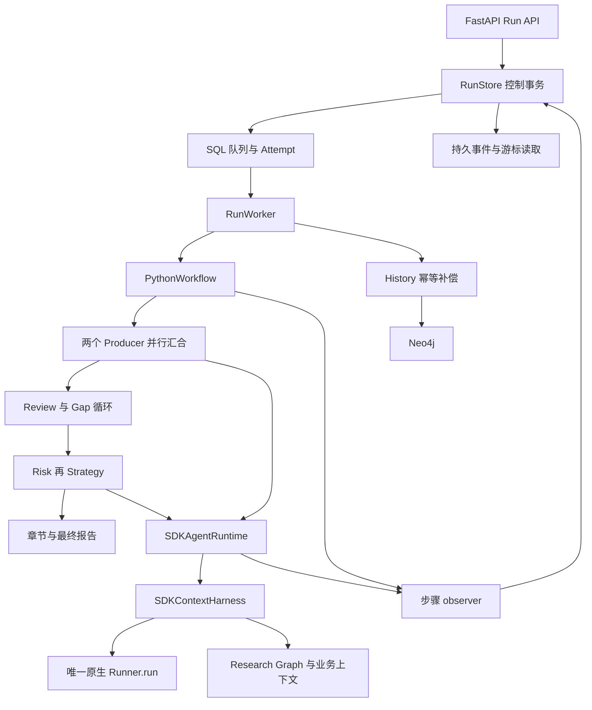

# 工作流引擎评估：Phase 4、自研运行设施、DBOS 与 Temporal

日期：2026-10-22（Asia/Shanghai）。评估基线：`5ca71c12f15013654a26f619071218a2be151a00`；Phase 3：`c6c6f54d5fe66972d33d29ccbc5b414c62cdc6ee`。原 [PR #24](https://github.com/kkaaakk/public_opinion_research/pull/24) 在评估开始时仍为 open、未合并，HEAD 与指定 SHA 一致。

**建议保留 Phase 4，暂不迁移引擎。DBOS 是优先保留的后续候选，Temporal 暂不采用。** 原因不是引擎能力不足，而是当前严格的工具未知副作用隔离、预算清算、公共事件与归档合同仍需项目维护；本次没有证明引入引擎可以在保持这些合同的同时显著减少总代码。DBOS 的普通 Step 可以容纳原 SDK + Harness，但官方 DBOSRunner 不能直接替换当前 Runner。Temporal 的官方 Agents 集成与固定 SDK 版本存在真实依赖冲突，普通 Activity 路径则可用。

这是选型审计与实验，不是迁移决定的实施。生产源文件、前端、依赖锁、配置、main、Phase 4 分支及 PR 均不作修改。实验位于 [experiments/workflow_engines](../../experiments/workflow_engines/README.md)。既有 AGENTS 中“不采用 DBOS”的架构记录没有被当成排斥候选的理由，也没有在本次被擅自改写。

## 1. 证据口径与版本

全文使用四种证据等级：**RUN**＝本次真实运行；**SOURCE**＝核对指定源码/安装发行包；**DOC**＝官方文档说明；**UNVERIFIED**＝尚未验证。运行成功不自动提升到生产兼容、HA 或任意 SDK turn 可恢复。

| 对象 | 本次核实版本 / 发布信息 | 验证范围 |
| --- | --- | --- |
| 项目 OpenAI Agents SDK | `0.24.0`，根锁不变；OpenAI Python `3.31.0` | RUN：真实 Agent、Runner、ScriptedModel、input filter、Hook、Harness |
| DBOS Python | `3.3.0`，PyPI 2026-10-15 发布 | RUN：私有文件 SQLite、Queue、Step、重启恢复、消息审批、preemptible 取消；生产 PostgreSQL/Conductor 未运行 |
| dbos-openai-agents | `0.3.0`，2026-02-02 发布 | RUN：基础 DBOSRunner 成功；项目 Harness 接入失败；SOURCE：`runner.py` 的 clone 和包装逻辑 |
| Temporal Python SDK | `1.34.0`，2026-09-30 发布 | RUN：普通 Workflow/Activity；保持 SDK `0.24.0` |
| temporalio-openai-agents | `1.1.0`，2026-10-01 发布 | RUN：真实依赖解析失败；SOURCE/DOC：插件边界；未强装、未降级项目 SDK |
| Temporal CLI / dev Server | `1.9.1` / `1.32.0`；CLI 附带 UI `2.54.1`，未开发/启用项目 UI | RUN：独立 loopback 服务与 SQLite dev persistence；非生产 Server 部署验收 |
| Restate Python SDK | `1.1.0`，2026-10-21 发布 | SOURCE/DOC：包元数据、官方集成说明；未运行 POC |

包版本来自当日 PyPI JSON 与实际 `importlib.metadata`，不是检索摘要。对应 [DBOS 3.3.0](https://pypi.org/project/dbos/3.3.0/)、[DBOS Agents 0.3.0](https://pypi.org/project/dbos-openai-agents/0.3.0/)、[Temporal 1.34.0](https://pypi.org/project/temporalio/1.34.0/)、[Temporal Agents 1.1.0](https://pypi.org/project/temporalio-openai-agents/1.1.0/)、[Restate SDK 1.1.0](https://pypi.org/project/restate-sdk/1.1.0/)。可复现安装见实验的独立 requirements；没有修改根 `pyproject.toml` / `uv.lock`。

CLI 使用官方 [v1.9.1 发行物](https://github.com/temporalio/cli/releases/tag/v1.9.1)，Windows amd64 压缩包 SHA256：`42637464c337a3da203fbd4e8c688e4b2d511fd42bd19c337c0422e923a7b619`。

阅读了 AGENTS、准备审计、迁移计划、Phase 0–4 审计，并核对 Workflow、Runtime、State reducer、Graph Store/Workspace/Extractor、Memory writer、MCP 工具适配、Run Store、Worker、API、History，以及 `test_durable_runs.py`、`test_durable_process.py`、`durable_process_fixture.py`、SDK/Phase 2/3 等回归源码。以下判断以实现为准。

## 2. Phase 4 的实际边界



真实调用链为 `RunWorker.execute → PythonWorkflow.ainvoke → _step / gather_owned → business_agent → SDKAgentRuntime.run → SDKContextHarness.run → Runner.run`。Worker 不解释业务 DAG，SDK 是唯一 Agent Loop。`workflow/python_state.py` 明确负责 patch、角色私有状态、确定性 Producer 合并；不能作为“工作流框架胶水”删除。

三个核心模块共 **2,001 物理行 / 1,789 SLOC**。SLOC 排除空白、独立注释和模块/类/函数 docstring，不等于语句数或复杂度。计数按固定 Git SHA，而非编辑器工作副本，脚本为 [inventory.py](../../experiments/workflow_engines/inventory.py)。

| 模块 | Phase 4 物理行 / SLOC | Phase 3 物理行 / SLOC | 含义 |
| --- | ---: | ---: | --- |
| `web/run_store.py` | 1,124 / 1,022 | 0 / 0 | 调度与领域控制数据混合，不是纯 Queue |
| `web/worker.py` | 482 / 423 | 0 / 0 | 调度、控制事务取消拥有权、SDK 清算、归档 |
| `workflow/python_workflow.py` | 395 / 344 | 295 / 255 | 显式业务流程；Phase 4 净增 89 SLOC |
| **核心三文件** | **2,001 / 1,789** | **295 / 255** | 本次减量分母，不能把全部视为可替换基础设施 |
| `workflow/execution.py` | 87 / 63 | 72 / 54 | observer + owned join；Phase 3 已有取消排空 |
| `web/runs.py` | 266 / 208 | 0 / 0 | HTTP 身份、准入、幂等键、事件协议 |
| `web/history.py` | 610 / 513 | 591 / 494 | 原有领域档案，净增 19 SLOC |
| `runtime/sdk_context.py` | 828 / 728 | 825 / 725 | Harness，净增 3 SLOC；不是引擎替换目标 |
| `runtime/sdk_runtime.py` | 724 / 631 | 683 / 593 | SDK Runtime，净增 38 SLOC；不是待删除的 Agent Loop |
| `workflow/python_state.py` | 127 / 103 | 127 / 103 | 领域状态合并，全部保留 |

`RunStore._write` 将所有控制写入串行化到 scheduler 行；SQLite 为 `BEGIN IMMEDIATE` + WAL/FULL，MySQL 为 InnoDB 锁定读。事务内包含 owner/request 幂等、配额、attempt、状态、checkpoint 和事件。因此模型耗时不持锁，但高频生命周期事件仍竞争同一锁。这是明确的扩展上限，**没有本次生产吞吐基准支持“足够高”或“已成为瓶颈”**。

`claim` 将 running/cancelling **以及 quarantined** 任务算入忙碌容量，同时限制全局、owner、session；不是单纯 Semaphore。`_owned` 在进度、工具准入、回执、终态写入前重新验证 attempt 和未过期租约。SDK Runtime 在模型/工具前发布 observer 事实，原 Worker 控制写入失败会关闭后续准入。这种工具级边界，不能用“引擎最终只接受一个 Activity 结果”替代。

## 3. 逐能力替换矩阵

G＝通用执行机制，D＝领域合同，M＝两者混合。表中的“可接管”均以未来正式接线完成为前提；本次实际删除生产代码为 **0**。

| 能力与真实实现 | 属性 | DBOS 等价范围 | Temporal 等价范围 | 仍需保留/重写，及可靠性边界 |
| --- | --- | --- | --- | --- |
| Run 生命周期：`RunStore.create/get/_transition/finish/public_run`，`runs.create_run/read` | M | Workflow 状态、ID 去重、结果 | Workflow 状态、ID 冲突策略、查询/结果 | owner、body 指纹、版本 CAS、accepted config、业务 interrupted/cancelling、usage/报告投影保留。引擎 SUCCESS 不等于业务 completed，POC 隔离分支即是实例 |
| 持久队列：`RunStore.create/claim`，scheduler/runs 表 | G/M | SQL 持久 Queue；原子引擎入队 | Server Task Queue | 可删除原 claim 交付；HTTP 接纳与引擎投递若跨库，需要稳定 Run ID + delivery outbox/补偿。不能破坏当前一次 SQL 事务的接纳保证 |
| Worker 调度：`RunWorker.__init__/tick/serve/main` | G/M | 库内 executor/queue poller | SDK Worker + Server poll/schedule | 原 tick/serve 可移交；仍需独立 Python 进程、资源限制、客户端启动/关闭和停止宽限 |
| 并发限制：`RunStore.claim`，`RunWorker.concurrency` | M | global/worker/partition queue 限额 | Worker slots、task queue 流控；复杂资源配额另做 | 当前 global + owner + session 三维联合约束、队列接纳容量、未知效果占位不直接等价。DBOS 单 partition key 也不同时表达全部约束 |
| 租约/心跳：`RunStore.heartbeat/_now/reconcile`，`RunWorker.execute` | G/M | 单 executor 重启恢复；跨 executor 自动故障发现需 Conductor 或外部协调 | Server Activity timeout/heartbeat 与重投 | 可移交任务存活检测。DBOS 无 Conductor 时不能把 POC 的同 executor 启动恢复当成多机 HA；业务未知效果隔离仍自行维护 |
| Attempt fencing：`RunStore._owned`，`progress/operation/finish`；Worker ownership_lost | M | 引擎 checkpoint ownership token 防旧执行提交 | task token/Activity completion 由 Server 判定 | 旧外部请求/线程不可撤销；粗粒度 Role Step 内多次模型/工具准入仍需自己的有效执行凭证。不得删除每工具准入防线后宣称等价 |
| Checkpoint：`PythonWorkflow.commit/RESUME_CURSORS`，`RunStore.progress` | M | Step output journal、确定顺序 replay | Activity result/Event History、Workflow replay | 引擎存结果；State codec、领域 patch、预算、代码/配置版本仍属项目。SDK Session 不替代这些；整体 Workflow 包成一个 Step 没有内部 checkpoint 增益 |
| 崩溃恢复：`RunStore.reconcile/retry/release_quarantine/SAFE_RETRY_STEPS` | M | 完成步骤缓存，未完成 Step 可能再次执行 | 完成 Activity 不随 replay 重跑，未确认 Activity 可以重试 | 替换机械 cursor/retry 部分；安全读白名单、未知效果拒绝重放、人工权威核对保留。关闭 exception retry 不会阻止 crash recovery 重做未完成 Step |
| 审批：`RunStore.progress(approval_required)/approve`，`PlanApprovalRequired` | D/M | durable send/recv、事件、超时 | Signal/Update、validator、wait condition/Timer | plan hash、owner、一次消费、操作方强制审批、过期/拒绝与 API 409 语义仍需项目。引擎等待能替代暂停调度，不能代替审批政策 |
| 取消与清算：`RunWorker.execute.commit/observer`，`SDKContextHarness._settle_on_exit/settle`，`gather_owned` | M | `cancel_workflow`；async Step 需 `preemptible=True` 才主动取消当前 Step | heartbeat 传播取消，WAIT_CANCELLATION_COMPLETED；terminate 不跑清算 | SDK 工具排空、SQL 线程 shield、Graph 批次回执、预算、迟到结果、cancelling→终态的业务顺序保留。引擎显示 CANCELLED 不保证这些已经完成 |
| Intent/Receipt：`SDKAgentRuntime._register_tool`，`RunStore.operation`，`RunWorker._unresolved_operations` | D/M | Step 输出确认，不是外部系统事务 | Activity 结果确认，不是外部系统事务 | 保留稳定操作身份、参数指纹、started/returned/uncertain/not_executed、不可盲重放。Graph WriteReceipt 与 invoker returned 是不同事实 |
| SSE 事件：`RunStore._event/read_events/progress/finish`，`runs.event_stream/subscription` | D/M | event 最新值、durable stream 可作为底层载体 | History、Signal/Workflow streams 可作底层载体 | 现有 protocol_version、seq、脱敏/allowlist、owner、Last-Event-ID、终态及重连合同仍需投影。直接代理引擎历史会暴露私有输入且改变协议 |
| History 归档：`RunWorker.archive`，`RunStore.archive_candidates/archive_result`，`Neo4jHistoryStore.save` | D/M | 可把归档调度/退避放 Step/独立 Workflow | 可放 Activity/独立 Workflow | HistoryRecord、稳定 HISTORY ID、owner、较新 Run version 和 Neo4j MERGE 保留；跨 SQL/引擎与 Neo4j 无原子事务，重试不能代替幂等归档 |

引擎能力来源分别为 DBOS 的 [Queue](https://docs.dbos.dev/python/tutorials/queue-tutorial)、[消息与事件](https://docs.dbos.dev/python/tutorials/workflow-communication)、[取消与恢复管理](https://docs.dbos.dev/python/tutorials/workflow-management)，以及 Temporal 的 [Activity 幂等/重试语义](https://docs.temporal.io/activity-definition)、[消息机制](https://docs.temporal.io/develop/python/workflows/message-passing)、[取消](https://docs.temporal.io/develop/python/workflows/cancellation)。这些来源只确认各自原语，不代表已经满足本项目整行合同。

## 4. DBOS：普通业务 Step 与 DBOSRunner 是两条不同路径

### 4.1 固定 SDK 版本与官方集成实测

`dbos-openai-agents==0.3.0` 声明 `dbos>=2.10.0`、`openai-agents>=0.7.0`，解析上允许 `0.24.0`。基础 `Agent + ScriptedModel + DBOSRunner.run` **RUN 成功**。但是把现有 `sdk_context.Runner` 在隔离探针中替换为 DBOSRunner，真实双 Producer 均失败：

```text
ValueError: Handoffs/nested roles require a separate SDKContextHarness.
```

原因已在双方源码核对：集成的 `_wrap_agent` 调用 `agent.clone(...)`；项目 `SDKContextHarness.run` 保存原 Agent，`filter_model_input` 拒绝 `data.agent is not self._agent`。没有通过放宽 Harness 断言、替换 Context Harness 或回退 legacy 使探针“成功”。[官方集成源码](https://github.com/dbos-inc/dbos-openai-agents/blob/main/dbos_openai_agents/runner.py) 的 `_wrap_agent/DBOSRunner.run` 与安装的 0.3.0 一致；检索的 main 文件 blob 为 `a0828a4273d94a05625404a05cf0a1abcac2913a`。

这不是“DBOS 与所有 0.24.0 不兼容”，也不是一个 import 别名问题。修复 clone 身份后，仍须处理：模型缓存输出重放时的 Hook 计费、input filter 中 Graph I/O/批次清算、ContextManager/rolling summary、SDK invocation 的随机身份、实际 FunctionTool wrapper 的持久边界、取消与未清算工具。官方只包装模型调用，工具/guardrail 还需应用显式标注；`stream_response` 在 0.3.0 durable model wrapper 中直接抛 NotImplementedError。项目目前是阶段 SSE，这个 streaming 限制不等于现有 SSE 必然不能保留。[集成指南](https://docs.dbos.dev/integrations/openai-agents)

**因此，采用官方 DBOSRunner 的细粒度 SDK 重放路线：未适配完成，不推荐本阶段切换。**

### 4.2 可行的粗粒度路线

已运行的链路是 `DBOS Workflow → durable business_boundary Step → 原 PythonWorkflow 的下一个真实 checkpoint → 原 SDKAgentRuntime → 原 Harness → 原 Runner.run`。不替换 Runner，不新增 Agent Loop。

实验 bridge 用已有 `execution_observer` 捕获 checkpoint，利用原 `PlanApprovalRequired` 交回所有权，再由引擎持久保存 JSON State/cursor。每次 Producer 汇合是一个 Step；Review、followup、Consumer、报告步骤分别保存结果。审批等待放在 Workflow 的 durable recv 中。完成步骤在进程重启后由引擎返回已保存结果。

这个 bridge 刻意保留 `PythonWorkflow`，证明“可以兼容”，**不证明“原 cursor 已经可以删除”**。如果只在整个 `PythonWorkflow.ainvoke` 外加一个 Step，代码更少，但恢复只能到整次研究，无法满足 Phase 4 已有安全步骤粒度。

DBOS Workflow 也要求确定的 Step 顺序。普通 Python if/while 可以保留；两个多步骤 Agent 分支不能随意交错共享父 Workflow 的 step 序号，需要独立 child Workflow 或整体并行组 Step。本 POC 使用后者，组内并行和结果归并由原 `gather_owned`/reducer 完成；未验证跨机器分发两个 Producer。[确定性与并行规则](https://docs.dbos.dev/python/tutorials/workflow-tutorial)

### 4.3 数据库、所有权与部署

本次 SQLite 运行成立；为维持当前共享多主机队列合同，目标生产部署采用官方推荐的 PostgreSQL system database；这不是说安装 SDK 必须先有 PostgreSQL，单机 SQLite 路径确实可运行。现有 MySQL 不能直接作为 DBOS system database，Neo4j 也不能。MySQL 的长期记忆、Neo4j 的证据/History 不会被引擎替代。可以不部署独立 orchestration server，但新增 PostgreSQL 的备份、升级、连接池、恢复和监控确实是新增运维。[DBOS 架构](https://docs.dbos.dev/architecture)

本次重启保持相同 application_version/executor_id，让库做真实 startup recovery，没有调用内部 recovery API。若要替代 Phase 4 多进程租约失效发现：需要 Conductor 或可信的外部恢复协调；“另一个进程连着同一个 Postgres”不自动等价于完整跨 executor 故障发现。[Distributed Recovery](https://docs.dbos.dev/conductor/distributed-recovery)

DBOS 有 checkpoint ownership token，旧执行不能再提交 journal；官方也明确存在 zombie executor 和 Step at-least-once。这个 token 不能让已经发出的 MCP/HTTP/数据库调用撤销，也不能自动为业务 Graph 写入 fencing。[Concurrent Executions](https://docs.dbos.dev/explanations/concurrent-executions)

DBOS 默认 serializer 是 pickle；实验粗粒度路径明确改用 `DBOSPortableJSONSerializer`，状态正文使用项目白名单 codec。官方 DBOSRunner 探针单独使用其默认原生序列化；不将其作为生产持久化策略。本项目不能因引入引擎退回任意 pickle/dynamic import 的状态恢复。

## 5. Temporal：可运行的 Activity 路线，不等于官方插件已经适配

### 5.1 版本与执行边界

实际 `uv pip install --dry-run temporalio-openai-agents==1.1.0 openai-agents==0.24.0` 返回依赖不可满足：插件要求 `openai-agents>=0.22,<0.23`。本次没有忽略依赖强装。SDK 1.34.0 的旧 `temporalio[openai-agents]` extra 也要求 `<0.20`，不能借旧 contrib 路径绕过约束。[发行元数据](https://pypi.org/project/temporalio-openai-agents/1.1.0/)、[当前官方 pyproject](https://github.com/temporalio/ai-integrations/blob/main/python/openai_agents/pyproject.toml)

官方插件把 Agent loop 放在 Workflow，模型放 Activity；普通 FunctionTool 仍在 Workflow，只有 Activity-backed tool/MCP proxy 等才能做 I/O。这对本项目的 input filter、Graph、ContextManager、budget ContextVar、MCP client 和 live Harness 都不是零改动。插件工具 Activity 接收 context 副本，不能依赖远端修改原 Harness 对象。**未验证在解除版本限制后可直接使用该插件。**[官方集成说明](https://docs.temporal.io/develop/python/integrations/openai-agents)

本次实际运行使用普通 `temporalio==1.34.0`，保持原 SDK `0.24.0`，把完整业务 checkpoint 操作放入 Activity。Workflow 模块只导入 Temporal/标准库，执行确定的状态推进、durable approval Update 和 Activity 调度；真实 SDK/LLM/Harness/MCP/Graph/Memory 边界留在 Activity 中。默认 sandbox 保持启用。[sandbox 合同](https://docs.temporal.io/develop/python/best-practices/python-sdk-sandbox)

### 5.2 当前业务到 Temporal 的映射

| 当前流程 | 本次真实 POC | 若做细粒度正式迁移 |
| --- | --- | --- |
| intake/planning | 每个原 checkpoint 为 Activity | 可复用业务函数；持久计划输出后 wait condition |
| 两个 Producer | 同一 Activity 内原 asyncio 并行，真实模型 barrier 验证，原 reducer 合并 | 两个 role Activity/child Workflow 分别返回 patch；汇合只提交一次，处理部分成功与失败费用；本次未做这种分发 |
| Review/Gap | Review、followup、下一轮 Producer group 分别为 Activity 边界 | 纯 routing/while 可在 Workflow；Graph 读取/结构化复核必须 Activity |
| Risk → Strategy | 两个顺序 Activity；Strategy 的模型输入实际包含风险报告 | 原业务装配直接复用 |
| SDK Runner / Harness / MCP | 全部留在 Activity 的同一事件循环/上下文 | 不把 socket、Neo4j driver、ContextVar、async lock 或 live Harness 序列化进 Workflow |
| 报告/Memory/History | 报告业务步骤为 Activity；Memory 默认关闭；History 兼容性源码审计 | Memory/History 外部写入要单独幂等与投影补偿；当前 POC 未验收完整归档替代 |

现有 `PythonWorkflow` 不能原样作为 Temporal Workflow 类：它包含 `asyncio.wait_for`、本地 Task、Config/Graph I/O、ambient accounting，`python_state.apply_patch` 还可能为无 ID 消息调用 `uuid4`。把这些模块标成 passthrough 并不使这些操作确定。本次复用在 Activity 中，保留原业务顺序，而非关闭 sandbox 让代码“跑过”。

审批使用真正的 Workflow Update + validator / query / wait condition；Signal 也可以承载通知，但 owner/CAS/审批政策仍属于 API。取消使用 Activity heartbeat 和 WAIT_CANCELLATION_COMPLETED，让原 SDK 清算结束；terminate 不提供清算机会。本次没有把 terminate 当成安全取消。

### 5.3 部署和重试成本

生产需要 Temporal Service（或 Cloud）及应用 Python Worker；自托管 Server 的 Frontend/History/Matching/内部 Worker 等组件与业务 Worker 是两类进程。Server 可使用 MySQL/PostgreSQL 等支持的持久库，因此 **Temporal 不强制新增 PostgreSQL**；复用现有 MySQL 仍需独立 schema/权限、Server 版本兼容与容量验收，不能直接使用 `por_runs` 表。SQLite dev Server 不能当成生产 HA 方案。[Persistence](https://docs.temporal.io/temporal-service/persistence)、[生产部署](https://docs.temporal.io/production-deployment)

本次 Worker kill 后由同一个本地 Server 保存的 History 重建 Workflow，新 Worker 接续。未测试 Server 集群宕机、MySQL HA、Cloud 或跨区域恢复。Activity retry 仍可能重复外部副作用；heartbeat timeout 不会物理终止一个已跑出的同步线程。[Activity 执行语义](https://docs.temporal.io/activity-definition)

Temporal 增益包括统一历史、长时间等待/消息、多 Worker 路由、版本演进和平台运维工具；代价是 Server/namespace/task queue、Activity 超时与 retry policy、payload/history 容量、代码 replay/patch/versioning 等新概念。当前没有实测需求证明这些增益抵消迁移与运维成本。自托管所需监控、升级、容量规划见[官方生产清单](https://docs.temporal.io/self-hosted-guide/production-checklist)。

## 6. 最小真实 POC：设计、结果与边界

### 6.1 实验组成

- [common.py](../../experiments/workflow_engines/common.py)：复用现有离线推理夹具；实际运行 PythonWorkflow、四角色装配、SDK Runtime、FunctionTool 业务适配、input filter、Hook、Harness、Graph 与原 reducer。不是重新实现业务流程的 Hello World。
- [dbos_poc.py](../../experiments/workflow_engines/dbos_poc.py)：真实 Queue/Workflow/Step、durable recv/event、preemptible cancellation、同版本 executor 启动恢复；另有官方 DBOSRunner 两个兼容性探针。
- [temporal_workflow.py](../../experiments/workflow_engines/temporal_workflow.py)、[temporal_poc.py](../../experiments/workflow_engines/temporal_poc.py)：默认 sandbox Workflow，真实 Update/validator/Activity/heartbeat/retry/Worker。
- [test_engines.py](../../experiments/workflow_engines/test_engines.py)：真实独立子进程，`kill()` 后创建新进程，真实引擎 journal 和独立副作用账本。执行期间禁止非 loopback Python socket、禁 dotenv/tracing，子进程移除真实 API key/token/secret 环境变量。
- Graph 使用项目真正的 Neo4j adapter。另建无用户数据的 `neo4j:5.26.31` 临时容器，仅绑定 `127.0.0.1:17687`；原 Neo4j/MySQL 容器不改动。不是把内存 Graph 丢失问题用 Mock 隐藏。
- 外部工具底层是独立文件 SQLite 表，**每一次真实 invoker 调用都 INSERT，没有 unique/idempotency 约束**；项目的工具权限、JSON schema、执行包装和 Harness 均保留。这是受控外部副作用，不是生产 API/MCP 实测。

两个 Producer 在官方 `ScriptedModel` 回调的 barrier 上互相等待；若串行调用就失败。Consumer 回调实际断言私有记忆不串角色、存在已提交 Evidence、Strategy 收到风险报告。rolling 模式用原生 reasoning/tool 历史触发真实应用压缩，不改 filter 为恒等函数。

### 6.2 结果矩阵

最终复验：**19 passed / 0 skipped / 0 xfailed，715.72s，退出0**。最初完整矩阵为 `17 passed / 2 failed`，失败及修正见 6.4；没有将失败轮次计为通过。

| 场景 / 对应测试 | DBOS | Temporal | 实际证明与未覆盖部分 |
| --- | --- | --- | --- |
| normal：四角色、输入过滤、预算、证据、顺序 | RUN 通过 | RUN 通过 | 13 个原业务 checkpoint，两个 Producer 并行汇合，Risk→Strategy；各角色 filter/settlement/证据断言实际执行 |
| 固定 fixture 预算 | RUN 一致 | RUN 一致 | 含初始额度：28 model_calls、235 input、76 output、311 total；工具副作用 2 次。是夹具账本，不是付费供应商账单 |
| clarify 条件提前结束 | RUN 通过 | RUN 通过 | 2 个 checkpoint，0 角色调用、0 外部工具效果 |
| Review/Gap 双 Producer 补查 | RUN 通过 | RUN 通过 | 应完成第 2 轮、2 个 completed_tasks、4 次实际工具效果；不是仅固定返回 research_complete=true |
| rolling history/context | RUN 通过 | RUN 通过 | 各 50 次实际工具调用、6 次真实 rolling compaction，Graph receipt 与角色 scope 保留 |
| Producer 已提交后 kill/restart | RUN 通过 | RUN 通过 | 在**下一引擎 gate Step/Activity** 中阻塞，保证 Producer 结果已经被引擎持久确认；重启后效果数仍为 2，Producer segment_enter 仍仅 1 次，后续 Consumer 从持久 Graph 读证据 |
| 工具成功、回执丢失，有守卫 | RUN 通过 | RUN 通过 | 工具 INSERT 后、tool_finished 回执前阻塞并 kill；恢复返回业务 interrupted，两条 started intent 保留，效果数 2→2，没有盲重放 |
| 同样故障，故意关闭守卫 | RUN 负例成立 | RUN 负例成立 | 原生引擎重做未确认的业务 Step/Activity，效果数 **2→4**；直接观察到了重复副作用 |
| 审批等待期间 kill，恢复再批准 | RUN 通过 | RUN 通过 | 真正 durable event/recv 或 query/Update；plan_report_sections checkpoint 仍仅 1 次，原计划复用，效果 2 次 |
| 模型等待期间取消，工具已返回 | RUN 通过 | RUN 通过 | 两份 returned 回执和真实 Harness settlement 完成；保留已观察预算，不把 SDK cancellation 当成功报告 |
| 官方 SDK 集成 | 基础 DBOSRunner 通过，项目 Harness 失败 | 插件依赖解析失败；普通 Activity 成功 | 不把这两项失败掩盖成官方插件兼容 |

本次取消 POC 在模型等待、两个工具已经返回后发出取消；**没有声称覆盖远程 MCP、不可中止同步线程、跨库 SQL 回执正提交时的引擎取消**。既有 Phase 4 的相关取消/迟到/提交竞争回归本次完整重跑通过，但只能说明旧生产路径没有被实验破坏，不等于新引擎全部具备同等能力。

### 6.3 防重放的实际含义

守卫是实验的少量领域 SQLite journal，不是 DBOS/Temporal 原生 exactly-once：在进入可能有副作用的业务 segment 前记录稳定 `run + cursor + effective research round`，工具前写 intent，返回后写 returned。恢复时发现未确认的同一业务 segment，就拒绝再次进入 SDK。工具参数、角色/原生 call 身份仍由真实 Runtime 产生。

它保留了 Phase 4 的保守语义：无法确认就 interrupted，等待权威核对。它没有实现完整的 owner/session/quarantined 容量、attempt fencing、API 状态和 SQL outbox，因此**不是生产 RunStore 的替代实现**。特别是引擎可能将“成功返回 interrupted envelope”的 Workflow 记为成功，领域 API 必须另行映射业务状态。

未完成 Step 在 crash recovery 中重新进入，和普通异常是否设置自动 retry 是两件事。DBOS 的 Step 即使没有开启 exception retries，崩溃后也可再次执行；Temporal 的 server 未收到 Activity completion 时也可重新派发。负例使用真正无幂等支持的外部表，结果 2→4，不能靠改变测试 Mock 的行为消除。

completed checkpoint 重放不重复业务操作已经验证；未知副作用不自动重放也已经验证。但“SDK 运行中任意位置恢复且不丢模型账单/在途工具”没有实现。进程死亡前供应商没有返回的 Usage 依然不可精确重建，必须保留 usage_complete=false 等领域语义。

### 6.4 失败记录

| 发现 | 处理与结论 |
| --- | --- |
| Temporal Agents 插件与 SDK 0.24.0 依赖冲突 | 保留真实 solver failure；不强装、不降级。使用普通 Activity 作为单独受验证路径 |
| DBOSRunner clone Agent 触发 Harness 身份断言 | 真实失败保留在探针结果；不修改生产 Harness/断言；基础 probe 与 Harness probe 分开 |
| 首次 Temporal heartbeat_timeout=3s，Graph 同步调用阻塞事件循环，引擎判超时 | 守卫拒绝第二次进入 Producer，业务 interrupted；POC 改为 15s 后复验。不是将 timeout 当作工具已撤销，也不把参数调优当成生产 SLO 验收 |
| 探针 driver 连续调用两次 asyncio.run，第二次遇到共享 executor shutdown | 合并到单一事件循环；这是实验 driver 的生命周期错误，不计作 DBOSRunner/Harness 不兼容证据 |
| 首次全矩阵：Gap 的 parent State 仍为上一轮，守卫误用旧 round | 2 failed / 17 passed，675.45s。核对 `followup_assignments` 与 merge 语义后，guard 使用实际下一轮身份；保留完成第 2 轮和 4 次效果的原断言，再完整复验。这是新适配代码的错误，说明业务身份仍需正确建模 |

原始日志/数据库仅留在此实验 worktree 的忽略目录 `.tmp/`，不提交运行数据库、凭据、缓存、原始 prompt 或本地报告输出。失败摘要和复现入口进入 Git。可用命令和服务生命周期见实验 README。

### 6.5 明确尚未验证

UNVERIFIED：DBOS PostgreSQL/多 executor/Conductor 恢复；Temporal 生产 MySQL/Server 集群/Cloud；生产负载及网络分区；旧 Worker 仍活着时的每模型/每工具 fencing；远程 MCP 的幂等键接受与查询；同步线程超时后迟到效果；新引擎 API/SSE 协议与完整 History 归档补偿；SDK Session 在新引擎中的持久接线；生产大状态/payload/retention；付费供应商行为。没有使用 Mock 将这些范围写成通过。

## 7. 逐文件去留与代码减量

### 7.1 生产模块映射

| 文件 / 方法 | 未来可删除部分 | 保留或重写 | 本次处理 |
| --- | --- | --- | --- |
| [run_store.py](../../src/open_deep_research/web/run_store.py)：`claim/heartbeat/_now/_end_attempt` 及 queue/attempt schema | 引擎任务交付、租约计时、机械 attempt 日志 | claim 中的 owner/session/隔离容量；attempt 使用量/领域身份；不是无条件删掉整个函数就完成迁移 | 保留全部 |
| 同文件：`create/_get/_save/_transition/public_run` | 部分引擎执行状态字段可归引擎权威 | 请求指纹、身份、配置/SDK 合同、领域 status/version、报告/usage 读取；可以缩成领域 Run projection，但不是空类改名 | 保留全部 |
| 同文件：`progress/_event/read_events/finish` | 原 checkpoint cursor 存取可替换 | 公共事件、连续 seq、脱敏/allowlist、业务终态与事件原子提交；引擎和投影间交付/修复 | 保留全部 |
| 同文件：`operation/release_quarantine/retry/reconcile` | 租约发现/机械 retry 小部分 | 未知效果、安全重试类别、人工核对、保持隔离容量；重写每工具执行凭证而非删除防线 | 保留全部 |
| 同文件：`approve/archive_candidates/archive_result` | 暂停/计时/归档任务调度可交引擎 | 不可变计划、owner/版本/一次消费；Neo4j 幂等结果与业务 done/history_saved | 保留全部 |
| [worker.py](../../src/open_deep_research/web/worker.py)：`tick/serve/__init__` | 原轮询/本地已领取 Task 集合可删 | 新 executor/Worker bootstrap、资源关闭、停止宽限仍存在 | 保留全部 |
| 同文件：`execute`（203 SLOC） | 部分调度/心跳/超时/机械续跑 | observer、模型/工具准入、SQL 线程 commit shield、取消清算、有效配置校验、partial usage、未知操作核对、Session 生命周期 | 保留全部；不能把 203 SLOC 全记净删除 |
| 同文件：`archive/_unresolved_operations/main` | 补偿轮询与部分 CLI 装配可替换 | HistoryRecord、幂等 owner/version、人工隔离释放工具、Graph/Session/client close | 保留全部 |
| [python_workflow.py](../../src/open_deep_research/workflow/python_workflow.py)：`ainvoke/_step/_account_failure/WorkflowExecutionError` | cursor 判断/observer 调度与局部 timeout plumbing | 取证汇合、Gap 分配、Consumer 顺序、预算/部分成功与错误的领域语义 | POC bridge 原样复用；正式减量需另行重构 |
| [execution.py](../../src/open_deep_research/workflow/execution.py) | 若彻底拆为引擎子任务，可替换外层调度 | observer 和 SDK/报告内部 owned join/drain 不自动消失 | 保留全部 |
| [runs.py](../../src/open_deep_research/web/runs.py)、[history.py](../../src/open_deep_research/web/history.py) | 仅调用后端接缝与调度部分 | API/事件协议、认证、准入、历史数据/幂等归档，不改前端 | 保留全部 |
| Runtime/Harness、Research Graph、RAG、Memory、MCP、业务 steps、State/Golden Sets | 无可直接删除的领域能力 | 现有所有权继续保留；最多适配执行身份/transport observer | 保留全部；不计入减量 |

Run Store 的 JSON codec 也被 POC 直接复用；这不是可以删除 Run Store 整文件的证据。正式迁移可以将 codec 迁入现有合适模块，但需独立评估兼容导出，不能借本次机械拆包。

### 7.2 测量、估算与实际减量分开

**测量事实**：核心 1,789 SLOC；当前独立实验增加 **6个 Python 文件、1,089物理行 / 926 SLOC**（共享夹具/守卫269、DBOS131、Temporal133、测试299、计数脚本94 SLOC）；生产删除 **0**、生产新增 **0**、生产重写 **0**。实验代码没有进入应用包或 Web/Worker 入口。

**可整函数移除的保守起点**：RunStore `heartbeat` 6；Worker `tick` 13、`serve` 18，合计 **37 SLOC**。这是完成新引擎接线后的旧轮询/续租函数删除量，不是今天可以随手删除的代码。`_now` 同时服务审批/事件时间，`_end_attempt` 含领域 usage，Worker 初始化含资源/Session所有权，因此将它们归入混合重写，而不当成免费删除。

剩余部分均属混合重写预算，而不是“框架原生提供，所以全删”：

| 原代码范围 | 旧代码可移除/替换预算（SLOC） | 依据与保留边界 |
| --- | ---: | --- |
| 上述整函数 | 37（实测函数大小） | 固定 AST 方法范围，可用 inventory 复核 |
| `RunStore.__init__` / `claim` / `_owned` / `reconcile` / `retry` / attempt 的执行控制部分 | 125–165（估算） | 原方法分别 136 / 54 / 9 / 47 / 32，另 attempt 20 SLOC；只算机械执行部分，联合配额与安全规则仍需新实现 |
| `RunWorker.execute/__init__/main` 的机械控制与装配 | 110–150（估算） | execute 203、main 67 SLOC；控制事务拥有权、领域 error/usage、Session/资源关闭不算免费删除 |
| PythonWorkflow cursor/resume/observer plumbing | 65–105（估算） | Phase 4 净增 89 SLOC 是交叉校验；不能把 Phase 3 的 255 SLOC 业务流程全部计为新增基础设施 |
| **DBOS 粗粒度路线旧代码毛减少** | **约 340–460** | 四项相加后取整；不是承诺已实现的 diff |

为了达到 Phase 4 等价合同，DBOS 仍需下列新增或重写的**替换代码**；这些数不与“原样保留代码”重复相加：

| 新/重写单元 | 预算（SLOC） |
| --- | ---: |
| 引擎 Step/Workflow adapter、版本/codec、partial budget/error envelope | 70–110 |
| 联合准入、隔离占位、稳定工具/执行凭证接缝 | 40–70 |
| API 接纳→引擎投递，公开 State/SSE projection 的幂等交付与修复 | 60–90 |
| cancelling/SDK settlement/迟到结果的业务确认 | 40–70 |
| 启停、归档调度、恢复/核对工具与配置 | 70–80 |
| **DBOS 新/重写替换代码** | **280–420** |

这些是工程估算，不是 POC 证明的生产最小实现。实验的 bridge 和守卫本身仍缺完整 API、配额与 fencing，不能把它们的短实现当成全功能迁移工作量。暂保留部分原 Worker/RunStore 并加引擎时，毛删除实际为 0，代码和调用层级先增加。

| 方案 | 毛移除旧代码 | 新/重写替换代码 | 预计净减少 SLOC（正数为减少） | 仍需原样保留的核心代码 |
| --- | ---: | ---: | ---: | ---: |
| A 保留 Phase 4（推荐） | 0 | 0 | **0，已知** | 1,789 |
| B DBOS，完整替换通用控制后 | 340–460 | 280–420 | **-80 至 +180**；中位预算约 +50，置信度低 | 约 1,329–1,449，再加替换代码 |
| C Temporal，普通 Activity 路线 | 340–500 | 400–600 | **-260 至 +100**；中位预算约 -80，置信度低 | 约 1,289–1,449，再加替换代码 |
| B/C 仅包装现有 Worker/RunStore | 0 | adapter/投影/配置增加 | **净增加** | 原核心全部 |

Temporal 的新增范围较大，来自独立确定性 Workflow shell、Activity 心跳/取消与错误传递、Client/Worker 注册、payload/版本演进及同样的领域投影；不是因为重写业务 Agent。当前官方 SDK 插件路线尚不兼容，不给它编造一个更低的已验证估算。

计数受格式化影响；表中 SLOC 是源码行数，不是复杂度指标。更可信的结论是：**可以把几类通用机制移交，但本次没有证明大幅净减量，绝不能声称删除 RunStore 1,022 + Worker 423 全部 SLOC。** 若正式设计得出不同结果，应提交可审查的等价 diff 与合同测试来更新预算。

### 7.3 调用层级与自行维护的概念

按“从 HTTP 接纳到原生 Runner 的逻辑职责节点”计数，忽略框架内部栈帧：

| 路线 | 调用链 | 节点数 / 变化 |
| --- | --- | --- |
| A | route → RunStore → RunWorker → PythonWorkflow → business_agent → SDKRuntime → Harness → Runner | 8 |
| B，保持当前 API 的粗粒度 bridge | route → 领域 Run projection → DBOS Client/Queue → executor → DBOS Workflow → Step adapter → PythonWorkflow → business_agent → SDKRuntime → Harness → Runner | 11，增加 3 |
| C，同一口径 | route → 领域 Run projection → Temporal Client → Server → Python Worker → Temporal Workflow → Activity adapter → PythonWorkflow → business_agent → SDKRuntime → Harness → Runner | 12，增加 4，另有 RPC |

后两条是未来接回当前 API 时的结构推演，POC 没有偷偷实施这些 HTTP 层。消除 bridge、直接重构业务 shell 可少一层；业务 `business_agent → SDKRuntime → Harness → Runner` 四层没有理由删除。所谓 SDK-native 持久 Runner 不是已经可用的更短生产路径。

为避免把行数当维护成本，另外按 5 类通用机制计数：交付队列、Worker 轮询/Task 拥有、租约/失活发现、执行 fencing、checkpoint/cursor。A 自行维护 5 类；DBOS 可接管其中队列、polling、journal 3 类，跨 executor 失活发现取决于 Conductor/协调方案；每工具 fencing 仍留项目。Temporal 接管前四者中的队列、polling、存活检测以及 journal 共 4 类，外部效果 fencing 仍留项目。

另有 8 类领域合同始终存在：Run 身份/联合准入；审批政策；预算与角色/State 合并；工具 intent/receipt；未知效果安全恢复/隔离；取消清算；公开事件投影；History 投影。它们相互有关，这里是职责桶而非独立失效模式的数学统计。引擎会新增 Step/Activity 语义、重放顺序与版本、引擎历史/payload、运维控制面等概念，不能只统计消失的 Lease 类。

## 8. 存储、身份和兼容性风险

### 8.1 身份不合并

| 身份 | 应保持的关系 |
| --- | --- |
| 业务 Run ID | 引擎前后稳定；Research Graph run scope 与 History stable_id 都依赖它 |
| DBOS Workflow ID / Temporal Workflow ID | 可由可信业务 Run ID 映射，一对一绑定；请求 body 指纹和 owner 授权另验，不因同 ID 就接受不同请求 |
| Temporal Run ID | 某一次 Workflow Execution 身份，不等于项目业务 Run；retry/continue-as-new/重建时需保留映射 |
| 原 attempt / Activity attempt / executor token | 执行拥有权；不能当成跨重试的外部业务幂等键，更不能代替稳定工具操作身份 |
| SDK invocation / Session | 原 Worker 为 owner:run:attempt:role:invocation 创建私有 Session；本次 POC observer 返回 None，Session 接线仅 SOURCE/旧回归，不冒称新引擎 Session 恢复已验收 |
| 工具 operation / Graph WriteReceipt | invoker 是否返回、哪些 Evidence 已提交，是两个独立事实；SDK call ID 相同也未必是跨进程可重放的业务操作 |

[OpenAI 对 Runner/continuation 的说明](https://developers.openai.com/api/docs/guides/agents/running-agents) 是 SDK 单次运行与会话状态的合同，不是本项目后台任务的持久 checkpoint。Session 既不保存 Workflow cursor/审批/租约，也不保证 MCP 外部效果一次执行。

### 8.2 数据层去留

| 层 | A | DBOS | Temporal |
| --- | --- | --- | --- |
| 执行控制 | 现有 MySQL / 本地 SQLite | PostgreSQL system DB；SQLite 只作为本次本机实验 | Server 支持的 persistence；可选 MySQL，不强制 PG |
| 领域 Run / API / SSE projection | 当前 RunStore 同一控制事务 | 仍需；如果另留 MySQL，新增投递/投影双写补偿 | 仍需；Server history 与 API SQL 之间也不能假定原子 |
| Research Graph / History | Neo4j | 继续 Neo4j | 继续 Neo4j |
| RAG、Memory | 原有存储与 MySQL 业务记忆 | 不迁移、不合并到 Session/system DB | 不迁移、不合并到 Workflow History |
| SDK Session | 可选原 SQLiteSession 接缝 | 独立保留/适配 | 独立保留/适配 |

DBOS journal、Temporal Event History 不能直接替换长期业务 History。反过来，如果把所有 State、工具/模型输入都复制进引擎历史，再保留完整 SQL State，就形成两份执行权威和更多敏感数据保留面。正式方案应明确：引擎权威执行历史/步骤结果，领域库只保存 API 投影、审批/效果核对等有独立合同的数据；不要同时继续维护两套游标。

POC 为验证而在每个边界返回完整 JSON State；这有放大存储与 replay payload 的成本，不是推荐生产数据布局。Temporal 官方的 [History 限制](https://docs.temporal.io/workflow-execution/limits) 是需要设计容量/Continue-As-New 的约束；不能根据这个小夹具证明大规模研究不会超限。DBOS 也要为大 Step 输出和 journal retention 付存储代价。

### 8.3 可靠性回归重点

1. **细粒度 SDK 变化**：缓存模型输出可能重新触发计费 Hook/filter/Graph side effect；必须验证请求准入、重试计数和真实 Usage 的一次合并，不能只看 final_output。
2. **并行 Producer**：本次保持同进程原 join。若分散到多个 Activity/executor，原 `ResearchGraphStore.ingestion_lock` 仅在进程/事件循环内有效；跨进程 source/version 核对、去重、角色 patch 合并、部分成功费用必须另验。
3. **未知效果/分区**：本次 kill 是原进程确实死亡。旧执行仍活着但失去数据库/Server 连接时，粗粒度 Activity/Step 未必阻止下一次内部工具准入；要保留原工具级 fence 和隔离容量，不能只靠新 attempt 替代旧进程。
4. **取消**：收到取消、引擎标 cancelled、SQL 线程实际返回、SDK drain、Graph receipt 和预算完成，是不同时间点。新实现必须维持项目的清算确认与 unresolved 状态。
5. **归档**：`Neo4jHistoryStore.save` 通过稳定 HISTORY ID 与较新 Run version 幂等更新；保留 archive pending/补偿，数据库失败不重跑研究。
6. **API 安全**：仍是单操作员 Token；引擎 admin API、Workflow ID 或 namespace 不提供本项目 owner/MCP/RAG ACL。引擎历史不得直接作为脱敏 SSE 暴露。
7. **版本**：业务 Workflow/SDK/Runtime/有效配置当前都有准入指纹。引擎版本隔离只覆盖其自身命令历史，不自动固定业务配置和工具实现。

## 9. 性能、并发、部署和业务修改成本

| 维度 | 保留 Phase 4 | DBOS 粗粒度 | Temporal 普通 Activity |
| --- | --- | --- | --- |
| 部署单元 | 现有 Web + Python Worker + SQL；Neo4j 已有 | 仍需 Web/执行进程；新增 PG；多机自动恢复另计 Conductor/协调 | Web + Python Worker + Temporal Service/Cloud；DB persistence 与监控；可复用独立 MySQL 库但需验收 |
| 新依赖 | 无 | dbos；普通 Step 不强制 dbos-openai-agents；psycopg、croniter、SQLAlchemy 最低版本升级等 | temporalio、nexus-rpc/types-protobuf；普通 Activity 不需不兼容的 Agents 插件 |
| 本次环境依赖变化 | 根锁完全不变 | 仅实验环境 SQLAlchemy 2.0.41→2.1.6、croniter 6.0.0→6.2.4；DBOS 3.3.0 要求 SQLAlchemy>=2.0.43 | 实验环境增加 SDK 1.34.0；OpenAI Agents 0.24.0 不动 |
| 调度吞吐 | 单 scheduler 控制锁是上限；默认全局4/owner2/session1 | DBOS 队列/数据库承担调度；本次只设置 global/worker=2，没有跨主机吞吐验收 | Server 负担调度和历史；本次 Worker activity slots=2，不等于全球/owner/session 联合配额 |
| 故障策略 | 安全边界显式 resume，运行中未知步骤隔离 | 完成 Step 缓存；未完成 Step 重入要领域 guard | 完成 Activity 缓存；未确认任务重试要领域 guard |
| 常规业务修改 | 显式 Python、原 reducer/测试；新 cursor 需更新兼容版本 | 业务仍 Python，但 Step 顺序/child IDs 与版本/patch 进入评审 | 修改命令序列需考虑 replay/patch/Worker 版本、Activity 类型/参数兼容 |
| 测试部署复杂度 | 既有离线全量及少量本地服务 smoke | 增加 PG、恢复协调、engine history 与领域状态一致性、跨版本恢复 | 增加 Server、namespace/task queue、Worker 版本、Activity heartbeat/timeout、Replay/大 payload 测试 |
| 总维护负担判断 | 自研通用部分需要团队负责 | 可外包部分通用正确性，但当前净减量不确定，并非只 pip install | 平台能力更广；当前应用范围下新增概念/运维与适配成本更高 |

上述并发值是 POC 配置/当前默认值，不是容量测量结果。官方框架 benchmark 不能当作本项目含 Graph/MCP/LLM 的吞吐保证。上下文窗口仍是应用配置（rolling夹具为22,000 tokens），不据此声明供应商容量。pytest 的总耗时包含 Python 导入、Neo4j、进程启动、真实等待与故障注入，也不是两个引擎的性能排名。

本 POC 还暴露同步 Graph 操作可能阻塞 Activity 事件循环，过短 heartbeat 会产生错误超时；提高 timeout 只能减少该夹具误判。生产仍要根据实际阻塞时间选择合理 timeout/心跳及线程边界，并验证取消宽限。当前 Harness 的有界 drain 及无法强杀同步工作这两个物理限制不会随引擎消失。

Restate 作范围内简查：SDK 1.1.0 的 OpenAI extra 声明 `openai-agents>=0.6.1`，官方提供 durable agent/model/tools/session 方案；运行时是额外的 Restate Server，业务工具副作用仍需显式持久动作/幂等。没有看到足以抵消当前 Harness、投影与身份适配成本的明确项目优势，因此没有扩展第四套 POC，也不宣称兼容已验证。[官方 SDK 集成](https://docs.restate.dev/ai/sdk-integrations/openai-agents-sdk)、[原生集成说明](https://restate.dev/blog/durable-orchestration-for-ai-agents-with-restate-and-openai-sdk)

## 10. 回归与复现结果

| 检查 | 本次结果 |
| --- | --- |
| 根锁准备 | 新评估 worktree 执行 `uv sync --extra dev --locked --python 3.11` 成功；根声明/锁无 diff |
| Phase 4 原锁基线 | **820 passed / 6 deselected / 156 warnings，220.47s**，退出0；使用原根解释器但指向新 worktree 源码，禁 dotenv/tracing 和非本地 socket |
| 加入引擎后的实验环境再跑原 suite | **820 passed / 6 deselected / 156 warnings，159.50s**，退出0；包含 SQLAlchemy/croniter 升级后的兼容回归 |
| 初次 POC 完整矩阵 | **17 passed / 2 failed**，675.45s；Gap guard 身份错误，不是通过 |
| 最终 POC | **19 passed / 0 skipped / 0 xfailed，715.72s，退出0**；无付费模型、无框架 Mock、无 skip/xfail 掩盖限制 |
| Ruff | 原 CI E/F/I 规则覆盖生产包、tests/conftest、全部 test_*.py 及 experiments：通过 |
| 格式 / compileall | 6 个实验 Python 文件格式检查与生产包/security/实验 compileall：通过；最后补充POC强制禁用Memory写入，子进程测试此前已显式禁用，另定向复验normal两项 **2 passed / 17 deselected，74.38s** |
| 依赖一致性 | **未通过**：仅既有 `markitdown-mcp → mcp~=1.8.0` 与实际1.23.0冲突；不是新引擎解决或新增的冲突 |
| Mypy | 本次未重跑；现有审计的历史非零基线不写成通过，不是本次 CI gate |
| 新前端/付费服务/生产 HA | 未实施/未调用/未验收 |

正常路径的 POC 返回值与角色 telemetry 都有断言，故障路径有独立副作用表计数。原 Phase 4 的 56 项新增回归不是可以被这组实验测试替代的：将来正式迁移仍须逐条迁移 API/并发/取消/回执/审批/归档合同，并保留原 820 项业务回归。

复现入口、固定版本、临时服务、socket guard 和清理命令见 [README](../../experiments/workflow_engines/README.md)。实验 suite 位于 tests 目录外，默认项目 CI 不会偷偷新增 Docker/Temporal 依赖；必须显式运行本地服务验收。日志位于忽略的 `.tmp/baseline-pytest.txt`、`.tmp/engine-env-pytest.txt`、`.tmp/poc-full-tests.log`、`.tmp/poc-final-tests.log` / `.tmp/poc-final.xml`。不把本地日志链接当成跨机器可访问的交付物，关键结果已写入本文。

## 11. 迁移方式与风险

| 方式 | 成本 / 可接受性 |
| --- | --- |
| 直接切换所有新旧 Run | **不建议**。原 State+cursor、SDK Session、attempt 与工具状态不是 DBOS/Temporal 原生 journal；不能伪造旧引擎历史后宣称可 replay。只能先排空全部旧任务，或逐 Run 做额外受信转换/权威核对 |
| 新任务灰度 | 后端按受信 Run 元数据固定 engine/version；旧 Run 继续原路径。需双套接纳/投影/部署与合同回归，过渡期生产代码**先增加**，尚不能兑现减量 |
| 保留旧任务通道直至排空 | 最安全的推荐迁移前提。保留原二进制/有效配置/数据，审批暂停和 archive pending 也算未排空；未知效果 Run 不得自动导入引擎重试 |

业务 Run 绑定引擎后不可因环境默认值改变而改用另一执行通道。回滚是停止接纳新的引擎 Run，让已接纳任务由原引擎继续/人工核对，而不是把它们重新投给原 Worker。Graph/Memory/History ID 不重命名、不复制为新研究身份。旧任务通道的保留是有结束条件的兼容期，不是同时永久维护两套执行权威。

## 12. ADR：当前选择及可执行的后续计划

状态：**建议，提交评审；本次不实施迁移。**

决定：保留 A。B 的粗粒度路线技术可行，保留为首选替代；C 暂不采用。理由是本次证明了引擎 journal 的价值，也证明了未知外部副作用不能交给自动 retry；在保留 Phase 4 全部合同的估算中，B 净减少范围跨过零，C 更可能增加代码和部署负担。没有以旧架构结论否定引擎，也没有将“完成了最小链路”包装为“完成了生产适配”。

如果未来要迁移，另开实施 ADR/PR，按下面的顺序执行，不混入 Phase 5：

1. **先明确值得替换的成本。** 收集控制事务/claim 延迟、队列等待、租约误失效、未知效果人工核对、恢复用时、状态/journal 大小与实际运维投入。本次没有这些生产数据，不用假设的规模触发迁移。
2. **先做等价后端合同。** 保持 HTTP/SSE 不动，将现有 56 项 durable 回归按同一对外合同验证候选。DBOS 采用普通业务 Step + 原 SDK/Harness；不先切官方 DBOSRunner。增加真实 PG、多 executor、失联旧 Worker 仍存活、回执提交期间取消、部分 Producer 成功、History 失败补偿、版本漂移和大状态测试。
3. **用可审查 diff 证明减量。** 清楚划分 engine journal 与领域 Run projection，维持每模型/工具 fencing、未知效果隔离、稳定操作 ID 和公开事件的原子/补偿合同。不增加无业务作用的 Manager/Adapter 层。建议迁移准入要求：所有合同等价、没有安全语义退化、通用实现不再双份维护，并达到团队认可的净减量；可把 **至少300 SLOC** 作为待评审的工程目标，不能当成本次已达到的数字。若可靠性/平台化收益有独立的实际SLO与成本证据，评审也可以接受更低净减量，不能用单一LOC阈值代替判断。
4. **确定部署责任。** DBOS 若使用多机自动恢复，明确 PG 与 Conductor/外部协调的所有者和恢复演练；单进程 supervisor restart 与多机 HA 分开。若选择 Temporal，应先证明共享平台/长等待/跨服务需求值得 Server、版本和 payload 运维成本，并解决官方 SDK 插件版本限制或明确继续普通 Activity。
5. **仅新 Run 灰度。** 由服务端固定 engine/version 和请求指纹；接纳 SQL 与引擎投递用 outbox/稳定 ID 修复，禁止同一业务 Run 两套执行器同时拥有。后台验证 public status/event/approval/cancel/history，保持前端协议，无需先做 UI 改造。
6. **排空旧 Run。** 原 RunWorker/原配置继续处理已接纳 Run、待审批和归档补偿；未知效果留原隔离与人工核对流程，绝不为了排空盲重放。不能把旧 SDK Session 当作导入的 Workflow checkpoint。
7. **最后才删除原通用设施。** 只有没有活动/暂停/待补偿旧 Run、必要历史可读、兼容导出消费者已评估、完整回归和故障演练通过后，按第7节逐项移除旧 queue/lease/polling/cursor。先兑现实际净减量，再更新 ADR；不顺带退役 LangGraph、旧 Runtime、RAG 或学习/评测材料。

若未来业务主要保持同一进程四角色研究，DBOS 比 Temporal 更接近现有 Python 心智模型。若团队已有可靠 Temporal 平台，或出现多服务/跨团队长流程与强平台治理需求，Temporal 的排序可以上升；这需要新的事实，不是本次已证明的收益。

## 13. 必须回答的七个问题

**Q1：Phase 4 是否自行实现了过多成熟引擎已有功能？** 覆盖了相当多通用功能：队列、调度、租约、fencing、checkpoint、恢复。但“覆盖重复”不能推导“1,789 SLOC 都是多余”；真正候选毛减量约340–460 SLOC，其余大量是项目合同。当前未证明属于应立即替换的过度实现。

**Q2：DBOS 能否替代大部分 RunStore/RunWorker 而不破坏 SDK + Harness？** 能接管大部分**通用调度职责**，普通 Step 已验证兼容原 SDK/Harness；不能据此删除两个文件的大部分代码。官方 DBOSRunner 真实不兼容当前 Harness，工具核对、公共投影、联合配额、取消和 fencing 还需保留/重写。完整 Phase 4 等价替代尚未完成。

**Q3：Temporal 增益值得成本吗？** 当前不值得。普通 Activity 路径可运行，但官方 Agents 插件与固定版本冲突，Server/Worker/版本/payload 和迁移成本超出现阶段已证明收益。已有团队级 Temporal 平台或更强跨服务需求时再评估。

**Q4：Python Workflow 需要重写吗，规模多大？** 只要接入引擎，不强制重写：本 POC 原生产改动0。若目的是删除通用执行逻辑，就需改造 `ainvoke` 周边约200–260 SLOC 的编排/错误/超时边界，其中真正可删除的 cursor plumbing 估65–105 SLOC；四角色、业务 steps、Harness、Graph、reducer 保留。Temporal 要把非确定行为留 Activity，不能整文件直接搬进 Workflow sandbox。

**Q5：最终选择？** **保留自研 Phase 4。DBOS 为首选后续候选；当前不迁移 Temporal。**

**Q6：推荐方案净减少多少生产代码、概念和运维？** 当前推荐净减少 **0**，新增生产依赖/服务 **0**；保留现有通用机制的维护责任。若未来迁 DBOS，估净减少 **-80至+180 SLOC**，可以移交队列/polling/journal 三类机制，多机恢复还需明确协调，工具级 fence 和8类领域合同保留；新增 PG，按HA要求另计 Conductor/协调。不能宣称已经净删上千行。Temporal 估净减少 -260至+100 SLOC，并新增 Server/平台运维。

**Q7：需要迁移时如何分阶段？** 合同与真实故障验收 → 可审查净减量 diff/部署责任 → 仅新 Run 灰度固定执行身份 → 原 Worker 排空旧 Run → 满足结束条件后删除原通用设施。保留未知效果隔离和旧任务通道，不能跨引擎盲重试。第12节是可执行后续计划，**本次不自动开始实施**。
